# Tài liệu Thiết kế Phần mềm (SDD) — Blueprint UX/UI — "Chat với tài liệu" (MVP)

> **Tiêu chuẩn:** IEEE 1016-2009 — Software Design Descriptions
> **Mã tài liệu:** SDD-CWD-001 · **Phiên bản:** 0.2 · **Trạng thái:** Draft · **Ngày:** 2026-10-21
> **Đầu vào:** [BRD.md](../requirements/BRD.md) (BRD-CWD-001 v0.1), [PRD.md](../requirements/PRD.md) (PRD-CWD-001 v0.1), [usecase_diagram.drawio](usecase_diagram.drawio)
> **Quy ước:**
> - `[TBD: OQ-xxx]` — giá trị chưa chốt, lấy từ câu hỏi mở của BRD/PRD.
> - **[Đề xuất]** — quyết định thiết kế do tài liệu này đề xuất, **chưa được đội kỹ thuật / sponsor phê duyệt**.
> - Mã truy vết: `BR`, `US`, `AC`, `STK`, `CON`, `ASM`, `RSK`, `G-xx` trỏ về BRD/PRD; mã mới trong SDD: `CN` (concern), `QAS` / `UXS` (kịch bản chất lượng), `C-` (thành phần), `SCR` (màn hình), `CMP` (UI component), `MSG` (thông điệp), `DD` (quyết định thiết kế).

---

## 0. Ghi chú trước khi đọc

1. **Tám view được chọn.** Prompt yêu cầu 8 view nhưng chỉ mô tả mẫu Composition View. Tài liệu chọn 8 viewpoint trong IEEE 1016-2009 có giá trị nhất cho MVP này: Composition, Logical, Dependency, Information, Interface, Interaction, State Dynamics, Resource. Context viewpoint được trình bày ở Mục 1.2. Thuật toán RAG (Algorithm viewpoint) được mô tả trong Interaction View, không tách riêng.
2. **Chưa có công nghệ nào được chốt.** Repository mới chỉ có tài liệu yêu cầu. Mọi lựa chọn công nghệ trong SDD là **[Đề xuất]** kèm phương án thay thế (Mục 6).
3. **Không tự đặt ngưỡng nghiệp vụ.** Độ trễ trả lời, thời gian xử lý tệp, giới hạn tệp và độ chính xác vẫn là `[TBD]` như BRD/PRD. Riêng các ngưỡng UX lấy từ chuẩn công khai (WCAG 2.1, Core Web Vitals) được ghi là **mục tiêu thiết kế đề xuất** và cần sponsor xác nhận.
4. **Một quyết định chặn kiến trúc:** OQ-011 (có được gửi tài liệu tới dịch vụ AI bên ngoài không). Thiết kế cô lập toàn bộ lời gọi AI sau một cổng (AI Gateway, DD-03), để kết quả OQ-011 chỉ thay đổi một adapter thay vì toàn hệ thống.

---

## 1. Context & Subject

### 1.1 System Identification

| Thuộc tính | Giá trị |
|---|---|
| **System Name** | Chat với tài liệu (MVP) — mã hệ thống `CWD` |
| **SDD Version** | v0.2 (Draft) |
| **Document Date** | 2026-10-21 |
| **Document Owner** | Lead Architect / Trưởng nhóm kỹ thuật — họ tên [TBD: OQ-013] |
| **Reviewers** | Đại diện đội phát triển kinh doanh; Đội UX/UI; Đội kỹ thuật; Bộ phận ATTT — [TBD: OQ-013] |

**Revision History**

| Phiên bản | Ngày | Tác giả | Thay đổi |
|---|---|---|---|
| 0.1 | 2026-10-21 | Đội kỹ thuật (bản nháp) | Bản đầu tiên dựa trên BRD-CWD-001 v0.1, PRD-CWD-001 v0.1 và sơ đồ use case |
| 0.2 | 2026-10-21 | Đội kỹ thuật (bản nháp) | Bổ sung Blueprint UX/UI: luồng người dùng (4.2.1), wireframe còn thiếu và bố cục theo độ rộng màn hình, đặc tả component chi tiết (4.5.1), hành vi tương tác và phím tắt (4.5.2, 4.5.3), token bổ sung, thông điệp MSG-22 → MSG-29, ma trận kiểm thử trợ năng (4.9.1), nội dung trợ giúp và thuật ngữ (4.11), kế hoạch kiểm thử khả dụng và truy vết UX → kiểm thử (4.12), bản thiết kế hi-fi (4.13). Sửa: nút Báo cáo hiện theo vai trò; nút Dừng có đủ component, trạng thái, thông điệp; đánh dấu các chức năng ngoài PRD (DQ-10); sửa ngày tuần ISO ở CMP-22 |

### 1.2 System Scope and External Boundaries

| Loại ranh giới | Mô tả |
|---|---|
| **System Purpose** | Ứng dụng web cho phép đội phát triển kinh doanh tải PDF của dự án lên một kho chung, hỏi bằng tiếng Việt tự nhiên và nhận câu trả lời tổng hợp từ nhiều tài liệu, **mỗi ý kèm tên tài liệu và số trang** để kiểm chứng. Giá trị: giảm thời gian tìm thông tin (BO-001), tăng độ tin cậy (BO-002), thu bằng chứng để quyết định đầu tư (BO-003). |
| **External Systems** | **EXT-01** Nhà cung cấp danh tính (SSO doanh nghiệp hoặc tài khoản riêng — [TBD: OQ-020]). **EXT-02** Dịch vụ AI: mô hình ngôn ngữ (LLM) và mô hình embedding — bên ngoài hoặc nội bộ [TBD: OQ-011]. **EXT-03** Báo cáo chi phí / hóa đơn của nhà cung cấp AI (dùng để đối soát, không tích hợp tự động trong MVP). |
| **User Types** | Nhân viên phát triển kinh doanh (người dùng chính, STK-002); Quản lý dự án / Sponsor (STK-001); Đội BA (STK-003); Đội kỹ thuật (STK-004); Bộ phận ATTT (STK-005). Tất cả đều là "Người dùng được cấp quyền" (xem sơ đồ use case). |
| **External Interfaces** | Giao diện web (HTTPS) cho người dùng; REST/JSON + Server-Sent Events giữa Web App và API **[Đề xuất]**; OpenID Connect với EXT-01 **[Đề xuất]**; HTTPS API với EXT-02 qua AI Gateway. |
| **Trust Boundaries** | **TB-1** Trình duyệt người dùng ↔ ứng dụng (mạng nội bộ hoặc Internet có xác thực — [TBD]). **TB-2** Vùng ứng dụng nội bộ (API, worker, CSDL, kho tệp) — không truy cập trực tiếp từ ngoài. **TB-3** Ranh giới bên thứ ba tới EXT-02 — **nội dung tài liệu đi qua ranh giới này**, cần phê duyệt G-01, G-02. **TB-4** Ranh giới tới EXT-01 — chỉ trao đổi token danh tính. |
| **Deployment Environment** | [TBD: OQ-011, CON-006]. **[Đề xuất]** Một môi trường đám mây hoặc máy chủ của tổ chức, đặt ở khu vực được Pháp chế chấp thuận; hai môi trường `staging` (dữ liệu mẫu, DEP-002) và `production` (dữ liệu thật, chỉ sau G-01/G-02). |

**Sơ đồ ngữ cảnh (Context viewpoint):**

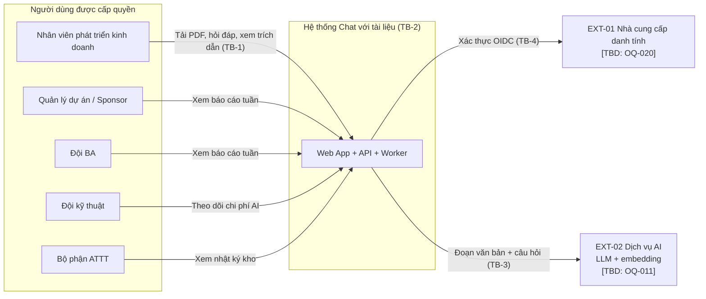

### 1.3 Assumptions and Constraints

| Loại | Mô tả | Nguồn |
|---|---|---|
| **Technical Constraints** | Ứng dụng web (CON-001); đầu vào chỉ PDF (CON-002); câu trả lời do AI tạo từ nội dung tài liệu (CON-003); câu trả lời chỉ dựa trên kho, không dùng kiến thức ngoài (BRU-003); ưu tiên trình duyệt máy tính, di động nằm ngoài MVP (PRD 4.0). | BRD Mục 8, 9; PRD 4.0 |
| **Business Constraints** | Là MVP (CON-004); ngân sách và hạn chót [TBD: OQ-012]; chi phí AI hàng tháng ≤ [TBD: OQ-012] (BR-025); không được nạp tài liệu thật trước khi có G-01, G-02. | BRD CON-004, CON-005; PRD 5.1 |
| **Regulatory Constraints** | Tuân thủ quy định bảo vệ dữ liệu cá nhân của Việt Nam và chính sách nội bộ (CON-006) — phạm vi áp dụng [TBD: OQ-011]; tài liệu ở mức phân loại [TBD: OQ-011] trở lên bị cấm (BRU-004). | BRD CON-006, BRU-004 |
| **Environmental Assumptions** | Người dùng có trình duyệt hiện đại và kết nối mạng ổn định tới ứng dụng (ASM-004); trình duyệt hỗ trợ: bản mới nhất của Chrome, Edge, Firefox, Safari (PRD 4.1, đề xuất); độ sẵn sàng mong muốn [TBD: OQ-019]. | BRD ASM-004; PRD G-43 |
| **Data Assumptions** | PDF chủ yếu có lớp văn bản (ASM-001); tiếng Việt và/hoặc tiếng Anh (ASM-002); quy mô kho và số người dùng [TBD: OQ-004] (ASM-003); một kho chung cho cả dự án (BRU-005, chờ OQ-010); thời hạn lưu trữ [TBD: OQ-014] (BRU-006); giới hạn tệp [TBD: OQ-007] (BRU-002). | BRD Mục 8, 10 |

---

## 2. Stakeholders & Concerns

### 2.1 Stakeholder Identification

| ID | Bên liên quan | Vai trò | Mối quan tâm chính |
|---|---|---|---|
| STK-001 | Quản lý dự án / Sponsor | Executive sponsor, người phê duyệt | Bằng chứng giá trị, chi phí, thời gian ra mắt |
| STK-002 | Nhân viên phát triển kinh doanh | Người dùng chính | Tốc độ, độ tin cậy, dễ dùng, kiểm chứng được |
| STK-003 | Đội BA | Phân tích yêu cầu, đánh giá MVP | Số liệu sử dụng chính xác, truy vết yêu cầu |
| STK-004 | Đội kỹ thuật / vận hành | Xây dựng, vận hành | Dễ bảo trì, dễ kiểm thử, dễ triển khai, chi phí AI, khả năng quan sát |
| STK-005 | Bộ phận ATTT / Pháp chế | Kiểm soát rủi ro dữ liệu | Xác thực, phân quyền, không rò rỉ, nhật ký truy vết |
| STK-006 *(mới trong SDD)* | Đội UX/UI | Thiết kế trải nghiệm | Nhất quán giao diện, trợ năng, thông điệp rõ ràng |
| STK-007 *(mới trong SDD)* | Đội QA | Kiểm thử | Mỗi AC có test case; môi trường có dữ liệu mẫu |

### 2.2 Stakeholder Concerns (IEEE 1016-2009)

| ID | Bên liên quan | Concern | Ưu tiên | Tiêu chí chấp nhận | Được xử lý tại |
|---|---|---|---|---|---|
| CN-01 | STK-002 | Nhận thông tin nhanh hơn tự đọc PDF | High | P90 thời gian trả lời ≤ [TBD: OQ-006] giây (AC-015); MET-001 giảm theo [TBD: OQ-002] | QAS-01, UXS-07, DD-05 |
| CN-02 | STK-002 | Kiểm chứng được từng ý trong câu trả lời | High | 100% câu trả lời có nội dung đều có trích dẫn; ≥ 95% trích dẫn đúng tài liệu và trang (AC-011) | 3.4, 3.6 SEQ-02, CMP-11 |
| CN-03 | STK-002 | Không bị đánh lừa khi tài liệu không có thông tin | High | ≥ 90% câu hỏi không có đáp án nhận "không tìm thấy" (AC-013) | QAS-11, DD-04, CMP-12 |
| CN-04 | STK-002 | Dùng được ngay, không cần biết cách viết lệnh cho AI | High | UXS-01 | Mục 4 |
| CN-05 | STK-002 | Biết tài liệu nào đã sẵn sàng để hỏi | High | Thấy đúng trạng thái từng tệp, lý do lỗi bằng tiếng Việt (AC-003) | 3.7 ST-01, CMP-05 |
| CN-06 | STK-005 | Chỉ người được cấp quyền truy cập dữ liệu | High | Người không có quyền không truy cập được qua mọi đường, kể cả gọi API trực tiếp (AC-020, G-30) | QAS-05, C-BE-01 |
| CN-07 | STK-005 | Tài liệu không bị dùng để huấn luyện AI hoặc rò rỉ ra ngoài | High | Xác nhận bằng văn bản (AC-021, G-02); chỉ gửi đoạn trích cần thiết qua TB-3 | DD-03, C-BE-07 |
| CN-08 | STK-005 | Truy vết thay đổi của kho | Medium | Mọi lần tải lên / xóa có bản ghi đủ người, thời điểm, tên tài liệu (AC-022) | C-BE-06, SCR-07 |
| CN-09 | STK-002, STK-005 | Tài liệu đã xóa không còn được dùng để trả lời | Medium | Câu hỏi chỉ có đáp án trong tài liệu đã xóa nhận "không tìm thấy" (AC-008) | QAS-06, SEQ-04 |
| CN-10 | STK-001, STK-003 | Có số liệu đánh giá MVP hàng tuần | High | Số liệu một tuần khớp với thao tác thực tế trong kịch bản kiểm thử (AC-024) | C-BE-05, SCR-05 |
| CN-11 | STK-005, STK-003 | Số liệu phân tích không chứa nội dung câu hỏi / câu trả lời | High | Kiểm tra lược đồ sự kiện: không có trường văn bản tự do (PRD 5.2) | 3.4, Mục 4.10 |
| CN-12 | STK-004 | Chi phí AI nằm trong ngân sách | Medium | Báo cáo chi phí tuần; cảnh báo khi vượt ngưỡng (AC-025) | C-BE-07, 3.8 |
| CN-13 | STK-004 | Đổi nhà cung cấp AI không phải viết lại hệ thống | High | QAS-07 | DD-03 |
| CN-14 | STK-004 | Chẩn đoán lỗi nhanh khi thử nghiệm | Medium | QAS-10 | 3.8, DD-09 |
| CN-15 | STK-006 | Giao diện nhất quán, tái sử dụng component | Medium | UXS-05 | 4.5, 4.6 |
| CN-16 | STK-007 | Kiểm thử được mọi AC của story P0 | High | Mỗi AC P0 có ≥ 1 test case (G-10); QAS-08 | 3.3, 3.5 |

### 2.3 Quality Attribute Scenarios

Định dạng sáu phần: Nguồn → Tác nhân kích thích → Thành phần chịu tác động → Môi trường → Phản hồi → Thước đo.

| ID | Thuộc tính | Nguồn | Kích thích | Thành phần | Môi trường | Phản hồi | Thước đo |
|---|---|---|---|---|---|---|---|
| QAS-01 | **Performance** | Người dùng | Gửi câu hỏi | C-BE-03, C-BE-07 | Vận hành bình thường, quy mô ASM-003 | Trả câu trả lời hoàn chỉnh; hiển thị dần theo luồng (DD-05) | P90 ≤ [TBD: OQ-006] giây đến câu trả lời hoàn chỉnh (AC-015); chỉ báo đang xử lý xuất hiện ≤ 300 ms **[Đề xuất]** |
| QAS-02 | **Performance (nạp tệp)** | Người dùng | Tải lên PDF hợp lệ trong giới hạn BRU-002 | C-WK-01..03 | Vận hành bình thường | Tệp chuyển sang "Sẵn sàng" | ≥ 95% trên 20 tệp mẫu đạt trong [TBD: OQ-005] phút (AC-004) |
| QAS-03 | **Scalability** | Đội BA | Quy mô kho / người dùng tăng tới mức OQ-004 | C-DS-02, C-WK | Thử nghiệm MVP | Hiệu năng giữ trong QAS-01, QAS-02 | Đo lại QAS-01, QAS-02 ở quy mô ASM-003 × 2 **[Đề xuất]**; mở rộng bằng cách thêm worker, không đổi thiết kế |
| QAS-04 | **Availability** | Sự cố hạ tầng hoặc EXT-02 | Dịch vụ AI không phản hồi | C-BE-07 | Giờ làm việc | Báo lỗi rõ (MSG-12), ghi nhận lỗi; phần còn lại của ứng dụng (kho, danh sách) vẫn dùng được | Mức sẵn sàng [TBD: OQ-019]; 100% lỗi AI được hiển thị bằng thông điệp, không có màn hình trống |
| QAS-05 | **Security** | Người không có quyền | Gọi trực tiếp API danh sách / nội dung tài liệu / hội thoại | C-BE-01 | Production | Từ chối với 401/403, không lộ tên tệp hay nội dung | 0 lỗ hổng trong kiểm thử G-30; mã hóa khi truyền (TLS) và khi lưu theo chuẩn [TBD: OQ-018] |
| QAS-06 | **Security / Integrity** | Người dùng | Xóa tài liệu X khi có câu hỏi đang xử lý | C-BE-02, C-BE-03 | Vận hành bình thường | Câu trả lời đang tạo không dùng X; câu hỏi sau không dùng X | 100% ca kiểm thử AC-008 đạt |
| QAS-07 | **Maintainability** | Đội kỹ thuật | Đổi nhà cung cấp AI (kết quả OQ-011) | C-BE-07 | Phát triển | Chỉ thay adapter, không sửa module nghiệp vụ | Thay đổi nằm trong C-BE-07 và cấu hình; 0 thay đổi ở C-BE-02..06 **[Đề xuất]** |
| QAS-08 | **Testability** | Đội QA | Chạy bộ câu hỏi kiểm thử DEP-002 | C-BE-03 | Staging | Chấm tự động trích dẫn đúng trang; chấm thủ công nội dung | Bộ đánh giá chạy lại được bằng một lệnh; mỗi AC P0 có ≥ 1 test case (G-10) |
| QAS-09 | **Deployability** | Đội kỹ thuật | Phát hành bản mới | Toàn hệ thống | Staging → Production | Triển khai không mất dữ liệu; quay lui được | Quay lui về bản trước trong ≤ [TBD] phút **[Đề xuất]**; migration CSDL có kịch bản quay lui |
| QAS-10 | **Observability** | Đội kỹ thuật | Người dùng báo "không trả lời được" | C-BE-03, C-BE-07 | Production | Tra được yêu cầu theo mã tương quan (correlation ID), thời gian từng bước, lỗi từ EXT-02 | Mỗi câu hỏi có log có cấu trúc với: thời gian truy xuất, thời gian sinh, số token, kết quả; **không ghi nội dung câu hỏi** (CN-11) |
| QAS-11 | **Correctness (grounding)** | Người dùng | Hỏi câu mà kho không có đáp án, hoặc hỏi kiến thức chung | C-BE-03 | Vận hành bình thường | Trả "không tìm thấy", không dùng kiến thức ngoài kho (BRU-003) | ≥ 90% (AC-013); tỷ lệ đúng tổng thể ≥ [TBD: OQ-003]% (AC-014) |

### 2.4 UX/UI Quality Attribute Scenarios

> Ngưỡng có nhãn **[Đề xuất]** là mục tiêu thiết kế theo chuẩn công khai, cần sponsor xác nhận; PRD hiện để `[TBD]` cho các yêu cầu này.

| ID | Thuộc tính | Kịch bản UX/UI |
|---|---|---|
| UXS-01 | **Usability** | Người dùng lần đầu, khi kho đã có ≥ 1 tài liệu "Sẵn sàng", từ màn hình chính đặt được câu hỏi đầu tiên trong ≤ 2 thao tác (bấm ô nhập → gửi) và không cần hướng dẫn. Khi kho trống, tải được tệp đầu tiên trong ≤ 3 thao tác. **[Đề xuất — PRD 4.0 để TBD số bước]** |
| UXS-02 | **Accessibility** | Toàn bộ chức năng P0 dùng được chỉ bằng bàn phím và trình đọc màn hình; đạt WCAG 2.1 mức AA. **[Đề xuất — PRD 4.1: chưa có yêu cầu từ sponsor]** |
| UXS-03 | **Performance (giao diện)** | Trên mạng nội bộ, màn hình chính có LCP ≤ 2,5 s, INP ≤ 200 ms, CLS ≤ 0,1 (ngưỡng "Good" của Core Web Vitals). **[Đề xuất]** |
| UXS-04 | **Responsiveness** | Bố cục hai vùng hoạt động từ 1280 px tới 1920 px; từ 1024 px tới 1279 px vùng kho thu gọn được; dưới 1024 px chuyển sang một cột, không cuộn ngang, kèm thông báo "tối ưu cho máy tính". Di động không nằm trong phạm vi kiểm thử MVP (PRD 4.0). |
| UXS-05 | **Visual Consistency** | 100% màu, cỡ chữ, khoảng cách lấy từ design token (Mục 4.6); 100% thành phần giao diện lấy từ danh mục CMP (Mục 4.5). Kiểm bằng rà soát thiết kế trước mỗi bản phát hành. |
| UXS-06 | **Error Recovery** | Mất kết nối khi gửi câu hỏi: nội dung câu hỏi được giữ nguyên trong ô nhập, có nút "Gửi lại", không cần tải lại trang (PRD 4.2). Tải tệp lỗi: tệp ở trạng thái "Thất bại" kèm lý do và nút "Thử lại", không treo ở "Đang xử lý". |
| UXS-07 | **Feedback & Affordance** | Mọi thao tác bất đồng bộ (tải tệp, gửi câu hỏi, xóa) hiện chỉ báo trong ≤ 300 ms **[Đề xuất]**; trạng thái tệp tự cập nhật không cần làm mới trang (PRD 4.1); mọi phần tử bấm được có trạng thái hover, focus, active, disabled. |
| UXS-08 | **Information Architecture** | Mọi chức năng P0 (tải tệp, xem trạng thái, hỏi, xem trích dẫn) nằm trên một màn hình duy nhất, cách ≤ 1 thao tác. Chức năng theo vai trò (báo cáo, nhật ký) cách ≤ 1 thao tác từ thanh đầu trang. |
| UXS-09 | **Internationalization** | Giao diện tiếng Việt có dấu đầy đủ; ngày dạng `dd/MM/yyyy`, giờ 24h, múi giờ Asia/Ho_Chi_Minh; số dùng dấu phẩy thập phân. Chuỗi giao diện tách khỏi mã để có thể thêm tiếng Anh (BR-019, P2) mà không sửa component. |
| UXS-10 | **Mobile Experience** | Ngoài phạm vi MVP (CON-001, PRD 4.0). Ràng buộc tối thiểu: vùng bấm ≥ 24 × 24 px theo WCAG 2.2 mục 2.5.8 trên máy tính; không dùng thao tác chỉ có ở màn hình cảm ứng. |

### 2.5 UX/UI Constraints Matrix

| Ràng buộc UX/UI | Yêu cầu | Chuẩn / công cụ | Phương pháp kiểm chứng |
|---|---|---|---|
| **Color Contrast** | Chữ thường ≥ 4,5:1; chữ lớn (≥ 24 px, hoặc ≥ 18,66 px đậm) và đường viền thành phần tương tác ≥ 3:1; không dùng màu làm tín hiệu duy nhất (trạng thái tệp luôn có biểu tượng + chữ) | WCAG 2.1 AA (1.4.3, 1.4.11, 1.4.1) | Kiểm tự động (axe) + kiểm token bằng công cụ đo tương phản |
| **Typography** | Chữ thân 16 px, dòng 24 px; tối thiểu 14 px cho dữ liệu phụ; font hiển thị đúng dấu tiếng Việt; phóng to 200% không mất nội dung | Design system Mục 4.6; WCAG 1.4.4 | Rà soát thiết kế; kiểm phóng to trình duyệt |
| **Touch / Click Targets** | ≥ 24 × 24 px; nút hành động chính ≥ 40 px chiều cao | WCAG 2.2 (2.5.8) | Kiểm thử UI |
| **Loading States** | Chỉ báo ≤ 300 ms; skeleton cho danh sách tài liệu; luồng chữ (streaming) cho câu trả lời; không để người dùng tưởng ứng dụng treo (AC US-014) | Thực hành UX tốt | Theo dõi hiệu năng; kiểm thử UI |
| **Error Messaging** | Tiếng Việt, nói rõ chuyện gì xảy ra và cần làm gì, không dùng thuật ngữ kỹ thuật hay mã lỗi thô; toàn bộ thông điệp lấy từ danh mục MSG (Mục 4.8) | Hướng dẫn UX writing nội bộ [TBD] | Rà soát nội dung |
| **Empty States** | Mọi trạng thái rỗng hướng dẫn bước tiếp theo (kho trống → tải tệp; hội thoại trống → câu hỏi mẫu) | PRD 4.2 | Kiểm kê UI (Mục 4.7) |
| **Notifications** | Toast tự ẩn sau 5 s cho thông báo thành công; lỗi chặn hiển thị tại chỗ, không tự ẩn; trạng thái thay đổi được đọc bằng `aria-live="polite"` | Thực hành UX tốt; WCAG 4.1.3 | Kiểm thử người dùng; kiểm bằng trình đọc màn hình |
| **Help & Onboarding** | Câu hỏi mẫu khi hội thoại trống (đội nghiệp vụ duyệt nội dung); dòng nhắc cố định về giới hạn AI (MSG-18) | PRD 4.1, 4.2; G-40 | Đo tỷ lệ hoàn thành tác vụ đầu tiên |
| **AI Transparency** | Câu trả lời luôn có trích dẫn hiển thị sẵn, không giấu sau thao tác phụ; trạng thái "không tìm thấy" phân biệt rõ với câu trả lời | PRD 4.0 trụ cột 1, 2 | Rà soát thiết kế; AC-011, AC-013 |

---

## 3. Design Views (IEEE 1016-2009)

Mỗi view nêu concern được giải quyết. Ma trận truy vết đầy đủ ở Mục 5.

### 3.1 Composition View

**Mục đích:** phân rã hệ thống thành các thành phần và trách nhiệm.
**Concern:** CN-13, CN-15, CN-16 (bảo trì, nhất quán, kiểm thử).
**Kiểu kiến trúc [Đề xuất, DD-01]:** ứng dụng web một trang (SPA) + API dạng *modular monolith* + một worker xử lý tệp bất đồng bộ.

| ID | Thành phần | Loại | Cha | Trách nhiệm | Phụ thuộc |
|---|---|---|---|---|---|
| C-00 | Hệ thống CWD | Hệ thống | — | Toàn bộ ứng dụng | EXT-01, EXT-02 |
| C-FE | Web App | Ứng dụng SPA | C-00 | Giao diện người dùng | C-BE (qua HTTPS) |
| C-FE-01 | App Shell & Auth Guard | Module | C-FE | Đầu trang, điều hướng theo vai trò, chặn route khi chưa đăng nhập / hết phiên | C-BE-01 |
| C-FE-02 | Library (Kho tài liệu) | Module | C-FE | Tải tệp, danh sách, trạng thái, xóa | C-BE-02, C-BE-08 |
| C-FE-03 | Conversation (Hội thoại) | Module | C-FE | Ô nhập, luồng câu trả lời, trích dẫn, đánh giá | C-BE-03, C-BE-04, C-BE-05 |
| C-FE-04 | Citation Viewer | Module | C-FE | Hiển thị đúng trang PDF được trích dẫn | C-BE-02 |
| C-FE-05 | Reports | Module | C-FE | Báo cáo sử dụng tuần, chi phí AI | C-BE-05, C-BE-07 |
| C-FE-06 | Audit Log View | Module | C-FE | Nhật ký tải lên / xóa | C-BE-06 |
| C-FE-07 | UI Kit (design system) | Thư viện | C-FE | Design token và component CMP-xx | — |
| C-FE-08 | Telemetry Client | Thư viện | C-FE | Gửi sự kiện PRD 5.2 (không chứa nội dung) | C-BE-05 |
| C-BE | API Server | Ứng dụng | C-00 | API nghiệp vụ | C-DS, EXT-01, EXT-02 |
| C-BE-01 | Auth & Access | Module | C-BE | Đăng nhập OIDC, phiên, danh sách người được cấp quyền, vai trò (RBAC) | EXT-01, C-DS-01 |
| C-BE-02 | Document | Module | C-BE | Nhận tệp, kiểm tra định dạng / kích thước, quản lý vòng đời tài liệu, cấp trang PDF | C-DS-01, C-DS-03, C-DS-04, C-BE-06 |
| C-BE-03 | Q&A Orchestrator (RAG) | Module | C-BE | Viết lại câu hỏi theo ngữ cảnh, truy xuất, sinh câu trả lời, kiểm tra trích dẫn, quyết định "không tìm thấy" | C-DS-02, C-BE-04, C-BE-07 |
| C-BE-04 | Conversation | Module | C-BE | Lưu hội thoại và lượt hỏi đáp trong thời hạn [TBD: OQ-014] | C-DS-01 |
| C-BE-05 | Feedback & Analytics | Module | C-BE | Ghi đánh giá, sự kiện sử dụng, tổng hợp báo cáo tuần | C-DS-01 |
| C-BE-06 | Audit | Module | C-BE | Ghi và truy vấn nhật ký tải lên / xóa (chỉ ghi thêm) | C-DS-01 |
| C-BE-07 | AI Gateway | Module (port + adapter) | C-BE | Giao diện thống nhất cho embedding và sinh văn bản; đo token, chi phí; timeout, thử lại | EXT-02, C-DS-01 |
| C-BE-08 | Realtime | Module | C-BE | Đẩy trạng thái tệp và luồng câu trả lời qua SSE | — |
| C-WK | Ingestion Worker | Tiến trình nền | C-00 | Xử lý tệp bất đồng bộ | C-DS, C-BE-07 |
| C-WK-01 | PDF Extractor | Module | C-WK | Kiểm tra PDF hỏng / có mật khẩu / không có lớp văn bản; trích văn bản **theo từng trang** | C-DS-03 |
| C-WK-02 | Page-aware Chunker | Module | C-WK | Chia đoạn, mỗi đoạn mang `document_id` và `page_number` | — |
| C-WK-03 | Indexer | Module | C-WK | Gọi embedding qua AI Gateway, ghi vào chỉ mục vector | C-BE-07, C-DS-02 |
| C-DS-01 | CSDL quan hệ | Kho dữ liệu | C-00 | Người dùng, tài liệu, hội thoại, nhật ký, sự kiện, chi phí | — |
| C-DS-02 | Chỉ mục vector | Kho dữ liệu | C-00 | Vector của đoạn văn bản | — |
| C-DS-03 | Kho tệp (object storage) | Kho dữ liệu | C-00 | Tệp PDF gốc | — |
| C-DS-04 | Hàng đợi công việc | Hạ tầng | C-00 | Hàng đợi xử lý tệp | — |

```mermaid
flowchart TD
    Root["C-00 Hệ thống CWD"] --> FE["C-FE Web App"]
    Root --> BE["C-BE API Server"]
    Root --> WK["C-WK Ingestion Worker"]
    Root --> DS["C-DS Data stores"]

    FE --> FE1["C-FE-01 App Shell & Auth Guard"]
    FE --> FE2["C-FE-02 Library"]
    FE --> FE3["C-FE-03 Conversation"]
    FE --> FE4["C-FE-04 Citation Viewer"]
    FE --> FE5["C-FE-05 Reports"]
    FE --> FE6["C-FE-06 Audit Log View"]
    FE --> FE7["C-FE-07 UI Kit"]
    FE --> FE8["C-FE-08 Telemetry Client"]

    BE --> BE1["C-BE-01 Auth & Access"]
    BE --> BE2["C-BE-02 Document"]
    BE --> BE3["C-BE-03 Q&A Orchestrator"]
    BE --> BE4["C-BE-04 Conversation"]
    BE --> BE5["C-BE-05 Feedback & Analytics"]
    BE --> BE6["C-BE-06 Audit"]
    BE --> BE7["C-BE-07 AI Gateway"]
    BE --> BE8["C-BE-08 Realtime"]

    WK --> WK1["C-WK-01 PDF Extractor"]
    WK --> WK2["C-WK-02 Page-aware Chunker"]
    WK --> WK3["C-WK-03 Indexer"]

    DS --> DS1["C-DS-01 CSDL quan hệ"]
    DS --> DS2["C-DS-02 Chỉ mục vector"]
    DS --> DS3["C-DS-03 Kho tệp"]
    DS --> DS4["C-DS-04 Hàng đợi"]
```

**Mô hình vai trò (RBAC tối thiểu cho MVP):**

| Vai trò hệ thống | Actor (sơ đồ use case) | Quyền |
|---|---|---|
| `R-USER` | Mọi người dùng được cấp quyền | Đăng nhập; xem kho; tải lên; xóa; hỏi đáp; mở trích dẫn; đánh giá |
| `R-ANALYST` | Đội BA, Quản lý dự án / Sponsor | `R-USER` + xem báo cáo sử dụng và chi phí (chỉ đọc) |
| `R-ENGINEER` | Đội kỹ thuật | `R-USER` + xem báo cáo chi phí AI, cấu hình cảnh báo chi phí |
| `R-SECURITY` | Bộ phận ATTT | `R-USER` + xem nhật ký kho |

> Theo BRU-005 mọi người dùng dùng chung một kho, nên **bất kỳ ai có `R-USER` đều xóa được mọi tài liệu**. Giao diện giảm rủi ro bằng hộp xác nhận (MSG-17) và nhật ký (C-BE-06); phân quyền theo tài liệu chờ OQ-010.

### 3.2 Logical View

**Mục đích:** các lớp miền chính và quan hệ.
**Concern:** CN-02, CN-09, CN-16.

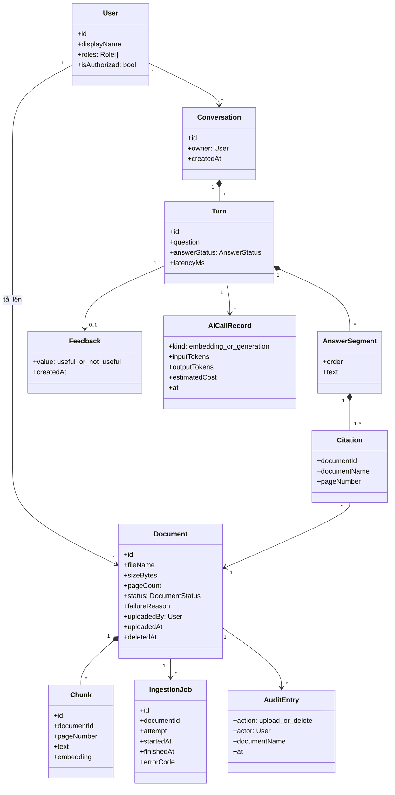

**Bất biến miền (invariant):**

| ID | Bất biến | Nguồn |
|---|---|---|
| INV-01 | Mọi `AnswerSegment` của câu trả lời có trạng thái `answered` đều có ≥ 1 `Citation` hợp lệ; đoạn không có trích dẫn bị loại trước khi hiển thị. | BR-011, AC-011 |
| INV-02 | `Citation.pageNumber` nằm trong `[1, Document.pageCount]` và trỏ tới `Chunk` thực sự được truy xuất cho lượt đó. | AC-011 |
| INV-03 | Chỉ `Chunk` của `Document.status = Ready` và `deletedAt = null` được truy xuất. | US-004 AC 2, BR-008 |
| INV-04 | `AuditEntry` chỉ được ghi thêm, không sửa, không xóa trong thời hạn lưu trữ. | BR-022 |
| INV-05 | `Citation.documentName` được chụp lại tại thời điểm trả lời, để câu trả lời cũ vẫn đọc được khi tài liệu đã bị xóa (MSG-20). | Đề xuất SDD |

### 3.3 Dependency View

**Mục đích:** quy tắc phụ thuộc giữa thành phần để giữ module tách biệt.
**Concern:** CN-13, CN-16.

**Quy tắc:**

| ID | Quy tắc |
|---|---|
| DEP-R1 | C-FE chỉ gọi C-BE qua API công khai (Mục 3.5); không gọi trực tiếp EXT-02 hay kho dữ liệu. |
| DEP-R2 | Chỉ C-BE-07 được gọi EXT-02. Module khác dùng giao diện `EmbeddingPort`, `GenerationPort`. |
| DEP-R3 | C-BE-03 không phụ thuộc C-BE-02 trực tiếp; đọc trạng thái tài liệu qua bộ lọc trong truy vấn chỉ mục (INV-03). |
| DEP-R4 | C-BE-05 (Analytics) chỉ nhận sự kiện; không module nào phụ thuộc ngược vào C-BE-05 để chạy nghiệp vụ. |
| DEP-R5 | Không phụ thuộc vòng giữa các module C-BE-xx; kiểm bằng công cụ phân tích phụ thuộc trong CI **[Đề xuất]**. |

**Ma trận phụ thuộc** (hàng phụ thuộc vào cột):

| | BE-01 | BE-02 | BE-03 | BE-04 | BE-05 | BE-06 | BE-07 | BE-08 | DS-01 | DS-02 | DS-03 | DS-04 |
|---|---|---|---|---|---|---|---|---|---|---|---|---|
| **C-BE-02 Document** | ● | | | | ○ | ● | | ● | ● | ● | ● | ● |
| **C-BE-03 Q&A** | ● | | | ● | ○ | | ● | ● | | ● | | |
| **C-BE-04 Conversation** | ● | | | | | | | | ● | | | |
| **C-BE-05 Analytics** | ● | | | | | | | | ● | | | |
| **C-BE-06 Audit** | ● | | | | | | | | ● | | | |
| **C-BE-07 AI Gateway** | | | | | | | | | ● | | | |
| **C-WK** | | ● | | | ○ | | ● | ● | ● | ● | ● | ● |

● phụ thuộc đồng bộ · ○ chỉ phát sự kiện. C-BE-02 phụ thuộc C-DS-02 để xóa vector khi xóa tài liệu (SEQ-04).

### 3.4 Information View

**Mục đích:** dữ liệu được lưu, phân loại, thời hạn.
**Concern:** CN-06, CN-07, CN-08, CN-09, CN-11.

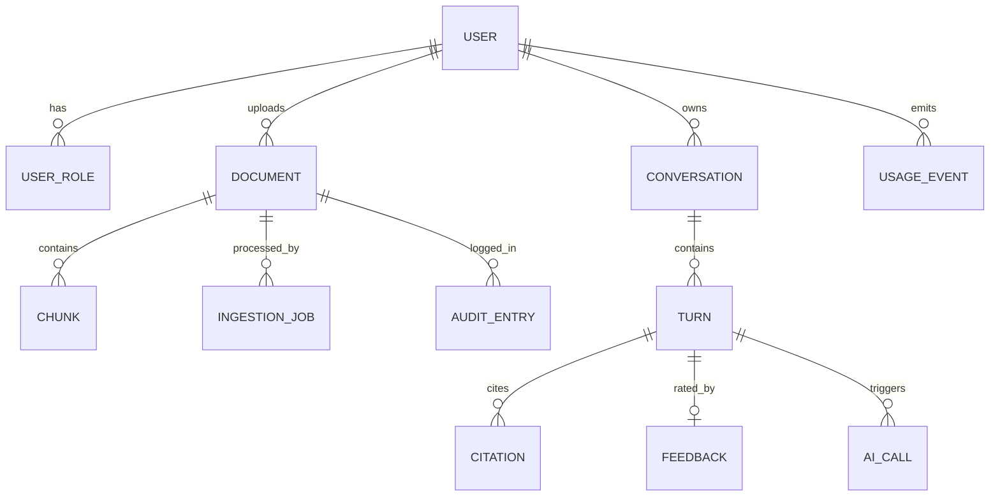

| Thực thể | Nơi lưu | Dữ liệu chính | Phân loại | Thời hạn lưu | Ghi chú |
|---|---|---|---|---|---|
| USER, USER_ROLE | C-DS-01 | Mã định danh từ IdP, tên hiển thị, vai trò | Dữ liệu cá nhân | Trong thời gian được cấp quyền | Không lưu mật khẩu nếu dùng SSO (OQ-020) |
| DOCUMENT | C-DS-01 + tệp gốc ở C-DS-03 | Tên tệp, kích thước, số trang, trạng thái, người / thời điểm tải | Nội bộ, mức [TBD: OQ-011] | [TBD: OQ-014] | Xóa = xóa tệp, xóa chunk, giữ bản ghi đã xóa cho nhật ký |
| CHUNK | C-DS-02 | Đoạn văn bản, số trang, vector | Như DOCUMENT | Như DOCUMENT | Xóa ngay khi tài liệu bị xóa (BR-008) |
| CONVERSATION, TURN, CITATION | C-DS-01 | Câu hỏi, câu trả lời, trích dẫn | Nội bộ, có thể chứa dữ liệu cá nhân | [TBD: OQ-014] | Cần cho hội thoại nhiều lượt (BR-016) |
| FEEDBACK | C-DS-01 | Hữu ích / không hữu ích | Nội bộ | Hết thời gian thử nghiệm | MET-004 |
| AUDIT_ENTRY | C-DS-01 | Hành động, người, thời điểm, tên tài liệu | Nội bộ, nhật ký bảo mật | ≥ thời hạn của DOCUMENT [TBD: OQ-014] | Chỉ ghi thêm (INV-04) |
| USAGE_EVENT | C-DS-01 | Sự kiện PRD 5.2: mã băm người dùng, mã đối tượng, độ dài, kết quả, thời gian | Nội bộ | Hết thời gian thử nghiệm | **Không có trường văn bản tự do** (CN-11) |
| AI_CALL | C-DS-01 | Loại lời gọi, số token, chi phí ước tính | Nội bộ | Hết thời gian thử nghiệm | BR-025 |

**Dữ liệu đi qua TB-3 (tới EXT-02):** chỉ gồm (1) văn bản đoạn tài liệu khi tạo embedding, (2) câu hỏi, các lượt trước cần cho ngữ cảnh và các đoạn được truy xuất khi sinh câu trả lời. **Không gửi:** tên người dùng, tệp PDF gốc, nhật ký. Chỉ được bật ở production khi có G-01, G-02.

### 3.5 Interface View

**Mục đích:** hợp đồng giữa thành phần và với bên ngoài. Giao diện người dùng được đặc tả chi tiết ở Mục 4.
**Concern:** CN-05, CN-06, CN-13, CN-16.

#### 3.5.1 API nội bộ (Web App ↔ API) **[Đề xuất]**

| ID | Phương thức & đường dẫn | Mục đích | Vai trò | Story |
|---|---|---|---|---|
| API-01 | `GET /api/me` | Người dùng hiện tại, vai trò, trạng thái được cấp quyền | Đã đăng nhập | US-001 |
| API-02 | `GET /api/documents` | Danh sách tài liệu (tên, ngày tải, người tải, trạng thái, lý do lỗi) | R-USER | US-007, US-004 |
| API-03 | `POST /api/documents` (multipart, 1..n tệp) | Tải lên; trả kết quả **theo từng tệp**: chấp nhận (202) hoặc từ chối kèm mã lỗi | R-USER | US-003, US-005, US-006 |
| API-04 | `GET /api/documents/events` (SSE) | Đẩy thay đổi trạng thái tài liệu | R-USER | US-004 |
| API-05 | `GET /api/documents/{id}/file` (hỗ trợ Range) | Tệp PDF cho Citation Viewer | R-USER | US-015 |
| API-06 | `DELETE /api/documents/{id}` | Xóa tài liệu; chỉ trả 200 sau khi chunk đã bị gỡ khỏi chỉ mục | R-USER | US-008 |
| API-07 | `POST /api/conversations` | Tạo hội thoại mới | R-USER | US-010, US-016 |
| API-08 | `POST /api/conversations/{id}/turns` (phản hồi SSE) | Gửi câu hỏi; nhận luồng đoạn câu trả lời và trích dẫn | R-USER | US-010 → US-014, US-016 |
| API-09 | `PUT /api/turns/{id}/feedback` | Ghi / đổi đánh giá | R-USER | US-017 |
| API-10 | `GET /api/reports/usage?week=YYYY-Www` | Báo cáo sử dụng tuần | R-ANALYST, R-ENGINEER | US-018 |
| API-11 | `GET /api/reports/ai-cost?week=YYYY-Www` | Chi phí AI tuần | R-ENGINEER, R-ANALYST | US-019 |
| API-12 | `GET /api/audit-logs?from&to&action` | Nhật ký tải lên / xóa | R-SECURITY | US-009 |
| API-13 | `POST /api/events` | Sự kiện telemetry từ giao diện (Mục 4.10) | R-USER | PRD 5.2 |

**Luồng sự kiện của API-08 (SSE):**

| Sự kiện | Dữ liệu | Giao diện xử lý |
|---|---|---|
| `status` | `retrieving` / `generating` | Cập nhật chỉ báo (CMP-14) |
| `segment` | `{order, text, citations:[{documentId, documentName, page}]}` | Thêm đoạn vào AnswerCard; trích dẫn nằm sát ý (PRD 4.1) |
| `excluded_documents` | `{processingCount}` | Hiện MSG-09 nếu còn tệp đang xử lý |
| `done` | `{turnId, answerStatus: answered \| not_found, latencyMs}` | Chuyển sang NotFoundCard nếu `not_found`; bật nút đánh giá |
| `error` | `{code}` | Hiện thông điệp theo bảng mã lỗi |

**Bảng mã lỗi ↔ thông điệp giao diện:**

| Mã lỗi | HTTP | Thông điệp (Mục 4.8) |
|---|---|---|
| `FILE_TYPE_NOT_ALLOWED` | 422 | MSG-01 |
| `FILE_TOO_LARGE` | 422 | MSG-02 |
| `PDF_CORRUPTED` | (trạng thái tài liệu) | MSG-03 |
| `PDF_ENCRYPTED` | (trạng thái tài liệu) | MSG-04 |
| `PDF_NO_TEXT_LAYER` | (trạng thái tài liệu) | MSG-05 |
| `NO_READY_DOCUMENTS` | 409 | MSG-07 / MSG-08 |
| `QUESTION_EMPTY`, `QUESTION_TOO_LONG` | 422 | Chặn ở giao diện; MSG-14 |
| `ANSWER_TIMEOUT` | SSE `error` | MSG-11 |
| `AI_UNAVAILABLE` | SSE `error` / 503 | MSG-12 |
| `NOT_AUTHORIZED` | 403 | MSG-15 |
| `SESSION_EXPIRED` | 401 | MSG-16 |
| `DOCUMENT_DELETED` | 410 | MSG-20 |

#### 3.5.2 Giao diện bên ngoài

| ID | Đối tác | Giao thức | Nội dung | Ghi chú |
|---|---|---|---|---|
| IF-EXT-01 | EXT-01 IdP | OpenID Connect (Authorization Code + PKCE) **[Đề xuất]** | Token danh tính | Phương án SSO hay tài khoản riêng chờ OQ-020 |
| IF-EXT-02a | EXT-02 Embedding | HTTPS qua `EmbeddingPort` | Văn bản đoạn → vector | Cùng một mô hình cho đoạn tài liệu và câu hỏi |
| IF-EXT-02b | EXT-02 LLM | HTTPS qua `GenerationPort`, phản hồi dạng luồng | Câu hỏi + đoạn truy xuất → câu trả lời có cấu trúc kèm mã trích dẫn | Timeout [TBD: OQ-006 × hệ số] |

### 3.6 Interaction View

**Mục đích:** luồng tương tác giữa thành phần cho các use case quan trọng.
**Concern:** CN-01, CN-02, CN-03, CN-05, CN-09.

#### SEQ-01 — Tải PDF lên và xử lý (UC03, UC05, UC06, UC04)

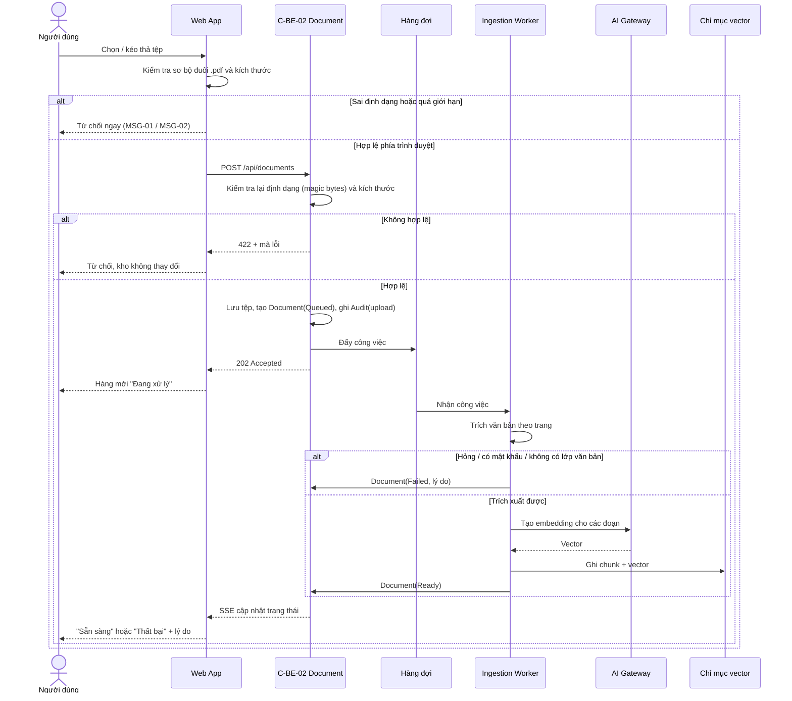

#### SEQ-02 — Đặt câu hỏi và nhận câu trả lời kèm trích dẫn (UC11, UC12, UC13, UC15)

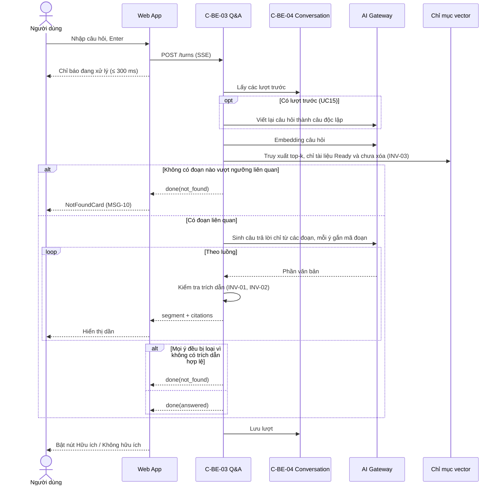

**Thuật toán Q&A (Algorithm viewpoint, tóm tắt) [Đề xuất, DD-04]:**

1. Nếu có lượt trước: viết lại câu hỏi thành câu độc lập (BR-016).
2. Truy xuất top-k đoạn từ **toàn bộ** tài liệu Ready (BR-010); k và ngưỡng liên quan được hiệu chỉnh trên bộ DEP-002.
3. Nếu không đoạn nào vượt ngưỡng → `not_found` **mà không gọi LLM** (giảm chi phí, AC-013).
4. Gọi LLM với chỉ dẫn: chỉ dùng đoạn được cung cấp; mỗi ý phải kèm mã đoạn; nếu đoạn không đủ thì trả `not_found` (BRU-003).
5. Hậu kiểm: loại ý không có mã đoạn hợp lệ; ánh xạ mã đoạn → (tên tài liệu, trang). Nếu không còn ý nào → `not_found`.

#### SEQ-03 — Mở trang được trích dẫn (UC14)

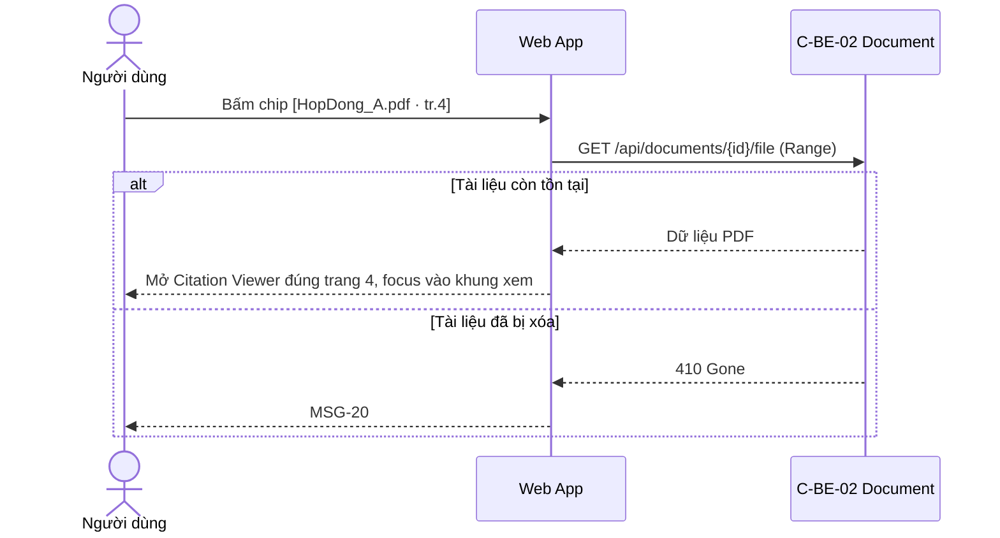

#### SEQ-04 — Xóa tài liệu khi có câu hỏi đang xử lý (UC09, BR-008)

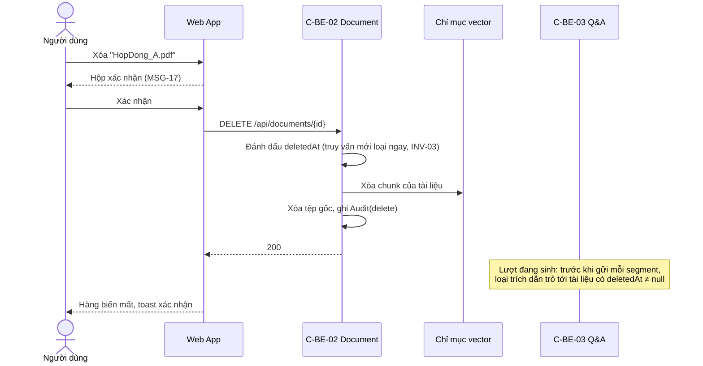

### 3.7 State Dynamics View

**Mục đích:** trạng thái của đối tượng chính và trạng thái giao diện.
**Concern:** CN-05, CN-03, UXS-06, UXS-07.

#### ST-01 — Vòng đời tài liệu

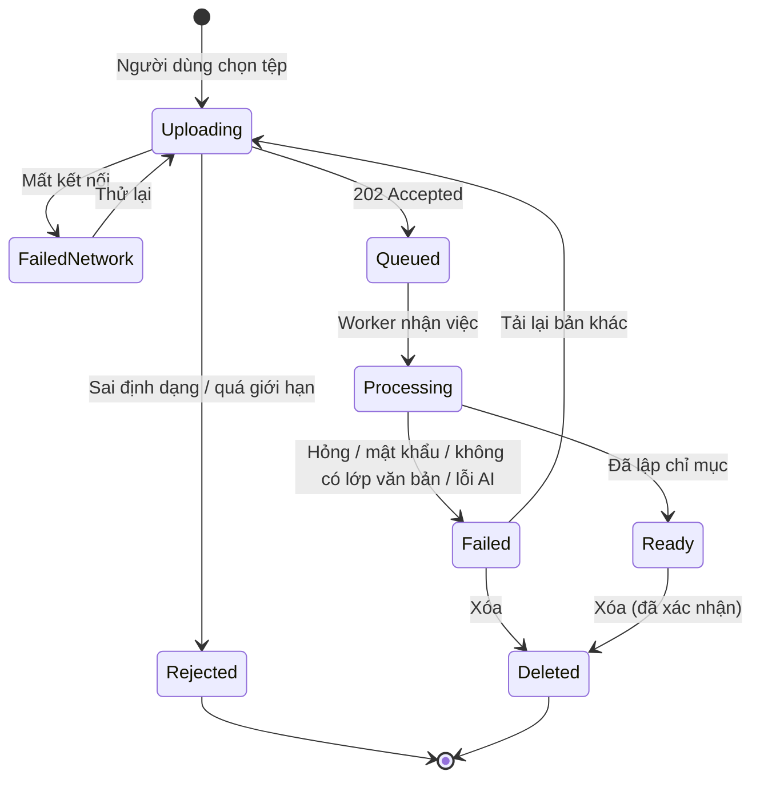

| Trạng thái | Nhãn hiển thị | Biểu tượng + màu (Mục 4.6) | Dùng để trả lời? |
|---|---|---|---|
| Uploading | "Đang tải lên… 45%" | Thanh tiến trình, `info` | Không |
| Queued, Processing | "Đang xử lý…" | Vòng xoay, `info` | Không |
| Ready | "Sẵn sàng" | Dấu tích, `success` | Có |
| Failed | "Thất bại: {lý do}" | Dấu chấm than, `danger` | Không |
| FailedNetwork | "Thất bại — mất kết nối" | Dấu chấm than, `danger` + nút "Thử lại" | Không |
| Rejected | Không thêm vào danh sách; hiện thông điệp tại vùng tải lên | `danger` | Không |

#### ST-02 — Vòng đời một lượt hỏi đáp

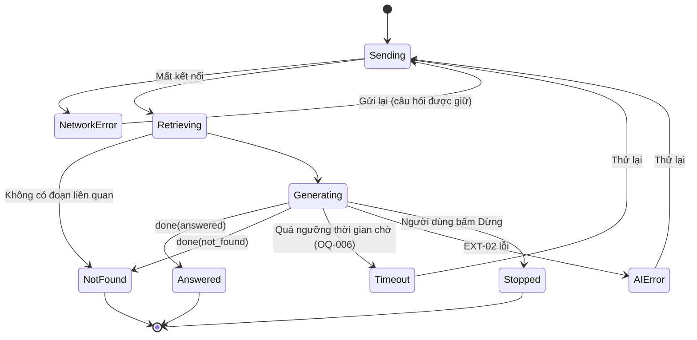

#### ST-03 — Trạng thái ô nhập câu hỏi (CMP-09)

| Trạng thái | Điều kiện | Ô nhập | Nút Gửi | Thông điệp |
|---|---|---|---|---|
| `disabled-empty-repo` | Kho không có tài liệu | Vô hiệu | Vô hiệu | MSG-07 |
| `disabled-all-processing` | Có tài liệu nhưng chưa tệp nào Ready | Vô hiệu | Vô hiệu | MSG-08 |
| `idle-empty` | Có ≥ 1 tài liệu Ready, ô trống | Bật | Vô hiệu | Câu hỏi mẫu |
| `typing` | Có nội dung, trong giới hạn | Bật | Bật | Bộ đếm ký tự |
| `over-limit` | Vượt [TBD] ký tự | Bật | Vô hiệu | MSG-14 |
| `submitting` | Đang chờ / nhận luồng | Khóa | Thành nút "Dừng" **[Đề xuất — ngoài PRD, DQ-10]** | Chỉ báo đang xử lý; MSG-22 sau khi dừng |

### 3.8 Resource View

**Mục đích:** tài nguyên dùng chung, chi phí, giới hạn.
**Concern:** CN-01, CN-12, CN-14.

| Tài nguyên | Yếu tố tiêu thụ | Kiểm soát thiết kế | Giám sát |
|---|---|---|---|
| Token LLM | Số đoạn top-k × độ dài đoạn + lịch sử hội thoại + độ dài câu trả lời | Giới hạn k, độ dài đoạn và số lượt lịch sử đưa vào ngữ cảnh — [TBD], hiệu chỉnh trên DEP-002; bỏ qua LLM khi `not_found` ở bước 3 | AI_CALL theo lượt; báo cáo tuần (US-019) |
| Token embedding | Tổng số trang được nạp + số câu hỏi | Mỗi tài liệu chỉ embedding một lần; không embedding lại khi chỉ đổi giao diện | AI_CALL theo tài liệu |
| Ngân sách AI | Tổng chi phí tháng ≤ [TBD: OQ-012] | Cảnh báo cho R-ENGINEER khi chi phí luỹ kế vượt 80% ngân sách tháng **[Đề xuất]**; giới hạn tần suất hỏi cho mỗi người dùng [TBD] | Báo cáo chi phí; đối soát với hóa đơn EXT-03 |
| Worker xử lý tệp | Số tệp đồng thời, số trang | Số worker cấu hình được; hàng đợi giữ thứ tự; thử lại tối đa 2 lần với lỗi tạm thời **[Đề xuất]** | Thời gian xử lý (sự kiện `doc_processing_completed`) |
| Lưu trữ | PDF gốc + chunk + vector | Giới hạn tệp [TBD: OQ-007]; xóa theo thời hạn [TBD: OQ-014] | Dung lượng theo tuần |
| Kết nối SSE | Số người dùng đồng thời [TBD: OQ-004] | Một kết nối trạng thái tài liệu cho mỗi tab; đóng khi tab ẩn lâu **[Đề xuất]** | Số kết nối mở |

---

## 4. Blueprint UX/UI

Mục này cụ thể hóa Interface View cho giao diện người dùng.

### 4.1 Nguyên tắc thiết kế

Dựa trên 4 trụ cột UX ở PRD 4.0 (đang chờ sponsor xác nhận):

| Nguyên tắc | Cách thể hiện trong thiết kế |
|---|---|
| **Kiểm chứng được là mặc định** | Chip trích dẫn nằm ngay sau từng ý; bấm một lần mở đúng trang; không gom trích dẫn xuống cuối |
| **Trung thực khi không biết** | "Không tìm thấy" có thẻ riêng, màu trung tính, không định dạng như câu trả lời; không hiển thị đoạn văn không có nguồn |
| **Ít thao tác** | Một màn hình làm việc chứa kho và hội thoại; ô nhập luôn ở cùng một chỗ; Enter để gửi |
| **Dùng trên máy tính** | Bố cục tối ưu từ 1280 px; Citation Viewer mở cạnh hội thoại để đối chiếu song song |

### 4.2 Kiến trúc thông tin (Sitemap)

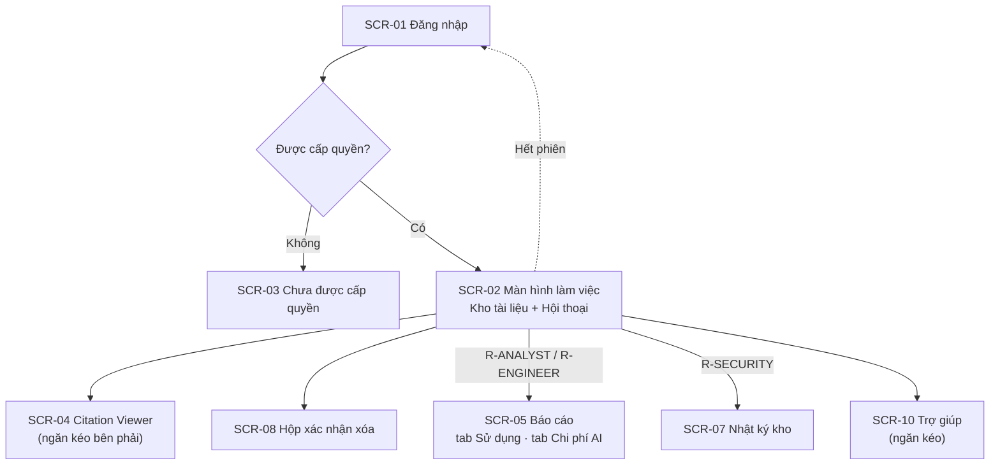

#### 4.2.1 Luồng người dùng theo tác vụ

Bốn luồng quan trọng nhất. Mỗi bước ghi màn hình, component hoặc thông điệp liên quan. Các luồng này là kịch bản gốc cho kiểm thử khả dụng (4.12.1) và kiểm thử trợ năng (4.9.1).

**UF-01 — Lần đầu dùng, kho trống → câu trả lời đầu tiên** (UXS-01)

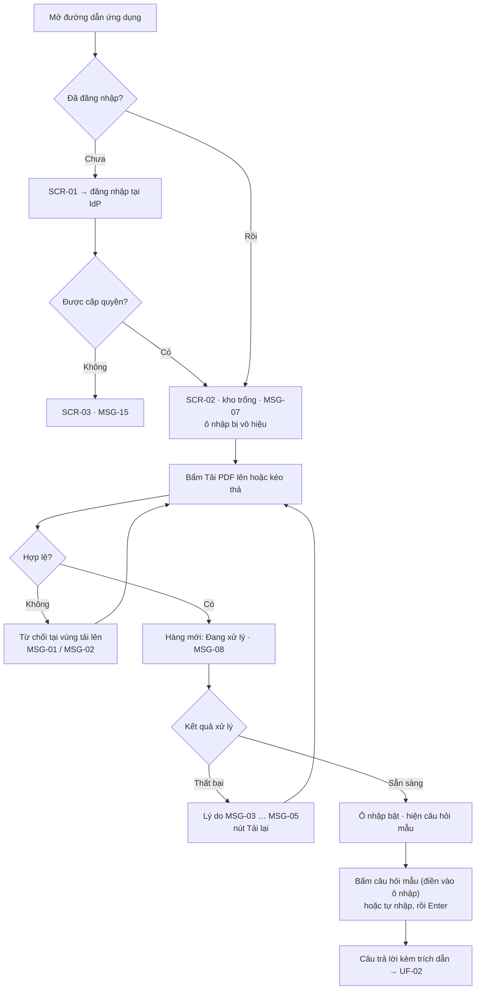

Đếm thao tác cho UXS-01: khi kho trống, tải tệp đầu tiên = bấm "Tải PDF lên" (1) → chọn tệp (2) → xác nhận hộp chọn tệp của hệ điều hành (3). Khi đã có tài liệu Sẵn sàng, hỏi = bấm câu hỏi mẫu hoặc ô nhập (1) → Enter (2). Câu hỏi mẫu **chỉ điền vào ô nhập, không gửi ngay**, để người dùng sửa trước khi gửi.

**UF-02 — Hỏi, kiểm chứng và hỏi tiếp** (CN-02, CN-03)

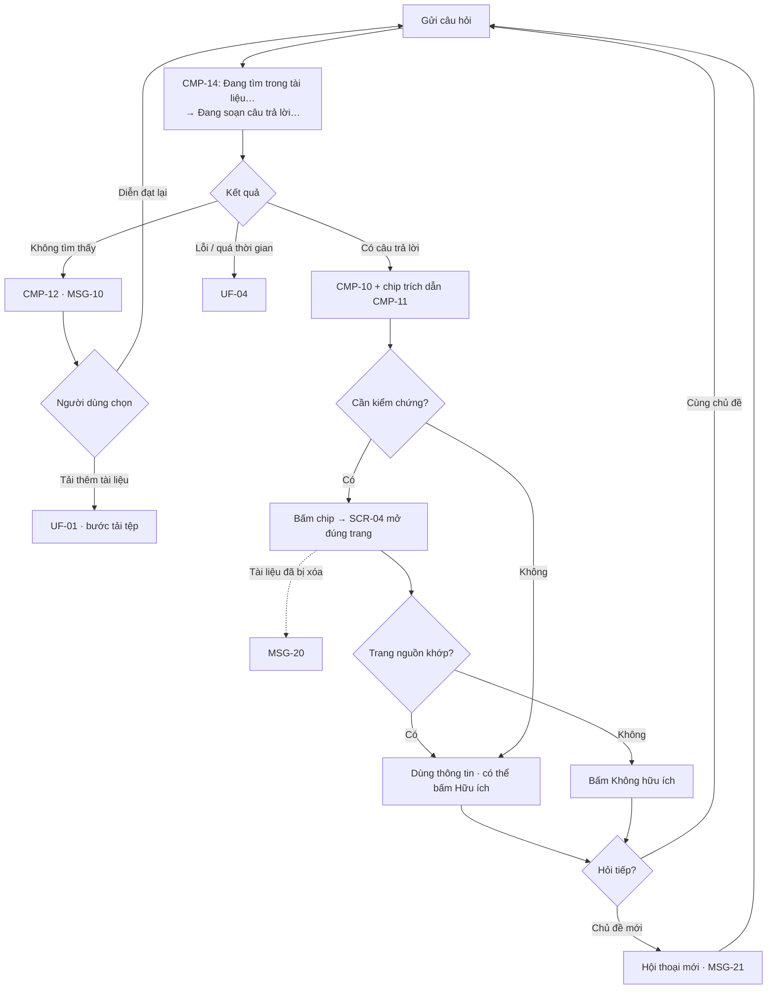

**UF-03 — Tải nhiều tệp và khôi phục khi tệp lỗi** (US-004, US-005, US-006)

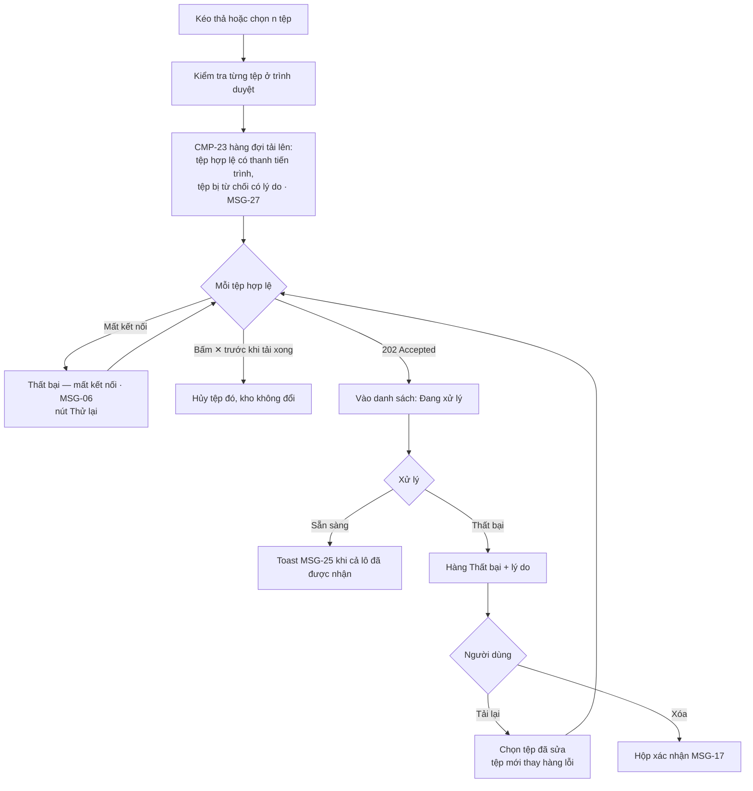

**UF-04 — Khôi phục khi hỏi đáp gặp sự cố** (UXS-06)

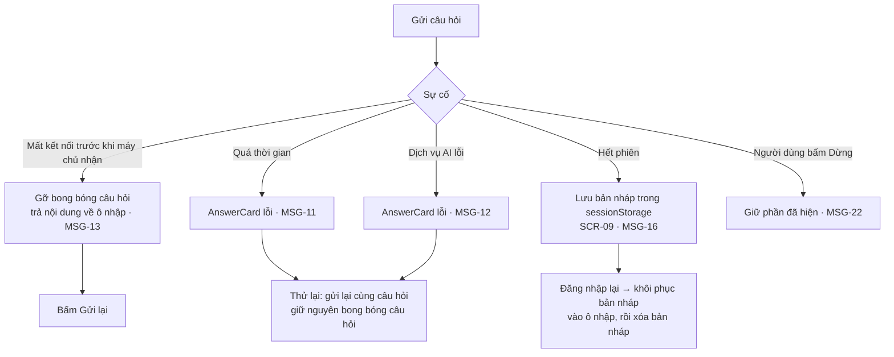

Bản nháp chỉ lưu trong trình duyệt của người dùng (sessionStorage), không gửi lên máy chủ, và bị xóa ngay khi khôi phục xong.

### 4.3 Danh mục màn hình

| ID | Màn hình | Vai trò | Use case / Story | Mục đích |
|---|---|---|---|---|
| SCR-01 | Đăng nhập | Tất cả | UC01 / US-001 | Chuyển hướng tới IdP; không hiển thị dữ liệu nào trước khi đăng nhập |
| SCR-02 | Màn hình làm việc | R-USER | UC03, UC04, UC07, UC08, UC09, UC11–UC16 | Màn hình chính |
| SCR-03 | Chưa được cấp quyền | Đã đăng nhập, không có quyền | US-001 AC 2 | Thông báo MSG-15, nút Đăng xuất |
| SCR-04 | Citation Viewer | R-USER | UC14 / US-015 | Xem trang PDF được trích dẫn, song song với câu trả lời |
| SCR-05 | Báo cáo | R-ANALYST, R-ENGINEER | UC17, UC18 / US-018, US-019 | Số liệu tuần và chi phí AI |
| SCR-07 | Nhật ký kho | R-SECURITY | UC10 / US-009 | Lọc, xem nhật ký tải lên / xóa |
| SCR-08 | Hộp xác nhận xóa | R-USER | UC09 / US-008 | Ngăn xóa nhầm (MSG-17) |
| SCR-09 | Lỗi chung / hết phiên | Tất cả | PRD 4.2 | MSG-16, lỗi không xác định có nút thử lại |
| SCR-10 | Trợ giúp (ngăn kéo) | Tất cả | G-40, RSK-001 | Giới hạn công cụ, cách hỏi, cách kiểm chứng (4.11.1) — **[Đề xuất — ngoài PRD]** |

> SCR-06 được để trống có chủ đích: chi phí AI là một tab trong SCR-05, không tách thành màn hình riêng.

### 4.4 Wireframe

> Wireframe mô tả bố cục và nội dung, **không quy định hình ảnh cuối cùng**. Dữ liệu trong khung là ví dụ.

#### SCR-02 — Màn hình làm việc (trạng thái có dữ liệu, ≥ 1280 px)

```
┌───────────────────────────────────────────────────────────────────────────────────┐
│ ▣ Chat với tài liệu                                  [? Trợ giúp] An Nguyễn ▾ │ Đăng xuất │
├────────────────────────────┬──────────────────────────────────────────────────────┤
│ KHO TÀI LIỆU · 12 tệp      │ HỘI THOẠI                          [+ Hội thoại mới] │
│ ┌────────────────────────┐ │                                                      │
│ │  ⤒  Kéo thả PDF vào    │ │                          ┌─────────────────────────┐ │
│ │     đây hoặc [Chọn tệp]│ │                          │ Tiến độ bàn giao giai   │ │
│ │  Chỉ PDF · ≤ [TBD] MB  │ │                          │ đoạn 2 là khi nào?      │ │
│ └────────────────────────┘ │                          └─────────────────────────┘ │
│ ⌕ Lọc theo tên tệp…        │ ┌──────────────────────────────────────────────────┐ │
│ ⓘ 1 tệp đang xử lý chưa    │ │ • Giai đoạn 2 bàn giao ngày 15/12/2026.          │ │
│   được dùng để trả lời     │ │   [HopDong_A.pdf · tr.4]                         │ │
│ ────────────────────────── │ │ • Ngày này có thể lùi tối đa 2 tuần nếu thiếu    │ │
│ ✔ BaoCao_Q3.pdf        🗑 │ │   nhân sự. [BaoCao_Q3.pdf · tr.12]               │ │
│   Sẵn sàng · 18/10 · Bình  │ │                                                  │ │
│ ◌ HopDong_B.pdf        🗑 │ │ Câu trả lời này có hữu ích không?  [👍] [👎]     │ │
│   Đang xử lý…              │ └──────────────────────────────────────────────────┘ │
│ ! KeHoach.pdf          🗑 │                                                      │
│   Thất bại: tệp có mật     │ ┌──────────────────────────────────────────┐ ┌─────┐ │
│   khẩu. [Tải lại]          │ │ Hỏi về nội dung tài liệu…                │ │ Gửi │ │
│ ✔ HopDong_A.pdf        🗑 │ │                                 42/[TBD] │ └─────┘ │
│   Sẵn sàng · 17/10 · An    │ └──────────────────────────────────────────┘         │
│                            │ ⓘ Câu trả lời do AI tạo; hãy kiểm tra trích dẫn     │
│                            │   với thông tin quan trọng.                          │
└────────────────────────────┴──────────────────────────────────────────────────────┘
  320 px                       phần còn lại (tối đa 880 px cho nội dung hội thoại)
```

- Wireframe trên là góc nhìn của người dùng chỉ có `R-USER`. Nút **[Báo cáo]** (R-ANALYST, R-ENGINEER) và **[Nhật ký]** (R-SECURITY) được chèn trước "Trợ giúp" khi người dùng có vai trò tương ứng (CMP-01).
- Ô **"Lọc theo tên tệp"** và nút **"Trợ giúp"** là **[Đề xuất — ngoài PRD]** (DQ-10).
- Thứ tự danh sách: tệp Thất bại và Đang xử lý được ghim trên cùng, sau đó là tệp mới tải nhất (4.5.2).

#### SCR-02 + SCR-04 — Mở trích dẫn (Citation Viewer dạng ngăn kéo bên phải)

```
┌──────────────────────┬──────────────────────────────┬────────────────────────────┐
│ KHO TÀI LIỆU (thu    │ HỘI THOẠI                    │ HopDong_A.pdf · Trang 4  ✕ │
│ gọn được)            │                              │ [‹ Trang trước] 4/37 [Sau ›]│
│                      │ • Giai đoạn 2 bàn giao ngày  │ ┌────────────────────────┐ │
│                      │   15/12/2026.                │ │                        │ │
│                      │   [HopDong_A.pdf · tr.4] ◉   │ │   (hiển thị trang PDF  │ │
│                      │                              │ │    số 4)               │ │
│                      │ • …                          │ │                        │ │
│                      │                              │ └────────────────────────┘ │
│                      │                              │ [Mở toàn bộ tệp ↗]         │
└──────────────────────┴──────────────────────────────┴────────────────────────────┘
  ◉ = chip đang được xem (trạng thái "selected")         ngăn kéo rộng 480 px
```

- Esc hoặc ✕ đóng ngăn kéo, focus quay về chip đã bấm.
- Từ 1024 px tới 1279 px: ngăn kéo phủ lên vùng hội thoại, có lớp nền mờ.
- Tô sáng đoạn văn được trích trong trang: **ngoài MVP** (cần lưu tọa độ văn bản), ghi nhận cho giai đoạn sau.

#### SCR-02 — Các trạng thái rỗng và đặc biệt của vùng hội thoại

```
Kho trống                              Tất cả đang xử lý
┌──────────────────────────────────┐   ┌──────────────────────────────────┐
│              ⤒                   │   │              ◌                   │
│   Chưa có tài liệu nào           │   │   Đang xử lý 3 tệp               │
│   Tải tệp PDF của dự án lên để   │   │   Bạn có thể hỏi khi có ít nhất  │
│   bắt đầu hỏi.                   │   │   một tệp ở trạng thái Sẵn sàng. │
│        [Tải PDF lên]             │   │                                  │
│ [ ô nhập bị vô hiệu hóa      ]   │   │ [ ô nhập bị vô hiệu hóa      ]   │
└──────────────────────────────────┘   └──────────────────────────────────┘

Hội thoại trống (có tài liệu Ready)    Không tìm thấy
┌──────────────────────────────────┐   ┌──────────────────────────────────┐
│ Bạn có thể hỏi, ví dụ:           │   │ ⓘ Không tìm thấy thông tin này   │
│ [Các mốc bàn giao của dự án?]    │   │   trong 12 tài liệu hiện có.     │
│ [Điều khoản phạt chậm tiến độ?]  │   │   Thử diễn đạt khác, hoặc tải    │
│ [Ngân sách giai đoạn 2?]         │   │   thêm tài liệu liên quan.       │
│ (câu mẫu do đội nghiệp vụ duyệt) │   │   [👍] [👎]                       │
└──────────────────────────────────┘   └──────────────────────────────────┘
```

#### SCR-05 — Báo cáo (tab Sử dụng)

```
┌───────────────────────────────────────────────────────────────────────────────┐
│ ‹ Quay lại   BÁO CÁO          [Sử dụng] [Chi phí AI]      Tuần: [2026-W44 ▾] │
├───────────────────────────────────────────────────────────────────────────────┤
│ ┌───────────────┐ ┌───────────────┐ ┌───────────────┐ ┌───────────────┐      │
│ │ Người dùng    │ │ Số câu hỏi    │ │ Tỷ lệ hữu ích │ │ Tỷ lệ "không  │      │
│ │ hoạt động     │ │               │ │               │ │ tìm thấy"     │      │
│ │ 9 / 14        │ │ 132           │ │ 78 %          │ │ 11 %          │      │
│ │ ▲ 2 so với    │ │ ▲ 40          │ │ (n = 61)      │ │               │      │
│ │ tuần trước    │ │               │ │               │ │               │      │
│ └───────────────┘ └───────────────┘ └───────────────┘ └───────────────┘      │
│ ┌───────────────┐ ┌──────────────────────────────────────────────────┐       │
│ │ P90 thời gian │ │ Tệp thất bại theo nguyên nhân                    │       │
│ │ phản hồi      │ │ Có mật khẩu ████ 3 · Scan ██ 2 · Hỏng █ 1        │       │
│ │ 7,4 s         │ │                                                  │       │
│ └───────────────┘ └──────────────────────────────────────────────────┘       │
│ Biểu đồ theo tuần: số câu hỏi và người dùng hoạt động (8 tuần gần nhất)      │
│ [Tải CSV]                                                                    │
└───────────────────────────────────────────────────────────────────────────────┘
```

Chỉ số theo PRD 5.2 (báo cáo tuần cho sponsor). Ngưỡng màu đạt / không đạt chưa áp dụng vì mục tiêu MET-003, MET-004 còn [TBD: OQ-015]. Ô tỷ lệ luôn hiển thị cỡ mẫu `n` để tránh đọc sai khi ít dữ liệu. Nút **[Tải CSV]** ở SCR-05 và SCR-07 là **[Đề xuất — ngoài PRD]** (DQ-10).

#### SCR-07 — Nhật ký kho

```
┌──────────────────────────────────────────────────────────────────────────┐
│ ‹ Quay lại   NHẬT KÝ KHO TÀI LIỆU                                         │
│ Từ [01/10/2026] đến [21/10/2026]   Hành động [Tất cả ▾]   [Tải CSV]      │
├──────────────────┬────────────┬───────────────────────┬──────────────────┤
│ Thời điểm        │ Hành động  │ Tài liệu              │ Người thực hiện  │
├──────────────────┼────────────┼───────────────────────┼──────────────────┤
│ 21/10/2026 09:14 │ Xóa        │ HopDong_A_v1.pdf      │ An Nguyễn        │
│ 20/10/2026 16:02 │ Tải lên    │ HopDong_A.pdf         │ An Nguyễn        │
└──────────────────┴────────────┴───────────────────────┴──────────────────┘
```

#### SCR-05 — Báo cáo (tab Chi phí AI)

```
┌───────────────────────────────────────────────────────────────────────────────┐
│ ‹ Quay lại   BÁO CÁO          [Sử dụng] [Chi phí AI]      Tuần: [2026-W44 ▾] │
├───────────────────────────────────────────────────────────────────────────────┤
│ ┌───────────────────┐ ┌─────────────────────────┐ ┌─────────────────────────┐ │
│ │ Chi phí tuần      │ │ Lũy kế tháng 10/2026    │ │ Chi phí trung bình      │ │
│ │ (ước tính)        │ │ ████████░░ 82 %         │ │ mỗi câu hỏi             │ │
│ │ {số tiền}         │ │ của ngân sách tháng     │ │ {số tiền} (n = 132)     │ │
│ │                   │ │ [TBD: OQ-012]           │ │                         │ │
│ │                   │ │ ! Đã vượt 80% · MSG-28  │ │                         │ │
│ └───────────────────┘ └─────────────────────────┘ └─────────────────────────┘ │
│ Phân bổ: Sinh câu trả lời ██████████ 86 % · Embedding ██ 14 %                 │
│ Biểu đồ 8 tuần: chi phí tuần và số câu hỏi; ngân sách là đường nét đứt         │
│ ⓘ Số liệu ước tính từ số token; đối soát với hóa đơn nhà cung cấp (EXT-03).  │
└───────────────────────────────────────────────────────────────────────────────┘
```

Cảnh báo vượt ngưỡng dùng biểu tượng "!" kèm chữ, không chỉ đổi màu (A11Y-10). R-ANALYST xem được tab này nhưng không cấu hình được ngưỡng cảnh báo.

#### SCR-01 — Đăng nhập

```
┌──────────────────────────────────────────────┐
│                                              │
│            ▣ Chat với tài liệu               │
│     Hỏi đáp trên tài liệu PDF của dự án      │
│                                              │
│    [  Đăng nhập bằng tài khoản công ty  ]    │
│                                              │
│     Chỉ dành cho người được cấp quyền.       │
└──────────────────────────────────────────────┘
```

Không hiển thị bất kỳ tên tệp hay số liệu nào trước khi đăng nhập (US-001 AC 1). Nhãn nút phụ thuộc OQ-020; nếu dùng tài khoản riêng, màn hình có thêm ô tên đăng nhập và mật khẩu.

#### SCR-03 — Chưa được cấp quyền

```
┌──────────────────────────────────────────────────────────────┐
│ ▣ Chat với tài liệu                     An Nguyễn │ Đăng xuất │
├──────────────────────────────────────────────────────────────┤
│                             🔒                               │
│          Bạn chưa được cấp quyền dùng công cụ này.           │
│          Liên hệ {đầu mối [TBD]} để được cấp quyền.          │
│                         [Đăng xuất]                          │
└──────────────────────────────────────────────────────────────┘
```

Đầu trang không có nút Trợ giúp, Báo cáo hay bất kỳ liên kết nào dẫn vào kho.

#### SCR-08 — Hộp xác nhận xóa

```
        ┌─────────────────────────────────────────────┐
        │ Xóa "HopDong_A_v1.pdf" khỏi kho?          ✕ │
        │                                             │
        │ Tài liệu sẽ không còn được dùng để trả lời  │
        │ cho mọi người trong dự án. Không thể hoàn   │
        │ tác.                                        │
        │                                             │
        │                    [Hủy]  [Xóa tài liệu]    │
        └─────────────────────────────────────────────┘
          Focus mặc định: [Hủy] · nút Xóa dùng màu danger
```

#### SCR-09 — Hết phiên

```
        ┌─────────────────────────────────────────────┐
        │ Phiên đăng nhập đã hết hạn                  │
        │                                             │
        │ Hãy đăng nhập lại — câu hỏi đang soạn sẽ    │
        │ được giữ lại.                               │
        │                          [Đăng nhập lại]    │
        └─────────────────────────────────────────────┘
```

Nội dung phía sau hộp thoại bị gỡ khỏi màn hình (không chỉ làm mờ), để người bị thu hồi quyền không còn thấy dữ liệu cũ (PRD 4.2).

#### CMP-10 — Các trạng thái của AnswerCard

```
Đang tạo (streaming)                          Quá thời gian (MSG-11)
┌─────────────────────────────────────────┐   ┌─────────────────────────────────────────┐
│ ◌ Đang soạn câu trả lời…                │   │ ! Câu trả lời mất quá nhiều thời gian.  │
│ • Giai đoạn 2 bàn giao ngày 15/12/2026. │   │                            [Thử lại]    │
│   [HopDong_A.pdf · tr.4]                │   └─────────────────────────────────────────┘
│ • Ngày này có thể lùi▍                  │
└─────────────────────────────────────────┘   Dịch vụ AI lỗi (MSG-12)
  Nút Gửi ở ô nhập chuyển thành [■ Dừng]      ┌─────────────────────────────────────────┐
                                              │ ! Hệ thống tạm thời không trả lời được, │
Đã dừng (MSG-22)                              │   hãy thử lại sau.         [Thử lại]    │
┌─────────────────────────────────────────┐   └─────────────────────────────────────────┘
│ • Giai đoạn 2 bàn giao ngày 15/12/2026. │
│   [HopDong_A.pdf · tr.4]                │
│ Đã dừng — câu trả lời chưa đầy đủ.      │
│                            [Hỏi lại]    │
└─────────────────────────────────────────┘
```

- Nút đánh giá (CMP-13) chỉ hiện ở trạng thái `answered` và `not_found`; không hiện khi lỗi, quá thời gian hoặc đã dừng.
- Ý đang được viết dở khi bấm Dừng bị bỏ; chỉ giữ các ý đã có trích dẫn hợp lệ (INV-01).

#### CMP-23 — Tải nhiều tệp cùng lúc

```
┌ KHO TÀI LIỆU ─────────────────────────────┐
│ ┌───────────────────────────────────────┐ │
│ │ Đang tải lên 2/3 tệp · 1 tệp bị từ    │ │
│ │ chối (MSG-27)                       ⌃ │ │
│ │ ───────────────────────────────────── │ │
│ │ BaoCao_Q4.pdf     ███████░░ 80 %   ✕  │ │
│ │ PhuLuc_1.pdf      ███░░░░░░ 35 %   ✕  │ │
│ │ PhuLuc_2.pdf      ✔ Đã nhận           │ │
│ │ BangGia.xlsx      ! Chỉ hỗ trợ tệp    │ │
│ │                     PDF.              │ │
│ └───────────────────────────────────────┘ │
│ ⌕ Lọc theo tên tệp…                       │
```

Khi mọi tệp hợp lệ đã được nhận, hàng đợi tự thu gọn sau 5 giây và hiện toast MSG-25; tệp bị từ chối vẫn được liệt kê cho đến khi người dùng đóng hàng đợi.

#### Bố cục theo độ rộng màn hình (UXS-04)

```
1024 – 1279 px                                          < 1024 px (không kiểm thử chính thức)
┌──────────────────────────────────────────────────┐    ┌────────────────────────────┐
│ ☰  ▣ Chat với tài liệu     [?]  An Nguyễn ▾ │ ⎋ │    │ ☰ ▣ Chat với tài liệu   ⋮ │
├──────────────────────────────────────────────────┤    ├────────────────────────────┤
│ HỘI THOẠI (toàn chiều rộng)                      │    │ ⓘ Giao diện tối ưu cho máy │
│ …                                                │    │   tính (≥ 1024 px).     ✕  │
│                                                  │    │ HỘI THOẠI                  │
│ [ Hỏi về nội dung tài liệu…            ] [Gửi]   │    │ …                          │
└──────────────────────────────────────────────────┘    │ [Hỏi…            ] [Gửi]   │
                                                        └────────────────────────────┘
```

| Độ rộng | Kho tài liệu | Citation Viewer | Ghi chú |
|---|---|---|---|
| ≥ 1280 px | Cột cố định 320 px bên trái | Ngăn kéo 480 px, đẩy hội thoại hẹp lại | Bố cục chuẩn |
| 1024 – 1279 px | Ngăn kéo trái 320 px, mở bằng ☰, phủ lên hội thoại; **mặc định mở** khi kho trống hoặc có tệp Thất bại | Ngăn kéo 480 px phủ lên hội thoại, có nền mờ | Bố cục hỗ trợ |
| < 1024 px | Toàn màn hình, mở bằng ☰ | Toàn màn hình | Có thông báo "tối ưu cho máy tính"; không cuộn ngang |

### 4.5 Danh mục UI Component

| ID | Component | Màn hình | Biến thể / trạng thái | Ghi chú trợ năng | Story |
|---|---|---|---|---|---|
| CMP-01 | AppHeader | Tất cả | Theo vai trò: hiện / ẩn "Báo cáo", "Nhật ký" | `<header>`, landmark `banner`; menu người dùng mở bằng bàn phím | US-001 |
| CMP-02 | RoleGuard | Tất cả | Cho phép / chuyển SCR-03 | — | US-001 |
| CMP-03 | UploadDropzone | SCR-02 | idle, drag-over, uploading, error | Nút "Chọn tệp" là `<button>` thật; kéo thả chỉ là cách bổ sung | US-003, US-005, US-006 |
| CMP-04 | DocumentList | SCR-02 | loading (skeleton), empty, populated, filtered-empty | `role="list"`; ô lọc có `<label>` | US-007 |
| CMP-05 | DocumentStatusBadge | SCR-02 | processing, ready, failed | Biểu tượng + chữ, không chỉ dùng màu; thay đổi được đọc qua `aria-live="polite"` | US-004 |
| CMP-06 | ConfirmDialog | SCR-08 | default, destructive | Bẫy focus; focus mặc định vào "Hủy"; Esc để đóng | US-008 |
| CMP-07 | ConversationThread | SCR-02 | empty (câu hỏi mẫu), populated | `role="log"`; câu trả lời mới được đọc khi `done`, không đọc từng token | US-010 |
| CMP-08 | QuestionBubble | SCR-02 | pending, sent | Khi mất kết nối trước khi máy chủ nhận, bong bóng bị gỡ và nội dung trả về ô nhập (UF-04) | US-010 |
| CMP-09 | Composer | SCR-02 | ST-03 (6 trạng thái); nút Gửi chuyển thành nút Dừng khi `submitting` | Enter gửi, Shift+Enter xuống dòng, Esc dừng; bộ đếm ký tự liên kết bằng `aria-describedby`; nút Dừng có nhãn "Dừng tạo câu trả lời" | US-010, US-014 |
| CMP-10 | AnswerCard | SCR-02 | streaming, answered, error, timeout | Khu vực `aria-busy="true"` khi đang tạo | US-011, US-014 |
| CMP-11 | CitationChip | SCR-02 | default, hover, focus, selected, unavailable (tài liệu đã xóa) | `<button>` với nhãn đọc được: "Mở HopDong_A.pdf, trang 4" | US-012, US-015 |
| CMP-12 | NotFoundCard | SCR-02 | default | Khác biệt rõ với AnswerCard: nền trung tính, biểu tượng ⓘ | US-013 |
| CMP-13 | FeedbackButtons | SCR-02 | none, useful, not-useful | `aria-pressed`; đổi được lựa chọn | US-017 |
| CMP-14 | ProcessingIndicator | SCR-02 | retrieving ("Đang tìm trong tài liệu…"), generating ("Đang soạn câu trả lời…") | Văn bản thay vì chỉ có biểu tượng xoay | US-014 |
| CMP-15 | CitationViewer | SCR-04 | loading, page, error, deleted | Ngăn kéo `role="dialog"`; focus vào tiêu đề khi mở, trả focus về chip khi đóng | US-015 |
| CMP-16 | AIDisclaimer | SCR-02 | cố định | Văn bản thường, không phải tooltip | G-40, RSK-001 |
| CMP-17 | Toast | Tất cả | success, info | `role="status"`; tự ẩn 5 s; không dùng cho lỗi chặn | — |
| CMP-18 | InlineAlert | Tất cả | info, warning, error | `role="alert"` cho lỗi | — |
| CMP-19 | EmptyState | SCR-02, SCR-05, SCR-07 | empty-repo, all-processing, no-data | Có hành động tiếp theo | PRD 4.2 |
| CMP-20 | KPITile | SCR-05 | default, no-data | Luôn hiện cỡ mẫu `n`; không dùng màu đạt / không đạt khi chưa có mục tiêu | US-018 |
| CMP-21 | DataTable | SCR-07 | loading, empty, populated | `<table>` có `<th scope>`; sắp xếp được bằng bàn phím | US-009 |
| CMP-22 | WeekPicker | SCR-05 | — | Tuần ISO, nhãn hiển thị "Tuần 44 (26/10 – 01/11/2026)" | US-018, US-019 |
| CMP-23 | UploadQueue | SCR-02 | uploading, partially-rejected, done (tự thu gọn sau 5 s) | Tiến trình đọc qua `role="progressbar"` + `aria-valuenow`; tóm tắt từ chối qua `role="alert"` | US-005, US-006 |
| CMP-24 | HelpPanel | SCR-10 | — | Ngăn kéo `role="dialog"`, quản lý focus như CMP-15 | G-40 |

#### 4.5.1 Đặc tả chi tiết các component chính

Kích thước tính theo token ở Mục 4.6. Bản hi-fi (4.13) là nguồn chuẩn khi có; bảng này là ràng buộc tối thiểu.

| Component | Cấu tạo | Kích thước | Hiển thị theo trạng thái |
|---|---|---|---|
| CMP-03 UploadDropzone | Biểu tượng tải lên 24 px; dòng chính "Kéo thả PDF vào đây hoặc"; nút viền "Chọn tệp"; dòng phụ nêu giới hạn tệp | Cao 112 px; viền nét đứt 1 px `color.border.input`; bo 8 px | **drag-over:** viền liền 2 px `color.action.primary`, nền xanh nhạt · **error:** viền `color.status.danger` + InlineAlert bên dưới · **disabled:** không áp dụng (luôn tải lên được) |
| CMP-04/05 DocumentRow | Biểu tượng trạng thái 16 px; tên tệp (`font.body`, 1 dòng); dòng meta (`font.body.sm`: trạng thái · ngày · người tải); nút xóa (biểu tượng 20 px) | Cao tối thiểu 56 px; padding 8 / 12 px; vùng bấm nút xóa 32 × 32 px | **hover / focus trong hàng:** nền `color.surface.muted`, hiện nút xóa (nút luôn hiện khi điều hướng bằng bàn phím) · **failed:** dòng meta màu `danger` + nút "Tải lại" · **processing:** biểu tượng xoay, tắt khi `prefers-reduced-motion` |
| CMP-09 Composer | Ô nhập tự giãn; bộ đếm ký tự ở góc phải dưới; nút Gửi / Dừng bên phải | Cao 48 px, giãn tối đa 6 dòng rồi cuộn trong ô; nút 40 × 40 px | **focus:** vòng focus · **disabled:** nền `color.surface.muted`, placeholder nêu lý do (MSG-07 / MSG-08) · **over-limit:** bộ đếm màu `danger`, nút Gửi vô hiệu |
| CMP-10 AnswerCard | Danh sách ý dạng gạch đầu dòng; mỗi ý kết thúc bằng 1..n chip trích dẫn; dòng trạng thái ở đầu khi đang tạo; hàng đánh giá ở cuối | Rộng tối đa 880 px; padding 16 px; bo 8 px; nền trắng, viền `color.border.subtle` | **streaming:** con trỏ ▍ ở cuối ý đang viết · **error / timeout:** viền trái 4 px `danger`, biểu tượng "!" · **stopped:** dòng ghi chú MSG-22 màu `color.text.secondary` |
| CMP-11 CitationChip | Biểu tượng tài liệu 14 px + "tên tệp · tr.N" | Cao 24 px; padding 2 / 8 px; bo 999 px; `font.body.sm`; tên tệp cắt tối đa 24 ký tự | **hover:** gạch chân · **selected (đang mở ở SCR-04):** nền `color.action.primary`, chữ trắng · **unavailable:** gạch ngang, màu `color.text.secondary`, vẫn focus được để đọc MSG-20 |
| CMP-12 NotFoundCard | Biểu tượng ⓘ 20 px; dòng 1 là câu chính của MSG-10; dòng 2 là gợi ý | Như CMP-10, nền `color.surface.muted`, không có viền màu | Một trạng thái duy nhất; không dùng màu `danger` hay `warning` vì đây không phải lỗi |
| CMP-15 CitationViewer | Thanh tiêu đề (tên tệp · Trang N, nút ✕); thanh điều hướng trang; vùng hiển thị trang vừa chiều rộng; liên kết "Mở toàn bộ tệp" | Rộng 480 px, cao bằng khung làm việc | **loading:** skeleton trang · **error:** InlineAlert + "Thử lại" · **deleted:** MSG-20 |

#### 4.5.2 Hành vi tương tác chi tiết

| Tình huống | Hành vi | Lý do |
|---|---|---|
| Kho có nhiều tài liệu | Tệp Thất bại và Đang xử lý ghim trên cùng; còn lại sắp theo ngày tải mới nhất; số tệp hiện ở tiêu đề vùng; dùng cuộn ảo (virtualized) khi > 200 hàng; **không phân trang** | Quy mô MVP nhỏ (ASM-003); tệp cần xử lý luôn nằm trong tầm mắt |
| Tên tệp dài | Cắt ở giữa, giữ đuôi `.pdf` (ví dụ `BaoCao_Tai_Chinh…Q3.pdf`); tên đầy đủ hiện trong tooltip và trong tên đọc được của phần tử | Phân biệt các phiên bản tệp vốn thường khác nhau ở cuối tên |
| Câu trả lời đang hiện dần | Tự cuộn khi người dùng đang ở cuối luồng (cách đáy ≤ 80 px); nếu người dùng cuộn lên, dừng tự cuộn và hiện nút "↓ Câu trả lời mới" | Không giật màn hình khi người dùng đang đọc câu trước |
| Câu trả lời dài | Hiện đầy đủ, không thu gọn; chip trích dẫn luôn nằm sát ý | PRD 4.1 |
| Thả tệp | Vùng thả là toàn bộ cột kho, không chỉ khung dropzone; thả lẫn PDF và tệp khác: PDF hợp lệ đi tiếp, tệp khác bị từ chối trong CMP-23 | Giảm thao tác chính xác |
| Thả thư mục | Từ chối với MSG-23 | MVP không hỗ trợ duyệt thư mục |
| Quá số tệp mỗi lần | Nhận [TBD: DQ-11] tệp đầu, từ chối phần còn lại với MSG-29 | AC-002 kiểm với 10 tệp |
| Hủy tải lên | Nút ✕ trên tệp **chưa tải xong** hủy tệp đó, không ghi gì vào kho. Sau 202 (Đang xử lý) không hủy được, chỉ xóa được | Tránh trạng thái nửa vời giữa hàng đợi và kho |
| Xóa tệp đang xử lý | Cho phép; worker bỏ kết quả của tệp đó | BR-008 |
| Tải lại tệp Thất bại | Mở hộp chọn tệp; tệp mới thay hàng lỗi (hàng lỗi bị gỡ, ghi Audit như một lần tải lên mới) | Không để hàng lỗi cũ tồn đọng |
| Rời trang khi đang tải lên | Hộp cảnh báo của trình duyệt (`beforeunload`); nội dung MSG-24 chỉ hiện được ở trình duyệt cho phép văn bản tùy chỉnh | Tránh mất tệp đang tải |
| Bấm Gửi liên tục | Nút khóa ngay ở `submitting`; không gửi trùng | ST-03 |
| Bấm Dừng | Đóng kết nối SSE; máy chủ hủy lời gọi LLM, lưu lượt với trạng thái `stopped`; lượt `stopped` không tính vào tỷ lệ "không tìm thấy" | US-014; tránh làm sai MET |
| Trạng thái tệp đổi khi người dùng đang đọc | Cập nhật tại chỗ, không đổi vị trí cuộn; nếu tệp chuyển sang Thất bại thì hàng được ghim lên đầu kèm thông báo `aria-live` | UXS-07, A11Y-04 |

#### 4.5.3 Phím tắt

| Phím | Ngữ cảnh | Hành động |
|---|---|---|
| Enter | Ô nhập | Gửi câu hỏi |
| Shift + Enter | Ô nhập | Xuống dòng |
| Esc | Đang tạo câu trả lời | Dừng (như nút Dừng) |
| Esc | Ngăn kéo hoặc hộp thoại đang mở | Đóng, trả focus về phần tử đã mở nó |
| Ctrl + / (⌘ + / trên macOS) | Bất kỳ đâu | Đưa focus vào ô nhập câu hỏi |
| ← / → | Citation Viewer | Trang trước / trang sau |

Không dùng phím tắt chỉ gồm một ký tự chữ hoặc dấu, để không cần cơ chế tắt phím tắt theo WCAG 2.1.4. Danh sách phím tắt có trong ngăn Trợ giúp (4.11.1). **[Đề xuất — ngoài PRD]** (DQ-10).

### 4.6 Design Tokens **[Đề xuất]**

**Màu** (tương phản đo trên nền `#FFFFFF`; giá trị cần kiểm lại bằng công cụ trước khi chốt):

| Token | Giá trị | Dùng cho | Tương phản |
|---|---|---|---|
| `color.text.primary` | `#1F2937` | Chữ chính | ≈ 14,7:1 |
| `color.text.secondary` | `#4B5563` | Metadata (ngày, người tải) | ≈ 7,6:1 |
| `color.border.input` | `#6B7280` | Viền ô nhập, nút viền | ≈ 4,8:1 (≥ 3:1 cho thành phần) |
| `color.border.subtle` | `#E5E7EB` | Đường phân cách trang trí | Không yêu cầu |
| `color.surface.base` | `#FFFFFF` | Nền | — |
| `color.surface.muted` | `#F3F4F6` | Nền thanh bên, NotFoundCard | — |
| `color.action.primary` | `#1D4ED8` | Nút chính, link, chip trích dẫn | ≈ 6,7:1 |
| `color.status.info` | `#0369A1` | Đang xử lý | ≈ 5,9:1 |
| `color.status.success` | `#15803D` | Sẵn sàng | ≈ 5,0:1 |
| `color.status.warning` | `#B45309` | Cảnh báo chi phí, tệp bị loại khỏi câu trả lời | ≈ 5,0:1 |
| `color.status.danger` | `#B91C1C` | Thất bại, xóa | ≈ 6,5:1 |
| `color.focus.ring` | `#1D4ED8`, viền 2 px, cách 2 px | Focus bàn phím | ≥ 3:1 |

**Chữ:** font hệ thống hỗ trợ đầy đủ dấu tiếng Việt (`"Segoe UI", system-ui, -apple-system, "Helvetica Neue", Arial, sans-serif`). Không tải font ngoài để tránh phụ thuộc mạng ra Internet.

| Token | Cỡ / dòng | Độ đậm | Dùng cho |
|---|---|---|---|
| `font.heading.lg` | 24 / 32 | 600 | Tiêu đề trang (SCR-05, SCR-07) |
| `font.heading.md` | 18 / 26 | 600 | Tiêu đề vùng ("KHO TÀI LIỆU") |
| `font.body` | 16 / 24 | 400 | Câu hỏi, câu trả lời |
| `font.body.sm` | 14 / 20 | 400 | Metadata, chip trích dẫn, bộ đếm ký tự |
| `font.kpi` | 28 / 36 | 600 | Số trong KPITile |

**Khoảng cách và hình khối:** thang 4 px — `4, 8, 12, 16, 24, 32, 48`. Bo góc: `6 px` (nút, ô nhập), `8 px` (thẻ), `999 px` (chip). Đổ bóng: chỉ cho ngăn kéo và hộp thoại.

**Chuyển động:** 150–200 ms cho hover / mở ngăn kéo; tắt hiệu ứng khi người dùng bật `prefers-reduced-motion`.

**Bố cục:** thanh kho 320 px; nội dung hội thoại tối đa 880 px; ngăn kéo trích dẫn 480 px; điểm ngắt `1024 px` và `1280 px`.

**Lưới:** khung làm việc dùng cột cố định (320 px | linh hoạt | 480 px), không dùng lưới 12 cột. SCR-05 dùng lưới 4 cột, khoảng cách 16 px cho KPITile.

**Biểu tượng:** một bộ biểu tượng nét (outline) duy nhất, ví dụ Lucide **[Đề xuất]**. Cỡ: 16 px (cạnh chữ nhỏ), 20 px (trong nút), 24 px (trạng thái rỗng). Biểu tượng mang nghĩa phải có nhãn chữ hoặc `aria-label`; biểu tượng trang trí đặt `aria-hidden="true"`.

| Ý nghĩa | Biểu tượng | Ý nghĩa | Biểu tượng |
|---|---|---|---|
| Sẵn sàng | check-circle | Tải lên | upload |
| Đang xử lý | loader | Xóa | trash |
| Thất bại / lỗi | alert-circle | Trích dẫn | file-text |
| Không tìm thấy | info | Trợ giúp | help-circle |
| Hữu ích / Không hữu ích | thumbs-up / thumbs-down | Dừng | square |

**Đổ bóng:**

| Token | Giá trị | Dùng cho |
|---|---|---|
| `elevation.1` | `0 1px 2px rgba(0,0,0,0.08)` | Thẻ khi hover |
| `elevation.2` | `0 8px 24px rgba(0,0,0,0.16)` | Ngăn kéo, hộp thoại, hàng đợi tải lên |

**Thứ tự lớp (z-index):** `base 0` · `header 100` · `drawer 200` · `overlay + dialog 300` · `toast 400`.

**Màu biểu đồ (SCR-05):** chuỗi 1 `#1D4ED8`, chuỗi 2 `#C2410C` (≈ 5,2:1 trên nền trắng); nét ≥ 2 px; mỗi chuỗi có nhãn trực tiếp trên biểu đồ, không chỉ dựa vào chú giải màu; ngân sách vẽ bằng đường nét đứt `color.status.warning`.

**Chế độ tối:** ngoài phạm vi MVP. Token được đặt tên theo vai trò (`color.text.primary`), không theo màu (`gray-800`), để thêm chế độ tối sau này mà không phải sửa component.

### 4.7 Ma trận trạng thái giao diện

| Vùng | Đang tải | Rỗng | Một phần | Lỗi | Thành công |
|---|---|---|---|---|---|
| Danh sách tài liệu | Skeleton 3 hàng | CMP-19 empty-repo | Có tệp đang xử lý: MSG-09 ở đầu danh sách | InlineAlert + "Thử lại" | Danh sách |
| Vùng tải lên | Thanh tiến trình theo tệp | — | Nhiều tệp: tệp hợp lệ vào danh sách, tệp bị từ chối hiện lý do tại chỗ | MSG-01 / MSG-02 / MSG-06 | Toast "Đã nhận {n} tệp" |
| Hội thoại | CMP-14 | Câu hỏi mẫu / MSG-07 / MSG-08 | Đang tạo câu trả lời: đoạn hiện dần | MSG-11 / MSG-12 / MSG-13 | AnswerCard hoặc NotFoundCard |
| Citation Viewer | Skeleton trang | — | — | MSG-20 hoặc lỗi tải tệp | Trang PDF |
| Báo cáo | Skeleton KPI | "Chưa có dữ liệu cho tuần này" | Tuần chưa kết thúc: nhãn "Số liệu tạm tính" | InlineAlert | KPI + biểu đồ |
| Nhật ký | Skeleton bảng | "Không có thao tác trong khoảng thời gian đã chọn" | — | InlineAlert | Bảng |

### 4.8 Danh mục thông điệp (UX writing)

Giọng văn: ngắn, nói rõ điều đã xảy ra và việc cần làm, không đổ lỗi, không dùng mã lỗi kỹ thuật.

| ID | Tình huống | Thông điệp | Hành động | Nguồn |
|---|---|---|---|---|
| MSG-01 | Tệp không phải PDF | Chỉ hỗ trợ tệp PDF. Tệp "{tên}" chưa được tải lên. | — | US-005 |
| MSG-02 | Tệp vượt giới hạn | Tệp "{tên}" vượt giới hạn {X} MB / {Y} trang. Hãy tách hoặc nén tệp rồi tải lại. | — | US-005, OQ-007 |
| MSG-03 | PDF hỏng | Không đọc được tệp. Tệp có thể bị hỏng — hãy xuất lại PDF rồi tải lên. | [Tải lại] | PRD 4.2 |
| MSG-04 | PDF có mật khẩu | Tệp đang được đặt mật khẩu. Hãy gỡ mật khẩu rồi tải lại. | [Tải lại] | PRD 4.2 |
| MSG-05 | PDF scan | Không đọc được văn bản trong tệp. Phiên bản này chưa hỗ trợ PDF dạng ảnh scan. | — | BRU-001, OQ-008 |
| MSG-06 | Mất kết nối khi tải lên | Mất kết nối khi tải lên "{tên}". | [Thử lại] | PRD 4.2 |
| MSG-07 | Kho trống | Chưa có tài liệu nào. Tải tệp PDF của dự án lên để bắt đầu hỏi. | [Tải PDF lên] | US-010 |
| MSG-08 | Tất cả đang xử lý | Đang xử lý {n} tệp. Bạn có thể hỏi khi có ít nhất một tệp ở trạng thái Sẵn sàng. | — | US-004 |
| MSG-09 | Một số tệp đang xử lý | {n} tệp đang xử lý chưa được dùng để trả lời. | — | US-004 AC 2 |
| MSG-10 | Không tìm thấy | Không tìm thấy thông tin này trong {n} tài liệu hiện có. Thử diễn đạt khác, hoặc tải thêm tài liệu liên quan. | — | US-013 |
| MSG-11 | Quá thời gian | Câu trả lời mất quá nhiều thời gian. | [Thử lại] | US-014 |
| MSG-12 | Dịch vụ AI lỗi | Hệ thống tạm thời không trả lời được, hãy thử lại sau. | [Thử lại] | PRD 4.2 |
| MSG-13 | Mất kết nối khi gửi | Chưa gửi được do mất kết nối. Câu hỏi của bạn vẫn được giữ nguyên. | [Gửi lại] | PRD 4.2 |
| MSG-14 | Câu hỏi quá dài | Câu hỏi dài hơn {max} ký tự. Hãy rút gọn {n} ký tự. | — | PRD 4.2 |
| MSG-15 | Chưa được cấp quyền | Bạn chưa được cấp quyền dùng công cụ này. Liên hệ {đầu mối [TBD]} để được cấp quyền. | [Đăng xuất] | US-001 AC 2 |
| MSG-16 | Hết phiên | Phiên đăng nhập đã hết hạn. Hãy đăng nhập lại — câu hỏi đang soạn sẽ được giữ lại. | [Đăng nhập] | PRD 4.2 |
| MSG-17 | Xác nhận xóa | **Xóa "{tên}" khỏi kho?** Tài liệu sẽ không còn được dùng để trả lời cho mọi người trong dự án. Không thể hoàn tác. | [Hủy] [Xóa tài liệu] | US-008, BRU-005 |
| MSG-18 | Nhắc giới hạn AI | Câu trả lời do AI tạo; hãy kiểm tra trích dẫn với thông tin quan trọng. | — | PRD 4.1, RSK-001 |
| MSG-19 | Đã ghi nhận đánh giá | Cảm ơn bạn đã đánh giá. | — | US-017 |
| MSG-20 | Trích dẫn tới tài liệu đã xóa | Tài liệu "{tên}" đã bị xóa khỏi kho nên không mở được trang này. | — | Đề xuất SDD (INV-05) |
| MSG-21 | Hội thoại mới | Bắt đầu hội thoại mới? Các câu hỏi tiếp theo sẽ không dựa vào hội thoại hiện tại. | [Hủy] [Bắt đầu] | DD-08 |
| MSG-22 | Đã dừng tạo câu trả lời | Đã dừng — câu trả lời chưa đầy đủ. | [Hỏi lại] | DQ-10 |
| MSG-23 | Thả thư mục | Chưa hỗ trợ tải cả thư mục. Hãy chọn các tệp PDF bên trong. | — | 4.5.2 |
| MSG-24 | Rời trang khi đang tải lên | Tệp đang tải lên sẽ bị hủy nếu bạn rời trang. | (hộp thoại trình duyệt) | 4.5.2 |
| MSG-25 | Đã nhận tệp | Đã nhận {n} tệp. Bạn sẽ thấy trạng thái Sẵn sàng khi xử lý xong. | — (toast) | US-003 |
| MSG-26 | Đã xóa tài liệu | Đã xóa "{tên}" khỏi kho. | — (toast) | US-008 |
| MSG-27 | Tóm tắt tệp bị từ chối | {n} tệp không được tải lên. Xem lý do bên dưới. | — | US-005, US-006 |
| MSG-28 | Cảnh báo chi phí | Chi phí AI tháng này đã đạt {p}% ngân sách. | [Xem báo cáo] | BR-025 |
| MSG-29 | Quá số tệp mỗi lần | Mỗi lần tải tối đa {max} tệp. {n} tệp cuối chưa được tải lên. | — | DQ-11 |

**Nhãn nút:** dùng động từ + đối tượng ("Xóa tài liệu", "Tải PDF lên", "Gửi lại"); không dùng nhãn chung chung như "OK", "Đồng ý". Thuật ngữ thống nhất ở Mục 4.11.3.

### 4.9 Trợ năng — điểm kiểm cụ thể

| ID | Điểm kiểm | Tiêu chí WCAG |
|---|---|---|
| A11Y-01 | Thứ tự Tab: Header → Vùng tải lên → Ô lọc → Danh sách tài liệu → Hội thoại → Ô nhập → Gửi | 2.4.3 |
| A11Y-02 | Liên kết "Bỏ qua tới ô nhập câu hỏi" ở đầu trang | 2.4.1 |
| A11Y-03 | Vòng focus luôn nhìn thấy, ≥ 3:1 so với nền | 2.4.7, 1.4.11 |
| A11Y-04 | Trạng thái tệp đổi được thông báo qua `aria-live="polite"`, gom lại nếu nhiều tệp đổi cùng lúc | 4.1.3 |
| A11Y-05 | Câu trả lời đang hiện dần: không đọc từng phần; đọc toàn bộ khi nhận `done` | 4.1.3 |
| A11Y-06 | Chip trích dẫn có tên đọc được đầy đủ, không chỉ "tr.4" | 2.4.4, 4.1.2 |
| A11Y-07 | Ngăn kéo và hộp thoại bẫy focus, Esc để đóng, trả focus về phần tử đã mở | 2.1.2, 2.4.3 |
| A11Y-08 | Phóng to 200% và độ rộng 320 CSS px (reflow) không mất chức năng P0 | 1.4.4, 1.4.10 |
| A11Y-09 | Thuộc tính `lang="vi"` trên trang | 3.1.1 |
| A11Y-10 | Không thông tin nào chỉ truyền đạt bằng màu (trạng thái, chi phí vượt ngưỡng) | 1.4.1 |

#### 4.9.1 Ma trận kiểm thử công nghệ hỗ trợ

| Công nghệ hỗ trợ | Trình duyệt | Hệ điều hành | Luồng kiểm | Bắt buộc |
|---|---|---|---|---|
| Chỉ dùng bàn phím | Chrome, Edge, Firefox, Safari | Windows, macOS | UF-01 → UF-04 | Có |
| NVDA (bản mới nhất) | Chrome, Firefox | Windows | UF-01, UF-02 | Có |
| VoiceOver | Safari | macOS | UF-01, UF-02 | Có |
| JAWS | Chrome | Windows | UF-02 | Chỉ khi tổ chức có giấy phép |
| Phóng to 200% và 400% | Chrome | Windows | SCR-02, SCR-04 | Có |
| axe-core tự động | Chạy trong CI trên staging | — | Mọi màn hình SCR-xx | Có — 0 lỗi mức *serious* / *critical* |

**Đề xuất cho cổng phát hành:** thêm điều kiện "không còn lỗi trợ năng mức *serious* / *critical* trên UF-01 và UF-02". Hiện PRD chưa có yêu cầu trợ năng, nên điều kiện này cần sponsor quyết định (DQ-08).

### 4.10 Đo lường hành vi giao diện

Ánh xạ thao tác giao diện tới sự kiện ở PRD 5.2. Mọi sự kiện **không chứa nội dung câu hỏi, câu trả lời hay tên tệp** (CN-11).

| Thao tác giao diện | Sự kiện | Phát từ |
|---|---|---|
| Đăng nhập thành công / bị từ chối | `session_login` / `login_denied` | C-BE-01 |
| Chọn tệp ở CMP-03 | `doc_upload_started` | C-FE-08 |
| Tệp bị từ chối | `doc_upload_rejected` | C-BE-02 |
| Tệp Ready / Failed | `doc_processing_completed` / `doc_processing_failed` | C-WK |
| Xác nhận xóa ở CMP-06 | `doc_deleted` | C-BE-02 |
| Gửi câu hỏi | `question_submitted`; lượt ≥ 2 thêm `followup_asked` | C-BE-03 |
| Nhận `done` / `error` | `answer_returned` / `answer_failed` | C-BE-03 |
| Bấm CMP-11 | `citation_opened` | C-FE-08 |
| Bấm CMP-13 | `answer_feedback` | C-BE-05 |

### 4.11 Nội dung hướng dẫn và thuật ngữ

#### 4.11.1 Nội dung ngăn Trợ giúp (SCR-10)

| Mục | Nội dung | Người soạn / duyệt |
|---|---|---|
| Công cụ làm được gì | Hỏi đáp bằng tiếng Việt trên các tệp PDF trong kho dự án; mỗi ý trả lời có tên tài liệu và số trang | BA |
| Giới hạn | Chỉ PDF có lớp văn bản (chưa đọc được PDF scan); mỗi tệp ≤ {X} MB / {Y} trang [TBD: OQ-007]; không trả lời bằng kiến thức ngoài kho; AI có thể sai | BA |
| Cách hỏi hiệu quả | Hỏi một ý mỗi lần; nêu rõ tên đối tác, hợp đồng hoặc giai đoạn; bấm "Hội thoại mới" khi đổi chủ đề | BA + đại diện đội phát triển kinh doanh |
| Kiểm chứng câu trả lời | Bấm chip trích dẫn để mở đúng trang nguồn; luôn đối chiếu với thông tin quan trọng trước khi dùng | BA |
| Dữ liệu của bạn | Mọi người được cấp quyền trong dự án xem được toàn bộ kho; thời hạn lưu [TBD: OQ-014]; nhà cung cấp AI không dùng dữ liệu để huấn luyện (sau G-02) | BA soạn, **ATTT duyệt** |
| Phím tắt | Bảng 4.5.3 | Đội UX/UI |
| Liên hệ hỗ trợ | Đầu mối [TBD: OQ-013] | Sponsor |

Ngăn Trợ giúp cũng là nội dung hướng dẫn người dùng thử nghiệm cho cổng G-40.

#### 4.11.2 Câu hỏi mẫu

- Đại diện đội phát triển kinh doanh đề xuất 6–10 câu, lấy từ bộ DEP-002, có đáp án trong kho thử nghiệm và đã được duyệt.
- Mỗi lần hiển thị 3 câu. Chỉ chọn câu mang tính chung (mốc thời gian, điều khoản, ngân sách), vì kho thật có thể khác kho thử nghiệm.
- Bấm câu mẫu chỉ điền vào ô nhập, không gửi ngay (UF-01).
- Cách cập nhật bộ câu mẫu khi kho thay đổi nhiều: [TBD: DQ-12].

#### 4.11.3 Thuật ngữ giao diện

| Dùng | Không dùng | Ghi chú |
|---|---|---|
| Kho tài liệu | Thư viện, Kho dữ liệu | |
| Tài liệu / tệp | File, Document | "Tệp" khi nói về thao tác tải lên; "tài liệu" khi nói về nội dung |
| Tải lên | Upload, Đưa lên | |
| Sẵn sàng | Hoàn tất, Đã xong | Trạng thái tài liệu |
| Đang xử lý | Đang chạy, Pending | |
| Thất bại | Lỗi, Failed | Luôn kèm lý do |
| Xóa | Loại bỏ, Gỡ | BRD dùng "loại bỏ"; giao diện dùng "Xóa" cho ngắn và quen |
| Hội thoại | Phiên chat, Cuộc trò chuyện | |
| Câu hỏi / Câu trả lời | Prompt, Response | |
| Trích dẫn | Nguồn, Reference | Trên chip dùng "tr." cho "trang" |
| Hữu ích / Không hữu ích | Like / Dislike | |
| Đăng nhập / Đăng xuất | Login / Logout | |

### 4.12 Kiểm chứng UX

#### 4.12.1 Kế hoạch kiểm thử khả dụng

| Hạng mục | Nội dung |
|---|---|
| Mục tiêu | Kiểm UXS-01, UXS-06; kiểm người dùng hiểu đúng trích dẫn và "không tìm thấy" (CN-02, CN-03); kiểm chứng persona chính (PRD 2.1 — chưa được phỏng vấn) |
| Người tham gia | 5 nhân viên phát triển kinh doanh chưa dùng công cụ; 1 sponsor (tùy chọn, chỉ cho SCR-05) |
| Hình thức | Có người điều phối, 45 phút mỗi người, nói to suy nghĩ (think-aloud) |
| Vòng 1 | Prototype hi-fi (4.13), **trước khi** lập trình giao diện |
| Vòng 2 | Bản staging với bộ tài liệu DEP-002, trước cổng phát hành |
| Người chịu trách nhiệm | Đội UX/UI (STK-006) + Đội BA |

| Tác vụ | Mô tả cho người tham gia | Luồng | Tiêu chí đạt |
|---|---|---|---|
| T1 | Tải lên 2 tệp (1 tệp có mật khẩu), cho biết tệp nào hỏi được | UF-01, UF-03 | ≥ 4/5 nhận ra tệp lỗi và lý do mà không cần trợ giúp |
| T2 | Hỏi một câu có đáp án nằm ở 2 tài liệu | UF-02 | ≥ 4/5 hoàn thành trong ≤ 2 thao tác sau khi có tài liệu Sẵn sàng (UXS-01) |
| T3 | Kiểm tra một ý trong câu trả lời lấy từ đâu | UF-02 | ≥ 4/5 mở đúng trang bằng chip trích dẫn |
| T4 | Hỏi một câu tài liệu không có đáp án, rồi giải thích kết quả | UF-02 | ≥ 4/5 hiểu rằng tài liệu không chứa thông tin (không nghĩ là hệ thống lỗi) |
| T5 | Hỏi tiếp một câu dùng đại từ thay cho chủ đề trước | UF-02 | ≥ 4/5 hoàn thành |
| T6 | Xóa một tài liệu lỗi thời | UF-03 | ≥ 4/5 hoàn thành, 0 lần xóa nhầm |

**Đo sau buổi kiểm thử:** tỷ lệ hoàn thành, số thao tác, thời gian, số lỗi; điểm SUS (mục tiêu ≥ 68 **[Đề xuất]**); câu hỏi "Bạn tin câu trả lời đến mức nào, vì sao?". Phát hiện mức nghiêm trọng cao phải được sửa trước vòng 2.

#### 4.12.2 Truy vết UX → kiểm thử

| Test case | Kiểm chứng | Phương pháp | Môi trường |
|---|---|---|---|
| TC-UX-01 | UXS-01, UF-01 | Kiểm thử khả dụng T1, T2 | Prototype, staging |
| TC-UX-02 | UXS-02, A11Y-01 → A11Y-10 | axe-core tự động + kiểm thủ công theo ma trận 4.9.1 | Staging |
| TC-UX-03 | UXS-03 | Lighthouse / đo Core Web Vitals trên mạng nội bộ | Staging |
| TC-UX-04 | UXS-04 | Kiểm ở 1920, 1280, 1024 và 800 px: không cuộn ngang, bố cục đúng bảng ở Mục 4.4 | Staging |
| TC-UX-05 | UXS-05 | Rà soát thiết kế: so màn hình với token và danh mục CMP | Prototype, staging |
| TC-UX-06 | UXS-06, UF-04 | Giả lập mất mạng, hết phiên, AI lỗi, quá thời gian; kiểm câu hỏi được giữ lại | Staging |
| TC-UX-07 | UXS-07 | Giả lập mạng chậm; đo thời gian xuất hiện chỉ báo ≤ 300 ms | Staging |
| TC-UX-08 | UXS-08 | Đếm thao tác tới từng chức năng P0 và chức năng theo vai trò | Prototype |
| TC-UX-09 | UXS-09 | Kiểm thử đơn vị định dạng ngày, giờ, số; rà soát chuỗi giao diện | CI |
| TC-UX-10 | MSG-01 → MSG-29, bảng mã lỗi 3.5.1 | Kiểm thử E2E: mỗi mã lỗi hiện đúng thông điệp; rà soát nội dung bởi BA | Staging |
| TC-UX-11 | 4.5.2 Hành vi tương tác | Kiểm thử E2E từng dòng của bảng | Staging |
| TC-UX-12 | 4.5.3 Phím tắt | Kiểm thử bàn phím trên 4 trình duyệt | Staging |

### 4.13 Bản thiết kế hi-fi và prototype

| Hạng mục | Liên kết | Phiên bản | Chủ sở hữu | Trạng thái |
|---|---|---|---|---|
| File thiết kế màn hình (Figma, trang "02 · Screens") | [Chat với tài liệu — UI/UX](https://www.figma.com/design/xET1GX8kL1noAGmdyJcx2S) | v0.1 (21/10/2026) | STK-006 | Draft — chờ rà soát |
| Prototype tương tác cho kiểm thử khả dụng vòng 1 | [TBD] | — | STK-006 | Chưa tạo |
| Thư viện component (UI kit, đồng bộ với C-FE-07) | [Cùng file, trang "00 · Cover & Foundations" và "01 · Components"](https://www.figma.com/design/xET1GX8kL1noAGmdyJcx2S) | v0.1 (21/10/2026) | STK-006 + đội kỹ thuật | Draft — token là Figma Variables; font Inter thay Segoe UI |

**Độ phủ màn hình (đối chiếu cấu trúc layer ngày 21/10/2026):** trang "02 · Screens" có 23 frame trong 5 section. Các frame bao phủ SCR-01, SCR-02 (5 trạng thái), SCR-03, SCR-04, SCR-05 (2 tab), SCR-07, SCR-08, SCR-09, SCR-10, cùng các trạng thái hỏi đáp (đang tạo kèm nút Dừng, lỗi và khôi phục, toast sau khi xóa) và 3 bố cục theo độ rộng (UXS-04). Tên component trong file trùng mã CMP-xx của SDD. **Chưa soát:** màu, khoảng cách, nội dung chữ trên màn hình; token ở trang "00" so với Mục 4.6.

**Quy tắc đồng bộ:** khi bản hi-fi khác wireframe hoặc đặc tả trong SDD, phải cập nhật SDD hoặc ghi lý do thành một quyết định DD mới. Bản hi-fi không được thêm chức năng ngoài PRD mà không qua DQ-10.

---

## 5. Truy vết

### 5.1 Concern → View

| Concern | Composition | Logical | Dependency | Information | Interface | Interaction | State | Resource | UX/UI (Mục 4) |
|---|---|---|---|---|---|---|---|---|---|
| CN-01 Nhanh | | | | | API-08 SSE | SEQ-02 | ST-02 | ● | CMP-14, UXS-07 |
| CN-02 Kiểm chứng | | INV-01, 02 | | CITATION | API-08 | SEQ-02, 03 | | | CMP-11, CMP-15 |
| CN-03 Không bịa | C-BE-03 | INV-01 | | | | SEQ-02 bước 3, 5 | ST-02 | | CMP-12, MSG-10 |
| CN-04 Dễ dùng | | | | | | | ST-03 | | 4.1, 4.4, UXS-01 |
| CN-05 Trạng thái tệp | C-WK | | | | API-04 | SEQ-01 | ST-01 | | CMP-05 |
| CN-06 Truy cập | C-BE-01, RBAC | | DEP-R1 | ● | Mã lỗi 401/403 | | | | CMP-02, SCR-03 |
| CN-07 Không rò rỉ | C-BE-07 | | DEP-R2 | TB-3 | IF-EXT-02 | | | | |
| CN-08 Nhật ký | C-BE-06 | INV-04 | | AUDIT_ENTRY | API-12 | SEQ-01, 04 | | | SCR-07 |
| CN-09 Xóa có hiệu lực | | INV-03 | | CHUNK | API-06 | SEQ-04 | ST-01 | | MSG-17, MSG-20 |
| CN-10 Số liệu MVP | C-BE-05 | | DEP-R4 | USAGE_EVENT | API-10 | | | | SCR-05, 4.10 |
| CN-11 Số liệu không chứa nội dung | | | | USAGE_EVENT | API-13 | | | | 4.10 |
| CN-12 Chi phí | C-BE-07 | AICallRecord | | AI_CALL | API-11 | | | ● | SCR-05 tab Chi phí |
| CN-13 Đổi nhà cung cấp AI | C-BE-07 | | DEP-R2 | | IF-EXT-02 | | | | |
| CN-14 Chẩn đoán | | | | | | | | ● | |
| CN-15 Nhất quán | C-FE-07 | | | | | | | | 4.5, 4.6 |
| CN-16 Kiểm thử | ● | INV-xx | DEP-R5 | | API-xx | SEQ-xx | ST-xx | | |

### 5.2 Story → Thiết kế

| Story | Ưu tiên | Use case | Màn hình / Component | API | Module | View liên quan |
|---|---|---|---|---|---|---|
| US-001 | P0 | UC01 | SCR-01, SCR-03, CMP-01, CMP-02 | API-01, IF-EXT-01 | C-BE-01, C-FE-01 | 3.1 RBAC, QAS-05 |
| US-002 | P0 | Ràng buộc (không phải UC) | — | IF-EXT-02 | C-BE-07 | 3.4 TB-3, DD-03 |
| US-003 | P0 | UC03 | CMP-03, CMP-04 | API-03 | C-BE-02, C-WK | SEQ-01, ST-01 |
| US-004 | P0 | UC04 | CMP-05, MSG-08, MSG-09 | API-04 | C-BE-08, C-WK | ST-01 |
| US-005 | P0 | UC05 | CMP-03, MSG-01, MSG-02 | API-03 | C-BE-02 | SEQ-01 |
| US-006 | P1 | UC07 | CMP-03, CMP-23 | API-03 | C-BE-02 | SEQ-01, UF-03 |
| US-007 | P1 | UC08 | CMP-04 | API-02 | C-BE-02 | 3.4 |
| US-008 | P1 | UC09 | CMP-06, SCR-08, MSG-17 | API-06 | C-BE-02, C-BE-06 | SEQ-04 |
| US-009 | P1 | UC10 | SCR-07, CMP-21 | API-12 | C-BE-06 | INV-04 |
| US-010 | P0 | UC11 | CMP-07, CMP-08, CMP-09 | API-07, API-08 | C-BE-03 | SEQ-02, ST-02, ST-03 |
| US-011 | P0 | UC12 | CMP-10 | API-08 | C-BE-03 | Thuật toán Q&A bước 2 |
| US-012 | P0 | UC12 | CMP-11 | API-08 | C-BE-03 | INV-01, INV-02 |
| US-013 | P0 | UC13 | CMP-12, MSG-10 | API-08 | C-BE-03 | Thuật toán Q&A bước 3, 5 |
| US-014 | P0 | UC11 (chất lượng) | CMP-14, MSG-11 | API-08 (SSE) | C-BE-03, C-BE-07 | QAS-01, 3.8 |
| US-015 | P1 | UC14 | SCR-04, CMP-15 | API-05 | C-FE-04 | SEQ-03 |
| US-016 | P1 | UC15 | CMP-07, MSG-21 | API-07, API-08 | C-BE-03, C-BE-04 | Thuật toán Q&A bước 1 |
| US-017 | P1 | UC16 | CMP-13 | API-09 | C-BE-05 | 4.10 |
| US-018 | P1 | UC17 | SCR-05, CMP-20, CMP-22 | API-10 | C-BE-05 | 3.4 USAGE_EVENT |
| US-019 | P1 | UC18 | SCR-05 tab Chi phí AI | API-11 | C-BE-07 | 3.8 |

**Độ phủ:** 19/19 story có thành phần thiết kế. US-002 là ràng buộc hợp đồng, được đáp ứng bằng thiết kế cô lập AI (DD-03) cộng với cổng phát hành G-02. Use case P2 (BR-017, BR-018, BR-019) chưa được thiết kế; DD-08 và UXS-09 giữ chỗ cho BR-018 và BR-019.

---

## 6. Quyết định thiết kế và lý do

| ID | Quyết định | Lý do | Phương án đã cân nhắc | Trạng thái |
|---|---|---|---|---|
| DD-01 | SPA + API modular monolith + một worker nạp tệp | Đội nhỏ, phạm vi MVP; tách module trong một khối triển khai giữ chi phí vận hành thấp mà vẫn tách được trách nhiệm | Microservices (quá nặng cho MVP); xử lý tệp đồng bộ trong API (chặn yêu cầu, vi phạm QAS-02) | Đề xuất |
| DD-02 | CSDL quan hệ có hỗ trợ vector (ví dụ PostgreSQL + pgvector) làm C-DS-01 và C-DS-02 | Một hệ quản trị cho cả dữ liệu nghiệp vụ và vector; xóa tài liệu và vector trong cùng giao dịch (BR-008) | Cơ sở dữ liệu vector chuyên dụng (thêm một hệ thống phải vận hành và đồng bộ) | Đề xuất |
| DD-03 | Mọi lời gọi AI qua AI Gateway (port + adapter), có đo token và chi phí | OQ-011 chưa chốt; đổi nhà cung cấp bên ngoài ↔ mô hình nội bộ chỉ thay adapter (QAS-07); một chỗ duy nhất để kiểm soát dữ liệu qua TB-3 | Gọi SDK nhà cung cấp trực tiếp trong từng module | Đề xuất |
| DD-04 | RAG có kiểm tra trích dẫn sau khi sinh, và trả `not_found` trước khi gọi LLM khi không có đoạn liên quan | Đáp ứng BR-011, BR-013, BRU-003 bằng cơ chế kiểm chứng được, không chỉ dựa vào chỉ dẫn cho mô hình | Chỉ dựa vào prompt (khó đạt AC-013 ≥ 90%) | Đề xuất (BRD 15.3 đã gợi ý RAG) |
| DD-05 | Câu trả lời hiện dần qua SSE | Giảm cảm giác chờ (US-014 AC 2); SSE đơn giản hơn WebSocket cho luồng một chiều | WebSocket; chờ trả lời đầy đủ rồi hiển thị | Đề xuất — **không thay thế ngưỡng BR-015** |
| DD-06 | Chia đoạn theo trang, mỗi đoạn mang số trang | Trích dẫn đúng trang (AC-011 ≥ 95%) là yêu cầu Must | Chia đoạn theo độ dài bất kể trang (dễ sai số trang) | Đề xuất |
| DD-07 | Citation Viewer trong ứng dụng, mở đúng trang, dùng trình hiển thị PDF phía trình duyệt (ví dụ pdf.js) | Đối chiếu song song với câu trả lời trong một thao tác (AC-012); không phụ thuộc trình xem PDF của từng trình duyệt | Mở tệp ở tab mới với `#page=N` (hành vi khác nhau giữa các trình duyệt) | Đề xuất |
| DD-08 | Có nút "Hội thoại mới"; hội thoại cũ không xem lại được trong MVP | Hội thoại nhiều lượt (BR-016) cần cách đặt lại ngữ cảnh; xem lại lịch sử là P2 (BR-018, chờ OQ-014) | Một hội thoại duy nhất kéo dài vô hạn (ngữ cảnh nhiễu, chi phí token tăng) | Đề xuất |
| DD-09 | Log có cấu trúc với mã tương quan cho mỗi câu hỏi; không ghi nội dung | QAS-10 và CN-11 cùng lúc | Ghi đầy đủ nội dung để gỡ lỗi (vi phạm PRD 5.2 nếu chưa có ATTT cho phép) | Đề xuất |
| DD-10 | Kiểm tra định dạng và kích thước ở cả trình duyệt và máy chủ | Phản hồi tức thì cho người dùng (UXS-07) nhưng không tin dữ liệu từ trình duyệt (QAS-05) | Chỉ kiểm phía máy chủ | Đề xuất |

---

## 7. Vấn đề mở về thiết kế

| ID | Vấn đề | Ảnh hưởng tới thiết kế | Phụ thuộc | Người chịu trách nhiệm |
|---|---|---|---|---|
| DQ-01 | Nhà cung cấp AI bên ngoài hay mô hình nội bộ | Adapter của C-BE-07, môi trường triển khai, TB-3 | OQ-011, G-01, G-02 | Bộ phận ATTT |
| DQ-02 | SSO hay tài khoản riêng | IF-EXT-01, SCR-01, cách quản lý danh sách người được cấp quyền | OQ-020 | Đội kỹ thuật + ATTT |
| DQ-03 | Ngưỡng thời gian trả lời, thời gian xử lý tệp, giới hạn tệp | QAS-01, QAS-02, timeout, MSG-02, MSG-11 | OQ-005, OQ-006, OQ-007 | Sponsor + đội phát triển kinh doanh |
| DQ-04 | Giới hạn độ dài câu hỏi | ST-03 `over-limit`, MSG-14 | PRD 4.2 [TBD] | Product owner |
| DQ-05 | Tải trùng tên / trùng nội dung | Luồng SEQ-01, cần thêm thông điệp | OQ-016 | Product owner |
| DQ-06 | Câu hỏi mơ hồ: hỏi lại hay trả lời theo nhiều cách hiểu | Thêm loại `segment` hoặc trạng thái `clarify` trong API-08 | OQ-017 | Product owner |
| DQ-07 | Có cho mọi người dùng xóa mọi tài liệu không | RBAC, CMP-06 | OQ-010 | Executive sponsor |
| DQ-08 | Xác nhận mục tiêu UX đề xuất (UXS-01, UXS-02, UXS-03) | Cổng phát hành có thêm tiêu chí UX hay không | PRD 4.0, 4.1 | Executive sponsor |
| DQ-09 | Đầu mối cấp quyền hiển thị trong MSG-15 | Nội dung SCR-03 | OQ-013 | Executive sponsor |
| DQ-10 | Duyệt các chức năng SDD đề xuất ngoài PRD: lọc theo tên tệp, Tải CSV, nút Dừng, ngăn Trợ giúp (SCR-10), phím tắt | Phạm vi và công sức của C-FE; các mục 4.4, 4.5.2, 4.5.3 | — | Product owner |
| DQ-11 | Số tệp tối đa trong một lần tải lên | CMP-23, MSG-29 | OQ-007; AC-002 kiểm với 10 tệp | Product owner + đội kỹ thuật |
| DQ-12 | Ai soạn và cập nhật nội dung Trợ giúp, câu hỏi mẫu | SCR-10, Mục 4.11 | DEP-002 | Đội BA + đội phát triển kinh doanh |

---

## 8. Kết luận mức độ sẵn sàng

**Trạng thái: Sẵn sàng có điều kiện.** Dùng được để:

- Đội UX/UI làm thiết kế chi tiết (hi-fi) dựa trên Mục 4.
- Đội kỹ thuật dựng khung dự án, UI kit, module Document, Conversation, Audit và AI Gateway với adapter giả (mock).
- Đội QA viết test case cho các AC P0 và các test case UX ở Mục 4.12.2.
- Chuẩn bị kiểm thử khả dụng vòng 1 (Mục 4.12.1) ngay khi có prototype hi-fi.

**Chưa sẵn sàng để:**

- Chốt công nghệ triển khai và môi trường production — chờ DQ-01, DQ-02.
- Cấu hình timeout, giới hạn tệp và tham số truy xuất — chờ DQ-03 và bộ câu hỏi DEP-002.
- Nạp tài liệu thật — chờ G-01, G-02.
