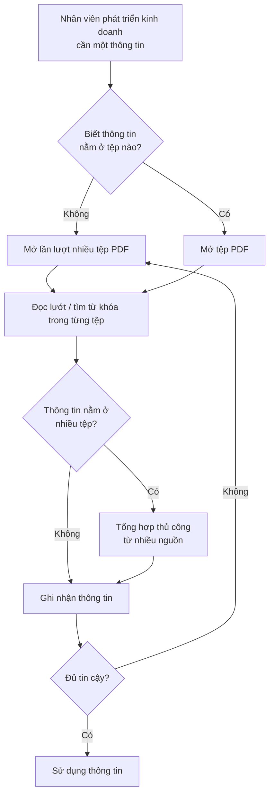
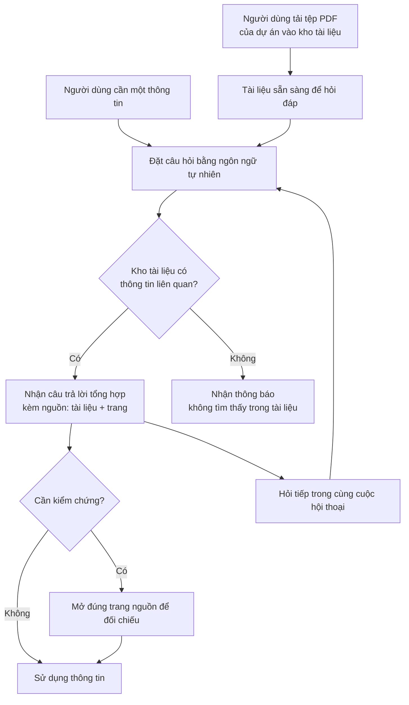

# Tài liệu Yêu cầu Nghiệp vụ (BRD) — Công cụ "Chat với tài liệu" (MVP)

> **Tiêu chuẩn áp dụng:** IEEE 29148-2018 — Kỹ thuật hệ thống và phần mềm — Quy trình vòng đời — Kỹ thuật yêu cầu
> **Giai đoạn SDLC:** 5.2 Thu thập và khám phá yêu cầu
> **Tài liệu hạ nguồn:** PRD / SRS (sẽ truy vết ngược về các mã `BR-xxx` trong tài liệu này)

---

## 0. Tóm tắt kiểm tra đầu vào

### 0.1 Đầu vào đã nhận

| Đầu vào | Tình trạng | Ghi chú |
|---|---|---|
| Brief/yêu cầu của quản lý (bối cảnh, mục tiêu MVP) | Đã nhận | SRC-001 — mô tả ngắn, chưa có số liệu |
| Định hướng "có thể bổ sung tính năng theo gợi ý của đội BA" | Đã nhận | Các tính năng đề xuất được ghi nguồn SRC-002 và cần sponsor xác nhận |
| Phỏng vấn các bên liên quan | **Chưa có** | Mọi nhu cầu người dùng hiện suy ra từ SRC-001 hoặc là đề xuất BA |
| Số liệu hiện trạng (thời gian tìm kiếm, số tài liệu, số người dùng) | **Chưa có** | Không có baseline → các chỉ số mục tiêu đều `[TBD]` |
| Chính sách bảo mật / phân loại dữ liệu nội bộ | **Chưa có** | Rủi ro chặn triển khai (xem OQ-011) |
| Ngân sách, mốc thời gian, tên sponsor/business owner | **Chưa có** | Xem OQ-012, OQ-013 |
| Template BRD nội bộ (`requirements/BRD-Template.md`) | **Không tìm thấy** trong repository | Tài liệu dùng cấu trúc Mục 4 của prompt |

### 0.2 Ba rủi ro lớn nhất đối với chất lượng yêu cầu

1. **Thiếu baseline và chỉ tiêu định lượng** — không thể chứng minh lợi ích của MVP; các yêu cầu Must BR-004, BR-013, BR-014 chưa kiểm chứng được cho đến khi OQ-001, OQ-003, OQ-005, OQ-006 được trả lời.
2. **Chưa rõ chính sách bảo mật dữ liệu** khi đưa tài liệu kinh doanh vào dịch vụ AI — có thể thay đổi toàn bộ phạm vi giải pháp (OQ-011).
3. **Nhu cầu người dùng chưa được phỏng vấn trực tiếp** — các nhu cầu SN-003, SN-005, SN-008 → SN-012 là đề xuất của BA (SRC-002), có nguy cơ không phản ánh đúng ưu tiên thực tế.

---

## 1. Kiểm soát tài liệu

| Thuộc tính | Giá trị |
|---|---|
| Tiêu đề | Tài liệu Yêu cầu Nghiệp vụ — Công cụ "Chat với tài liệu" (MVP) |
| Mã tài liệu | BRD-CWD-001 |
| Phiên bản | 0.1 |
| Trạng thái | **Draft** |
| Tác giả | Đội BA |
| Người đóng góp | [TBD: OQ-013] |
| Người rà soát | Đại diện đội phát triển kinh doanh; Trưởng nhóm kỹ thuật; Bộ phận An toàn thông tin — [TBD: OQ-013] |
| Người phê duyệt | Quản lý (người yêu cầu, Executive sponsor) — [TBD: OQ-013] |
| Phân loại bảo mật | Nội bộ |

### 1.1 Lịch sử phiên bản

| Phiên bản | Ngày | Tác giả | Tóm tắt thay đổi |
|---|---|---|---|
| 0.1 | 2026-10-19 | Đội BA | Bản nháp đầu tiên dựa trên brief của quản lý (SRC-001) và đề xuất BA (SRC-002) |

### 1.2 Danh sách phân phối

| Vai trò | Mục đích nhận |
|---|---|
| Executive sponsor (Quản lý) | Phê duyệt |
| Đại diện đội phát triển kinh doanh | Rà soát nhu cầu, xác nhận ưu tiên |
| Trưởng nhóm kỹ thuật | Rà soát tính khả thi |
| Bộ phận An toàn thông tin / Pháp chế | Rà soát ràng buộc bảo mật |

### 1.3 Quy ước ngôn ngữ chuẩn hóa

| Từ trong tài liệu | Tương đương IEEE 29148 | Ý nghĩa |
|---|---|---|
| **phải** | shall | Bắt buộc |
| **nên** | should | Mong muốn, không bắt buộc |
| **có thể** | may | Được phép, tùy chọn |

Các từ "sẽ", "cần", "được" không dùng làm động từ chuẩn hóa trong câu yêu cầu.

---

## 2. Tóm tắt điều hành

**Vấn đề.** Trong dự án kinh doanh hiện tại, thông tin quan trọng nằm rải rác trong nhiều tệp PDF. Đội phát triển kinh doanh khó nắm đầy đủ nội dung và mỗi lần cần một thông tin phải mở, đọc và tổng hợp thủ công từ nhiều tệp, gây tốn thời gian (SRC-001). Mức độ tác động định lượng (số giờ mất đi, số tài liệu, số người bị ảnh hưởng) hiện **chưa được đo** `[TBD: OQ-001, OQ-004]`.

**Thay đổi đề xuất.** Xây dựng MVP một ứng dụng web cho phép người dùng tải lên các tệp PDF của dự án và đặt câu hỏi bằng ngôn ngữ tự nhiên; AI trả lời dựa trên nội dung của toàn bộ tài liệu đã tải lên, kèm chỉ dẫn nguồn (tài liệu, trang) để người dùng kiểm chứng (SRC-001, SRC-002).

**Lợi ích kỳ vọng.** Giảm thời gian tìm kiếm thông tin (MET-001), câu trả lời đạt độ chính xác chấp nhận được (MET-002), và có dữ liệu sử dụng thực tế để quyết định đầu tư tiếp (MET-003, MET-004). Giá trị chỉ tiêu cụ thể: `[TBD: OQ-002, OQ-003, OQ-015]`.

**Đầu tư, thời gian, rủi ro.** Ngân sách và mốc thời gian: `[TBD: OQ-012]`. Rủi ro chính: AI trả lời sai (RSK-001), rò rỉ tài liệu nội bộ qua dịch vụ AI (RSK-002), chất lượng trích xuất PDF scan/bảng biểu kém (RSK-003).

**Quyết định cần từ người phê duyệt.**
1. Xác nhận phạm vi MVP tại Mục 5 và mức ưu tiên tại Mục 7.
2. Chỉ định người chịu trách nhiệm và hạn trả lời cho các câu hỏi mở chặn (OQ-001, OQ-003, OQ-010, OQ-011, OQ-012).

---

## 3. Bối cảnh nghiệp vụ và phát biểu vấn đề

### 3.1 Quy trình hiện tại

*Quy trình trên được suy ra từ mô tả trong SRC-001; chưa được xác nhận qua quan sát thực tế* `[Unverified]`.

### 3.2 Đối tượng bị ảnh hưởng

| Đối tượng | Ảnh hưởng | Bằng chứng |
|---|---|---|
| Đội phát triển kinh doanh | Mất thời gian tìm và tổng hợp thông tin; khó nắm đầy đủ nội dung tài liệu | SRC-001 |
| Quản lý dự án | Đội ngũ phản hồi chậm hơn; nguy cơ quyết định dựa trên thông tin thiếu | Suy luận `[Unverified]` |

### 3.3 Chi phí nếu không hành động

- **Chi phí thời gian:** số giờ/nhân viên/tuần dành cho việc tìm kiếm tài liệu — `[TBD: OQ-001]`.
- **Rủi ro chất lượng quyết định:** thông tin bỏ sót do không đọc hết tài liệu — `[Unverified]`, chưa có sự cố được ghi nhận.
- **Doanh thu, tuân thủ, khách hàng:** chưa có bằng chứng về tác động trực tiếp `[TBD: OQ-001]`.

### 3.4 Nguyên nhân gốc và triệu chứng

| Triệu chứng | Nguyên nhân gốc (giả thuyết) | Trạng thái |
|---|---|---|
| Tốn thời gian tìm thông tin | Không có điểm truy cập hợp nhất để tra cứu nội dung của nhiều tài liệu cùng lúc | SRC-001 |
| Khó nắm đầy đủ thông tin | Khối lượng tài liệu lớn so với thời gian đọc của nhân viên | `[Unverified]` — cần số liệu OQ-004 |
| Phải tổng hợp thủ công | Thông tin về một chủ đề phân tán qua nhiều tệp | SRC-001 |
| Phải kiểm tra lại nhiều lần | Không dễ xác định nguồn gốc của một thông tin đã tổng hợp | `[Unverified]` |

### 3.5 Lý do thực hiện ngay

Quản lý đã yêu cầu phát triển MVP (SRC-001). Hạn chót và sự kiện kích hoạt cụ thể chưa được nêu `[TBD: OQ-012]`.

### 3.6 Quy trình đề xuất (ở mức nghiệp vụ)

---

## 4. Động lực và mục tiêu nghiệp vụ

| ID | Động lực nghiệp vụ | Mục tiêu (kết quả, không phải hoạt động) | Metric ID | Baseline | Target | Thời hạn | Nguồn |
|---|---|---|---|---|---|---|---|
| BO-001 | Tiết kiệm thời gian của đội phát triển kinh doanh | Giảm thời gian để tìm được một thông tin cần thiết trong tài liệu PDF của dự án | MET-001 | [TBD: OQ-001] | [TBD: OQ-002] | [TBD: OQ-012] | SRC-001 |
| BO-002 | Nâng cao mức độ nắm bắt thông tin | Người dùng nhận được thông tin chính xác, có thể kiểm chứng được, tổng hợp từ nhiều tài liệu | MET-002 | Không áp dụng (năng lực mới) | [TBD: OQ-003] | [TBD: OQ-012] | SRC-001, SRC-002 |
| BO-003 | Ra quyết định đầu tư dựa trên bằng chứng | Xác nhận giá trị nghiệp vụ của công cụ qua MVP để quyết định đầu tư giai đoạn tiếp theo | MET-003, MET-004 | Không áp dụng (năng lực mới) | [TBD: OQ-015] | [TBD: OQ-012] | SRC-001 ("MVP") |

### 4.1 Định nghĩa chỉ số

| ID | Định nghĩa | Công thức | Nguồn dữ liệu | Chủ sở hữu | Tần suất | Ngày baseline |
|---|---|---|---|---|---|---|
| MET-001 | Thời gian trung bình từ lúc người dùng bắt đầu tìm đến lúc có được thông tin cần thiết, đo trên bộ tác vụ tìm kiếm chuẩn | Tổng thời gian hoàn thành các tác vụ ÷ số tác vụ | Bài đo có bấm giờ trên bộ tác vụ chuẩn, thực hiện trước (cách hiện tại) và sau (dùng công cụ) | Đội BA | Một lần trước MVP, một lần khi kết thúc thử nghiệm | [TBD: OQ-001] |
| MET-002 | Tỷ lệ câu trả lời được đội nghiệp vụ đánh giá là đúng **và** có trích dẫn nguồn đúng, trên bộ câu hỏi kiểm thử có đáp án | Số câu trả lời đạt ÷ tổng số câu hỏi kiểm thử × 100% | Bộ câu hỏi kiểm thử (DEP-002) | Đại diện đội phát triển kinh doanh | Mỗi bản phát hành MVP | Không áp dụng |
| MET-003 | Tỷ lệ người dùng mục tiêu sử dụng công cụ ít nhất một lần mỗi tuần trong thời gian thử nghiệm | Số người dùng hoạt động trong tuần ÷ tổng số người dùng mục tiêu × 100% | Số liệu sử dụng (BR-023) | Đội BA | Hàng tuần | Không áp dụng |
| MET-004 | Tỷ lệ câu trả lời được người dùng đánh giá "hữu ích" | Số đánh giá "hữu ích" ÷ tổng số đánh giá × 100% | Phản hồi người dùng (BR-022) | Đội BA | Hàng tuần | Không áp dụng |

---

## 5. Phạm vi

### 5.1 Trong phạm vi

- **Năng lực nghiệp vụ:** đưa tài liệu PDF vào kho; quản lý danh sách tài liệu; hỏi đáp bằng ngôn ngữ tự nhiên trên toàn bộ kho; chỉ dẫn nguồn trả lời; hội thoại nhiều lượt; thu thập phản hồi và số liệu sử dụng để đánh giá MVP.
- **Đơn vị tổ chức:** đội phát triển kinh doanh của dự án (SRC-001).
- **Kênh:** ứng dụng web (CON-001).
- **Miền dữ liệu:** tài liệu PDF của dự án kinh doanh (CON-002).
- **Địa lý:** [TBD: OQ-004].

### 5.2 Ngoài phạm vi

| Hạng mục | Lý do |
|---|---|
| Định dạng khác PDF (Word, Excel, PowerPoint, ảnh, email) | Brief chỉ yêu cầu PDF (SRC-001, CON-002) |
| Chỉnh sửa, chú thích hoặc tạo mới nội dung tài liệu gốc | Mục tiêu là truy vấn, không phải biên tập |
| Ứng dụng di động cài đặt (native app) | Brief chỉ định ứng dụng web (CON-001) |
| Trả lời dựa trên kiến thức ngoài kho tài liệu (Internet, kiến thức chung của AI) | Mâu thuẫn với BRU-003 và làm giảm khả năng kiểm chứng |
| Đưa ra quyết định thay người dùng (phê duyệt, đề xuất giá, ký kết) | Công cụ chỉ cung cấp thông tin |

### 5.3 Hoãn sang giai đoạn sau

| Hạng mục | Lý do hoãn |
|---|---|
| Đọc PDF dạng ảnh scan (cần OCR) | Chờ xác nhận tỷ lệ tài liệu scan (OQ-008, ASM-001) |
| Tích hợp với kho lưu trữ hiện có (SharePoint, Google Drive, …) | Không cần thiết để chứng minh giá trị MVP |
| Phân quyền chi tiết theo vai trò / theo tài liệu | Chờ quyết định mô hình kho chung hay riêng (OQ-010) |
| Xuất câu trả lời / chia sẻ cuộc hội thoại | Giá trị chưa được xác nhận |
| Tóm tắt tài liệu, so sánh tài liệu theo mẫu dựng sẵn | Đề xuất BA, chưa được sponsor xác nhận |

### 5.4 Ranh giới

Sáng kiến bắt đầu khi người dùng có tệp PDF trong tay và kết thúc khi người dùng nhận được câu trả lời kèm nguồn. Việc thu thập, lưu trữ chính thức và phê duyệt tài liệu gốc của dự án nằm ngoài sáng kiến này.

---

## 6. Các bên liên quan và nhu cầu

### 6.1 Các bên liên quan

| ID | Bên liên quan | Vai trò nghiệp vụ | Mối quan tâm | Ảnh hưởng | Nhu cầu | Nguồn |
|---|---|---|---|---|---|---|
| STK-001 | Quản lý (người yêu cầu) | Executive sponsor, người phê duyệt | Hiệu quả đội ngũ; bằng chứng giá trị trước khi đầu tư thêm | Cao | SN-006 | SRC-001 |
| STK-002 | Đội phát triển kinh doanh | Người dùng chính | Tìm thông tin nhanh, đầy đủ, đáng tin cậy | Cao | SN-001, SN-002, SN-003, SN-004, SN-005, SN-008, SN-009, SN-012 | SRC-001 |
| STK-003 | Đội BA | Phân tích yêu cầu, đánh giá MVP | Đo được kết quả MVP | Trung bình | SN-010 | SRC-001 |
| STK-004 | Đội kỹ thuật / vận hành | Xây dựng và vận hành công cụ | Phạm vi khả thi; chi phí vận hành kiểm soát được | Trung bình | SN-011 | `[Unverified]` — suy ra từ việc phải xây dựng MVP |
| STK-005 | Bộ phận An toàn thông tin / Pháp chế | Kiểm soát rủi ro dữ liệu; **có thể chặn triển khai** | Tài liệu nội bộ không bị lộ, không bị dùng sai mục đích | Cao | SN-007 | `[Unverified]` — cần xác nhận sự tồn tại và vai trò (OQ-011) |

### 6.2 Nhu cầu của các bên liên quan

| ID | Bên liên quan | Phát biểu nhu cầu | Khó khăn hiện tại | Bằng chứng | Ưu tiên |
|---|---|---|---|---|---|
| SN-001 | STK-002 | "Tôi cần tìm được thông tin mình cần mà không phải đọc từng tệp PDF." | Mở và đọc thủ công nhiều tệp | SRC-001 | Must |
| SN-002 | STK-002 | "Tôi muốn hỏi bằng câu hỏi thông thường và nhận câu trả lời đã tổng hợp từ tất cả tài liệu liên quan." | Phải tự tổng hợp từ nhiều nguồn | SRC-001 | Must |
| SN-003 | STK-002 | "Tôi cần biết câu trả lời lấy từ tài liệu nào, trang nào để kiểm tra lại." | Khó truy lại nguồn của thông tin đã tổng hợp | SRC-002 | Must |
| SN-004 | STK-002 | "Tôi cần tự đưa tài liệu PDF mới vào để có thể hỏi về nó." | — | SRC-001 | Must |
| SN-005 | STK-002 | "Tôi cần biết kho hiện có những tài liệu nào và loại bỏ tài liệu đã lỗi thời." | Không rõ thông tin đang dựa trên phiên bản tài liệu nào | SRC-002 | Should |
| SN-006 | STK-001 | "Tôi cần một MVP để đánh giá công cụ có đáng đầu tư tiếp hay không." | Chưa có bằng chứng giá trị | SRC-001 | Must |
| SN-007 | STK-005 | "Tài liệu kinh doanh chỉ được người có quyền truy cập và không bị dùng ngoài mục đích dự án." | Chưa có chính sách cho việc dùng AI với tài liệu nội bộ | SRC-002 `[Unverified]` | Must |
| SN-008 | STK-002 | "Tôi muốn hỏi tiếp dựa trên câu trả lời trước mà không phải nhắc lại bối cảnh." | — | SRC-002 | Should |
| SN-009 | STK-002 | "Khi tài liệu không có thông tin, tôi cần được báo rõ thay vì nhận câu trả lời bịa." | — | SRC-002 | Must |
| SN-010 | STK-003 | "Tôi cần dữ liệu sử dụng và phản hồi của người dùng để đánh giá MVP." | Không có số liệu | SRC-002 | Should |
| SN-011 | STK-004 | "Chi phí sử dụng dịch vụ AI cần nằm trong ngân sách được duyệt." | — | `[Unverified]` | Should |
| SN-012 | STK-002 | "Đôi khi tôi chỉ muốn hỏi trong một vài tài liệu cụ thể." | Câu trả lời có thể lẫn thông tin từ tài liệu không liên quan | SRC-002 | Could |

---

## 7. Yêu cầu nghiệp vụ

Thang ưu tiên: **Must** (thiếu thì sáng kiến thất bại), **Should** (giá trị đáng kể, có cách làm thay thế), **Could** (mong muốn), **Won't** (loại trừ trong phiên bản này). Không áp dụng thang 1–5 vì không có template nội bộ.

### 7.1 Nhóm A — Nạp và quản lý tài liệu

| ID | Yêu cầu | Lý do | Nguồn | Ưu tiên | Tiêu chí chấp nhận | Phương pháp kiểm chứng | Trạng thái |
|---|---|---|---|---|---|---|---|
| BR-001 | Người dùng được cấp quyền **phải** có khả năng đưa một tệp PDF vào kho tài liệu của dự án. | Không có tài liệu thì không có gì để hỏi | BO-001 / SN-004 | Must | AC-001: Người dùng thử nghiệm đưa thành công 1 tệp PDF hợp lệ; tệp xuất hiện trong kho và hỏi được nội dung của nó | Demonstration | Draft |
| BR-002 | Người dùng được cấp quyền **nên** có khả năng đưa nhiều tệp PDF vào kho trong một lần thao tác. | Giảm công sức khi nạp bộ tài liệu ban đầu | SN-004 | Should | AC-002: Đưa đồng thời 10 tệp PDF hợp lệ trong một thao tác; cả 10 tệp đều có trạng thái "Sẵn sàng" | Demonstration | Draft |
| BR-003 | Sau khi đưa một tệp vào, người dùng **phải** được thông báo trạng thái xử lý của tệp đó: Đang xử lý, Sẵn sàng, hoặc Thất bại kèm lý do. | Người dùng cần biết khi nào có thể hỏi về tài liệu | SN-004 | Must | AC-003: Với 1 tệp hợp lệ và 1 tệp bị lỗi, người dùng thấy đúng trạng thái của từng tệp; tệp lỗi hiển thị lý do bằng tiếng Việt | Test | Draft |
| BR-004 | Một tệp PDF hợp lệ có kích thước trong giới hạn BRU-002 **phải** sẵn sàng để hỏi đáp trong vòng [TBD: OQ-005] phút kể từ khi người dùng đưa vào. | Độ trễ lớn làm mất giá trị so với tự đọc | BO-001 / SN-001 | Must | AC-004: Trên 20 tệp mẫu ở kích thước giới hạn, ≥ 95% tệp đạt trạng thái "Sẵn sàng" trong thời hạn đã chốt | Test | Draft — chặn bởi OQ-005 |
| BR-005 | Khi người dùng đưa vào một tệp không phải PDF hoặc vượt giới hạn BRU-002, tệp đó **phải** bị từ chối kèm lý do cụ thể. | Tránh nội dung không xử lý được làm sai kết quả | SN-004 | Must | AC-005: Tệp .docx và tệp PDF vượt giới hạn đều bị từ chối, mỗi tệp hiển thị đúng lý do; kho không thay đổi | Test | Draft |
| BR-006 | Người dùng được cấp quyền **phải** xem được danh sách tài liệu trong kho, gồm tên tệp, ngày đưa vào và người đưa vào. | Người dùng cần biết câu trả lời dựa trên tập tài liệu nào | SN-005 | Should | AC-006: Sau khi đưa 3 tệp, danh sách hiển thị đủ 3 tệp với đúng 3 thông tin nêu trên | Demonstration | Draft |
| BR-007 | Người dùng được cấp quyền **nên** có khả năng loại bỏ một tài liệu khỏi kho. | Tài liệu lỗi thời làm sai câu trả lời | SN-005 | Should | AC-007: Sau khi loại bỏ tài liệu X, tài liệu X không còn trong danh sách | Demonstration | Draft |
| BR-008 | Sau khi một tài liệu bị loại bỏ, nội dung của tài liệu đó **phải** không còn được dùng làm nguồn cho bất kỳ câu trả lời nào. | Đảm bảo việc loại bỏ có hiệu lực thực sự | SN-005, SN-007 | Should | AC-008: Một câu hỏi chỉ có đáp án trong tài liệu X, hỏi sau khi X bị loại bỏ, nhận thông báo "không tìm thấy" (BR-013) | Test | Draft |

### 7.2 Nhóm B — Hỏi đáp trên tài liệu

| ID | Yêu cầu | Lý do | Nguồn | Ưu tiên | Tiêu chí chấp nhận | Phương pháp kiểm chứng | Trạng thái |
|---|---|---|---|---|---|---|---|
| BR-009 | Người dùng được cấp quyền **phải** có khả năng đặt câu hỏi bằng ngôn ngữ tự nhiên tiếng Việt về nội dung các tài liệu trong kho. | Năng lực cốt lõi của sáng kiến | BO-001 / SN-002 | Must | AC-009: 100% câu hỏi trong bộ kiểm thử (DEP-002) nhập được và nhận phản hồi | Test | Draft |
| BR-010 | Câu trả lời **phải** được tổng hợp từ tất cả tài liệu trong kho có chứa thông tin liên quan, không giới hạn ở một tài liệu. | Thông tin phân tán qua nhiều tệp là nguyên nhân gốc | BO-002 / SN-002 | Must | AC-010: Với ≥ 10 câu hỏi kiểm thử có đáp án nằm ở ≥ 2 tài liệu, ≥ [TBD: OQ-003]% câu trả lời bao gồm thông tin từ đủ các tài liệu đó | Test | Draft — chặn bởi OQ-003 |
| BR-011 | Mỗi câu trả lời **phải** chỉ rõ tên tài liệu nguồn và số trang của từng thông tin được sử dụng. | Cho phép người dùng kiểm chứng; giảm rủi ro RSK-001 | BO-002 / SN-003 | Must | AC-011: 100% câu trả lời có nội dung trong bộ kiểm thử có trích dẫn; ≥ 95% trích dẫn trỏ đúng tài liệu và trang chứa thông tin | Test + Inspection | Draft |
| BR-012 | Người dùng **nên** có khả năng mở trực tiếp trang tài liệu được trích dẫn từ câu trả lời. | Giảm thời gian kiểm chứng | SN-003 | Should | AC-012: Từ một trích dẫn, người dùng mở được đúng trang của tài liệu nguồn trong 1 thao tác | Demonstration | Draft |
| BR-013 | Khi kho tài liệu không chứa thông tin để trả lời câu hỏi, người dùng **phải** nhận thông báo rằng thông tin không có trong tài liệu, thay vì một câu trả lời không có nguồn. | Ngăn câu trả lời bịa đặt dẫn đến quyết định sai | BO-002 / SN-009 | Must | AC-013: Với ≥ 10 câu hỏi kiểm thử không có đáp án trong kho, ≥ 90% nhận thông báo "không tìm thấy" | Test | Draft |
| BR-014 | Câu trả lời đúng và có trích dẫn đúng **phải** đạt tỷ lệ ≥ [TBD: OQ-003]% trên bộ câu hỏi kiểm thử được đội phát triển kinh doanh phê duyệt. | Độ chính xác quyết định niềm tin và mức sử dụng | BO-002 / SN-002 | Must | AC-014: MET-002 đo trên bộ câu hỏi kiểm thử đạt ngưỡng đã chốt | Test | Draft — chặn bởi OQ-003, DEP-002 |
| BR-015 | ≥ 90% câu hỏi **phải** nhận được câu trả lời hoàn chỉnh trong vòng [TBD: OQ-006] giây kể từ khi gửi, với kho có quy mô theo ASM-003. | Thời gian chờ dài làm mất lợi ích so với tự tìm | BO-001 / SN-001 | Must | AC-015: Đo trên toàn bộ bộ câu hỏi kiểm thử, phân vị 90 của thời gian phản hồi ≤ ngưỡng đã chốt | Test | Draft — chặn bởi OQ-006 |
| BR-016 | Người dùng **nên** có khả năng đặt câu hỏi tiếp nối dựa trên các câu hỏi và câu trả lời trước đó trong cùng cuộc hội thoại. | Hỏi đáp tự nhiên, không phải nhắc lại bối cảnh | SN-008 | Should | AC-016: Với 5 chuỗi hỏi 2 lượt (lượt 2 dùng đại từ thay thế chủ đề lượt 1), ≥ 4 chuỗi nhận câu trả lời lượt 2 đúng chủ đề | Test | Draft |
| BR-017 | Người dùng **có thể** giới hạn phạm vi câu hỏi vào một hoặc nhiều tài liệu do mình chọn. | Tránh lẫn thông tin từ tài liệu không liên quan | SN-012 | Could | AC-017: Khi chọn tài liệu A, mọi trích dẫn trong câu trả lời chỉ trỏ đến tài liệu A | Test | Draft |
| BR-018 | Người dùng **có thể** xem lại các cuộc hội thoại trước của chính mình. | Tránh hỏi lại câu đã hỏi | SN-001 | Could | AC-018: Sau khi đăng xuất và đăng nhập lại, người dùng thấy cuộc hội thoại trước với đầy đủ câu hỏi và câu trả lời | Demonstration | Draft — phụ thuộc OQ-014 |
| BR-019 | Người dùng **có thể** đặt câu hỏi bằng tiếng Anh về nội dung tài liệu. | Tài liệu dự án có thể bằng tiếng Anh | SN-002 | Could | AC-019: Với 10 câu hỏi tiếng Anh trong bộ kiểm thử, tỷ lệ đạt tương đương ngưỡng BR-014 | Test | Draft — phụ thuộc OQ-009 |

### 7.3 Nhóm C — Bảo mật và kiểm soát truy cập

| ID | Yêu cầu | Lý do | Nguồn | Ưu tiên | Tiêu chí chấp nhận | Phương pháp kiểm chứng | Trạng thái |
|---|---|---|---|---|---|---|---|
| BR-020 | Chỉ người dùng được cấp quyền **phải** truy cập được ứng dụng, tài liệu trong kho và nội dung hội thoại. | Tài liệu kinh doanh là thông tin nội bộ | SN-007 | Must | AC-020: Người không có quyền không xem được danh sách tài liệu, nội dung tài liệu hay câu trả lời qua bất kỳ đường truy cập nào được kiểm thử | Test | Draft |
| BR-021 | Nội dung tài liệu và hội thoại **phải** không được bên cung cấp dịch vụ AI dùng để huấn luyện mô hình. | Tránh rò rỉ thông tin kinh doanh ra ngoài | SN-007 | Must | AC-021: Điều khoản hợp đồng / điều khoản dịch vụ của nhà cung cấp AI được Bộ phận An toàn thông tin xác nhận đáp ứng điều kiện này | Inspection | Draft — `[Unverified]`, phụ thuộc OQ-011 |
| BR-022 | Mỗi lần đưa vào hoặc loại bỏ tài liệu **nên** được ghi nhận gồm người thực hiện, thời điểm và tên tài liệu. | Truy vết thay đổi của kho | SN-005, SN-007 | Should | AC-022: Sau 3 thao tác đưa vào và 1 thao tác loại bỏ, nhật ký có đủ 4 bản ghi với đúng 3 thông tin | Inspection | Draft |

### 7.4 Nhóm D — Đánh giá MVP

| ID | Yêu cầu | Lý do | Nguồn | Ưu tiên | Tiêu chí chấp nhận | Phương pháp kiểm chứng | Trạng thái |
|---|---|---|---|---|---|---|---|
| BR-023 | Người dùng **nên** có khả năng đánh giá từng câu trả lời là "hữu ích" hoặc "không hữu ích". | Nguồn dữ liệu cho MET-004 | BO-003 / SN-010 | Should | AC-023: Đánh giá trên một câu trả lời được ghi nhận và xuất hiện trong số liệu BR-024 | Demonstration | Draft |
| BR-024 | Đội BA **nên** có khả năng lấy số liệu sử dụng theo tuần: số câu hỏi, số người dùng hoạt động, tỷ lệ đánh giá "hữu ích". | Nguồn dữ liệu cho MET-003, MET-004 và quyết định BO-003 | BO-003 / SN-006, SN-010 | Should | AC-024: Số liệu 1 tuần thử nghiệm khớp với số lượng thao tác thực tế đã thực hiện trong kịch bản kiểm thử | Test | Draft |
| BR-025 | Chi phí sử dụng dịch vụ AI trong thời gian thử nghiệm MVP **nên** không vượt [TBD: OQ-012] mỗi tháng. | Kiểm soát chi phí vận hành | SN-011 | Should | AC-025: Hóa đơn/báo cáo chi phí các tháng thử nghiệm ≤ ngưỡng đã chốt | Analysis | Draft — chặn bởi OQ-012 |

---

## 8. Quy tắc nghiệp vụ

| ID | Quy tắc | Loại | Phạm vi | Người chịu trách nhiệm thực thi | Nguồn |
|---|---|---|---|---|---|
| BRU-001 | Trong MVP, chỉ tệp PDF có lớp văn bản (không phải ảnh scan) được bảo đảm hỏi đáp chính xác. | Decision | Nạp tài liệu | Product owner | SRC-002 `[Unverified]` — OQ-008 |
| BRU-002 | Một tệp PDF được đưa vào không vượt quá [TBD: OQ-007] MB và [TBD: OQ-007] trang. | Decision | Nạp tài liệu | Product owner | OQ-007 |
| BRU-003 | Câu trả lời chỉ được dựa trên nội dung các tài liệu trong kho; không dùng kiến thức bên ngoài kho. | Policy | Hỏi đáp | Product owner | SRC-002 |
| BRU-004 | Tài liệu thuộc mức phân loại bảo mật [TBD: OQ-011] trở lên không được đưa vào công cụ. | Policy | Nạp tài liệu | Bộ phận An toàn thông tin | OQ-011 |
| BRU-005 | Mọi người dùng được cấp quyền dùng chung một kho tài liệu của dự án. | Decision | Toàn bộ | Executive sponsor | `[Unverified]` — đề xuất mặc định cho MVP, chờ OQ-010 |
| BRU-006 | Tài liệu và lịch sử hội thoại được lưu giữ trong [TBD: OQ-014] rồi xóa. | Policy | Lưu trữ | Bộ phận An toàn thông tin | OQ-014 |

---

## 9. Ràng buộc

| ID | Ràng buộc | Loại | Bên áp đặt | Tác động | Nguồn |
|---|---|---|---|---|---|
| CON-001 | Công cụ là ứng dụng web. | Technical | Executive sponsor | Loại trừ ứng dụng cài đặt trên máy/di động | SRC-001 |
| CON-002 | Định dạng tài liệu đầu vào là PDF. | Technical | Executive sponsor | Loại trừ định dạng khác trong MVP | SRC-001 |
| CON-003 | Câu trả lời do AI tạo ra từ nội dung tài liệu. | Technical | Executive sponsor | Phải quản lý rủi ro độ chính xác (RSK-001) và rủi ro dữ liệu (RSK-002) | SRC-001 |
| CON-004 | Sản phẩm giai đoạn này là MVP. | Organizational | Executive sponsor | Phạm vi tối thiểu đủ chứng minh giá trị; nhiều hạng mục bị hoãn (Mục 5.3) | SRC-001 |
| CON-005 | Ngân sách và thời hạn MVP: [TBD: OQ-012]. | Budget / Time | Executive sponsor | Quyết định số yêu cầu Should/Could được đưa vào | OQ-012 |
| CON-006 | Việc xử lý tài liệu có dữ liệu cá nhân phải tuân thủ quy định pháp luật Việt Nam về bảo vệ dữ liệu cá nhân và chính sách bảo mật nội bộ. | Regulatory / Legal | Pháp luật; Bộ phận Pháp chế | Có thể giới hạn nơi lưu trữ/xử lý và nhà cung cấp AI được phép | SRC-004 `[Unverified]` — phạm vi áp dụng chờ OQ-011 |

---

## 10. Giả định, phụ thuộc và rủi ro

| ID | Hạng mục | Loại | Mô tả | Tác động nếu sai | Người chịu trách nhiệm | Kiểm chứng / giảm thiểu | Hạn |
|---|---|---|---|---|---|---|---|
| ASM-001 | PDF chủ yếu có lớp văn bản | Assumption | Phần lớn tài liệu dự án là PDF xuất từ phần mềm soạn thảo, không phải scan | Nhiều tài liệu không hỏi được; cần đưa OCR vào MVP | Đội BA | Khảo sát mẫu tài liệu thực tế (OQ-008) | 2026-10-30 |
| ASM-002 | Ngôn ngữ tài liệu | Assumption | Tài liệu chủ yếu bằng tiếng Việt và/hoặc tiếng Anh | Chất lượng trả lời giảm với ngôn ngữ khác | Đội BA | Khảo sát mẫu tài liệu (OQ-009) | 2026-10-30 |
| ASM-003 | Quy mô kho | Assumption | Số tài liệu, tổng số trang và số người dùng ở mức [TBD: OQ-004] | BR-004, BR-015 có thể không đạt ở quy mô lớn hơn | Đội BA | Thu thập số liệu từ đội phát triển kinh doanh | 2026-10-30 |
| ASM-004 | Truy cập | Assumption | Người dùng có trình duyệt web và kết nối mạng tới ứng dụng | Người dùng không truy cập được | Đội kỹ thuật | Xác nhận môi trường làm việc | 2026-11-06 |
| ASM-005 | Được phép dùng dịch vụ AI bên ngoài | Assumption | Tổ chức cho phép gửi nội dung tài liệu (không thuộc BRU-004) tới dịch vụ AI bên ngoài | Phải dùng AI triển khai nội bộ → thay đổi chi phí, thời gian | Bộ phận ATTT | Xin ý kiến chính thức (OQ-011) | 2026-10-30 |
| DEP-001 | Phê duyệt bảo mật | Dependency | Bộ phận ATTT/Pháp chế phê duyệt việc dùng AI với tài liệu dự án | Không thể triển khai cho người dùng thật | Executive sponsor | Theo dõi trong cuộc họp hàng tuần | 2026-11-06 |
| DEP-002 | Bộ kiểm thử nghiệp vụ | Dependency | Đội phát triển kinh doanh cung cấp bộ tài liệu mẫu và ≥ 50 câu hỏi có đáp án và vị trí nguồn, trong đó ≥ 10 câu không có đáp án trong kho và ≥ 10 câu có đáp án ở ≥ 2 tài liệu | Không kiểm chứng được BR-010, BR-011, BR-013, BR-014 | Đại diện đội phát triển kinh doanh | Lên lịch workshop xây dựng bộ câu hỏi | 2026-11-13 |
| DEP-003 | Ngân sách dịch vụ AI | Dependency | Ngân sách chi phí sử dụng dịch vụ AI trong thời gian thử nghiệm được duyệt | Không thể vận hành thử nghiệm | Executive sponsor | Đưa vào quyết định OQ-012 | 2026-10-30 |
| RSK-001 | AI trả lời sai | Risk | AI diễn giải sai hoặc bịa nội dung → người dùng tin câu trả lời sai → quyết định kinh doanh sai | Cao | Product owner | BR-011 (trích dẫn), BR-013 (báo không tìm thấy), BRU-003; kiểm thử BR-014; hướng dẫn người dùng kiểm chứng thông tin quan trọng | Liên tục |
| RSK-002 | Rò rỉ tài liệu | Risk | Tài liệu nội bộ được gửi tới dịch vụ bên ngoài hoặc người không có quyền → thông tin kinh doanh bị lộ → thiệt hại thương mại/pháp lý | Cao | Bộ phận ATTT | BR-020, BR-021, BRU-004; DEP-001 trước khi dùng tài liệu thật | 2026-11-06 |
| RSK-003 | Trích xuất PDF kém | Risk | Tài liệu scan, bảng biểu, biểu đồ phức tạp → nội dung đọc sai/thiếu → câu trả lời thiếu chính xác | Trung bình | Đội kỹ thuật | Khảo sát ASM-001; đưa tài liệu khó vào DEP-002; BR-003 báo lỗi rõ ràng | 2026-11-13 |
| RSK-004 | Người dùng không chấp nhận | Risk | Câu trả lời chậm hoặc không đáng tin → người dùng quay lại cách cũ → MVP không chứng minh được giá trị | Trung bình | Executive sponsor | Đưa đại diện người dùng vào kiểm thử sớm; theo dõi MET-003, MET-004 | Trong thử nghiệm |
| RSK-005 | Vượt chi phí | Risk | Số câu hỏi/tài liệu tăng ngoài dự kiến → chi phí dịch vụ AI vượt ngân sách | Trung bình | Đội kỹ thuật | BR-025; theo dõi chi phí hàng tuần | Trong thử nghiệm |
| RSK-006 | Thiếu baseline | Risk | Không đo MET-001 trước MVP → không chứng minh được BO-001 → quyết định đầu tư thiếu căn cứ | Cao | Đội BA | Đo baseline trước khi phát hành MVP (OQ-001) | 2026-11-13 |

---

## 11. Truy vết

### 11.1 Ma trận truy vết

| Mục tiêu nghiệp vụ | Nhu cầu | Yêu cầu nghiệp vụ | Tiêu chí chấp nhận | Mã PRD/SRS hạ nguồn |
|---|---|---|---|---|
| BO-001 | SN-004 | BR-001 | AC-001 | [TBD] |
| BO-001 | SN-004 | BR-002 | AC-002 | [TBD] |
| BO-001 | SN-004 | BR-003 | AC-003 | [TBD] |
| BO-001 | SN-001 | BR-004 | AC-004 | [TBD] |
| BO-001 | SN-004 | BR-005 | AC-005 | [TBD] |
| BO-002 | SN-005 | BR-006 | AC-006 | [TBD] |
| BO-002 | SN-005 | BR-007 | AC-007 | [TBD] |
| BO-002 | SN-005, SN-007 | BR-008 | AC-008 | [TBD] |
| BO-001 | SN-002 | BR-009 | AC-009 | [TBD] |
| BO-002 | SN-002 | BR-010 | AC-010 | [TBD] |
| BO-002 | SN-003 | BR-011 | AC-011 | [TBD] |
| BO-002 | SN-003 | BR-012 | AC-012 | [TBD] |
| BO-002 | SN-009 | BR-013 | AC-013 | [TBD] |
| BO-002 | SN-002 | BR-014 | AC-014 | [TBD] |
| BO-001 | SN-001 | BR-015 | AC-015 | [TBD] |
| BO-001 | SN-008 | BR-016 | AC-016 | [TBD] |
| BO-002 | SN-012 | BR-017 | AC-017 | [TBD] |
| BO-001 | SN-001 | BR-018 | AC-018 | [TBD] |
| BO-001 | SN-002 | BR-019 | AC-019 | [TBD] |
| BO-003 | SN-007 | BR-020 | AC-020 | [TBD] |
| BO-003 | SN-007 | BR-021 | AC-021 | [TBD] |
| BO-002 | SN-005, SN-007 | BR-022 | AC-022 | [TBD] |
| BO-003 | SN-010 | BR-023 | AC-023 | [TBD] |
| BO-003 | SN-006, SN-010 | BR-024 | AC-024 | [TBD] |
| BO-003 | SN-011 | BR-025 | AC-025 | [TBD] |

*Ghi chú:* BR-020, BR-021 gắn với BO-003 vì phê duyệt bảo mật là điều kiện tiên quyết để MVP được dùng với tài liệu thật và thu được bằng chứng giá trị.

### 11.2 Báo cáo độ phủ

| Kiểm tra | Kết quả |
|---|---|
| Mục tiêu không có yêu cầu | Không có — BO-001, BO-002, BO-003 đều có ≥ 3 yêu cầu |
| Yêu cầu mồ côi (không có mục tiêu/nhu cầu) | Không có |
| Nhu cầu không có yêu cầu | Không có — SN-001 → SN-012 đều được bao phủ (SN-006 qua BR-024) |
| Yêu cầu thiếu tiêu chí chấp nhận / phương pháp kiểm chứng | Không có về cấu trúc; **tuy nhiên** AC-004, AC-010, AC-014, AC-015, AC-025 chứa ngưỡng `[TBD]` nên chưa quyết định được khách quan cho đến khi OQ-003, OQ-005, OQ-006, OQ-012 được trả lời |

---

## 12. Câu hỏi mở và quyết định

Các hạn "Cần trước" là đề xuất của BA, cần sponsor xác nhận.

| ID | Câu hỏi / quyết định cần đưa ra | Lý do quan trọng | Người chịu trách nhiệm | Cần trước | Trạng thái | Kết luận |
|---|---|---|---|---|---|---|
| OQ-001 | Hiện tại một nhân viên mất trung bình bao lâu để tìm một thông tin trong tài liệu PDF dự án, và bao nhiêu giờ mỗi tuần? | Baseline cho MET-001, BO-001; định lượng chi phí nếu không hành động | Đội BA + đại diện đội phát triển kinh doanh | 2026-11-13 | Open | — |
| OQ-002 | Mức giảm thời gian tìm kiếm nào được coi là thành công? | Target cho MET-001 | Executive sponsor | 2026-11-13 | Open | — |
| OQ-003 | Ngưỡng tỷ lệ câu trả lời đúng tối thiểu chấp nhận được là bao nhiêu? | Chặn BR-010, BR-014 | Executive sponsor + đội phát triển kinh doanh | 2026-10-30 | Open | — |
| OQ-004 | Số tài liệu, tổng số trang, tốc độ tài liệu mới mỗi tháng, số người dùng và địa điểm làm việc dự kiến? | Xác định quy mô (ASM-003), ảnh hưởng BR-004, BR-015, chi phí | Đội BA | 2026-10-30 | Open | — |
| OQ-005 | Thời gian tối đa chấp nhận được từ khi đưa tài liệu vào đến khi hỏi được là bao nhiêu? | Chặn BR-004 | Đại diện đội phát triển kinh doanh | 2026-10-30 | Open | — |
| OQ-006 | Thời gian chờ câu trả lời tối đa chấp nhận được là bao nhiêu giây? | Chặn BR-015 | Đại diện đội phát triển kinh doanh | 2026-10-30 | Open | — |
| OQ-007 | Giới hạn kích thước (MB) và số trang cho một tệp PDF là bao nhiêu? | Chặn BRU-002, BR-004, BR-005 | Product owner + đội kỹ thuật | 2026-11-06 | Open | — |
| OQ-008 | Tỷ lệ tài liệu PDF dạng scan là bao nhiêu? Có cần hỗ trợ trong MVP không? | Xác nhận ASM-001, BRU-001; có thể thay đổi phạm vi | Đội BA | 2026-10-30 | Open | — |
| OQ-009 | Tài liệu và câu hỏi dùng những ngôn ngữ nào? | Xác định ưu tiên BR-019, ASM-002 | Đội BA | 2026-10-30 | Open | — |
| OQ-010 | Kho tài liệu dùng chung cho cả đội hay riêng từng người dùng? Có cần giới hạn quyền xem theo tài liệu không? | Xác nhận BRU-005; ảnh hưởng BR-006, BR-007, BR-020 | Executive sponsor | 2026-10-30 | Open | — |
| OQ-011 | Chính sách bảo mật có cho phép gửi tài liệu dự án tới dịch vụ AI bên ngoài không? Mức phân loại nào bị cấm? Có áp dụng quy định bảo vệ dữ liệu cá nhân không? | Có thể thay đổi toàn bộ giải pháp; chặn BR-021, BRU-004, CON-006 | Bộ phận ATTT / Pháp chế | 2026-10-30 | Open | — |
| OQ-012 | Ngân sách (bao gồm chi phí dịch vụ AI hàng tháng) và hạn chót của MVP là gì? | Chặn CON-005, BR-025; quyết định phạm vi Should/Could | Executive sponsor | 2026-10-30 | Open | — |
| OQ-013 | Tên Executive sponsor, Business owner, Product owner và những người rà soát? | Hoàn thiện kiểm soát tài liệu và phê duyệt | Executive sponsor | 2026-10-23 | Open | — |
| OQ-014 | Tài liệu và lịch sử hội thoại được lưu giữ trong bao lâu? | Chặn BRU-006; ảnh hưởng BR-018 | Bộ phận ATTT | 2026-11-06 | Open | — |
| OQ-015 | Tiêu chí nào để quyết định đầu tư giai đoạn tiếp theo sau MVP (ngưỡng MET-003, MET-004, thời gian thử nghiệm)? | Target cho BO-003 | Executive sponsor | 2026-11-13 | Open | — |

---

## 13. Thuật ngữ và tài liệu tham chiếu

### 13.1 Thuật ngữ

| Thuật ngữ | Định nghĩa |
|---|---|
| AI | Trí tuệ nhân tạo; trong tài liệu này là mô hình ngôn ngữ dùng để hiểu câu hỏi và tạo câu trả lời từ nội dung tài liệu |
| BRD | Business Requirements Document — Tài liệu yêu cầu nghiệp vụ |
| Bộ câu hỏi kiểm thử | Tập câu hỏi do đội nghiệp vụ soạn, kèm đáp án đúng và vị trí nguồn, dùng để đo MET-002 (DEP-002) |
| Câu trả lời đúng | Câu trả lời mà người chấm thuộc đội phát triển kinh doanh xác nhận khớp với đáp án trong bộ câu hỏi kiểm thử về nội dung, không mâu thuẫn và không thiếu ý chính |
| Hội thoại | Chuỗi các câu hỏi và câu trả lời liên tiếp của một người dùng, trong đó câu hỏi sau có thể tham chiếu câu trước |
| Kho tài liệu | Tập hợp các tệp PDF đã được đưa vào công cụ và sẵn sàng để hỏi đáp |
| MVP | Minimum Viable Product — Sản phẩm khả dụng tối thiểu, đủ để kiểm chứng giá trị với người dùng thật |
| OCR | Nhận dạng ký tự quang học — chuyển ảnh chụp/scan văn bản thành văn bản đọc được bởi máy |
| PDF có lớp văn bản | Tệp PDF mà nội dung chữ có thể chọn/sao chép được (thường xuất từ phần mềm soạn thảo), khác với PDF chỉ chứa ảnh scan |
| PRD / SRS | Product Requirements Document / Software Requirements Specification — tài liệu yêu cầu sản phẩm / đặc tả yêu cầu phần mềm ở hạ nguồn |
| Người dùng được cấp quyền | Người được Executive sponsor (hoặc người được ủy quyền) cho phép sử dụng công cụ |
| Trích dẫn | Chỉ dẫn tên tài liệu và số trang mà một thông tin trong câu trả lời được lấy ra |
| ATTT | An toàn thông tin |

### 13.2 Nguồn bằng chứng và tài liệu tham chiếu

| Source ID | Nguồn | Loại | Chủ sở hữu | Ngày / Phiên bản | Chứng minh điều gì |
|---|---|---|---|---|---|
| SRC-001 | Yêu cầu của quản lý về MVP "Chat với tài liệu" (Mục 2.1 của `BRD_Prompt_IEEE_standard.md`) | Brief của sponsor | Quản lý [TBD: OQ-013] | v1.0, nhận ngày 2026-10-19 | Vấn đề nghiệp vụ, mục tiêu MVP, ràng buộc web/PDF/AI |
| SRC-002 | Phân tích và đề xuất của đội BA (tài liệu này) | Phân tích BA | Đội BA | 2026-10-19 | Các nhu cầu và tính năng bổ sung — **cần sponsor xác nhận** |
| SRC-003 | IEEE 29148-2018, Systems and software engineering — Life cycle processes — Requirements engineering | Tiêu chuẩn | IEEE | 2018 | Cấu trúc và tiêu chí chất lượng yêu cầu |
| SRC-004 | Quy định pháp luật Việt Nam về bảo vệ dữ liệu cá nhân | Văn bản pháp luật | Nhà nước | [TBD: OQ-011] | Ràng buộc CON-006 — `[Unverified]`, phạm vi áp dụng cần Pháp chế xác nhận |

---

## 14. Phê duyệt

| Vai trò | Họ tên | Quyết định | Chữ ký / ngày |
|---|---|---|---|
| Executive sponsor | [TBD: OQ-013] | [Phê duyệt / Phê duyệt có điều kiện / Từ chối] | |
| Business owner | [TBD: OQ-013] | [Phê duyệt / Từ chối] | |
| Product manager / Product owner | [TBD: OQ-013] | [Phê duyệt / Từ chối] | |
| An toàn thông tin / Pháp chế | [TBD: OQ-013] | [Phê duyệt / Từ chối] | |

**Phiên bản đề nghị làm baseline:** chưa có — bản 0.1 dùng để rà soát.
**Điều kiện phê duyệt đề xuất:** OQ-003, OQ-005, OQ-006, OQ-011, OQ-012 được trả lời và các ngưỡng `[TBD]` trong BR-004, BR-010, BR-014, BR-015, BR-021 được cập nhật.

---

## 15. Phụ lục

### 15.1 Kết quả kiểm tra theo checklist (Mục 5 của prompt)

**Chất lượng yêu cầu**

| Kiểm tra | Kết quả | Ghi chú |
|---|---|---|
| Mọi yêu cầu dùng cú pháp "phải/nên/có thể" và chỉ có một nghĩa vụ | Đạt | |
| Không có ngôn ngữ thiết kế giải pháp | Đạt | Web, PDF, AI được ghi nhận là ràng buộc (CON-001 → CON-003) |
| Định lượng ở những chỗ ảnh hưởng đến chấp nhận | **Chưa đạt** | BR-004, BR-010, BR-014, BR-015, BR-025 còn ngưỡng `[TBD]` |
| Không còn từ mơ hồ (nhanh, dễ dùng, …) | Đạt | |
| Thuật ngữ chuyên biệt có trong bảng thuật ngữ | Đạt | |
| Không trùng lặp / mâu thuẫn | Đạt | |
| ID duy nhất, cố định | Đạt | |

**Độ đầy đủ và truy vết**

| Kiểm tra | Kết quả | Ghi chú |
|---|---|---|
| Mọi mục tiêu có ≥ 1 yêu cầu | Đạt | |
| Mọi yêu cầu truy vết về mục tiêu/nhu cầu | Đạt | |
| Mọi yêu cầu có ≥ 1 tiêu chí chấp nhận | Đạt | 5 AC còn ngưỡng `[TBD]` |
| Mọi yêu cầu có phương pháp kiểm chứng | Đạt | |
| Mọi nhóm bên liên quan có ≥ 1 nhu cầu | Đạt | STK-004, STK-005 chưa được xác nhận |
| Phạm vi, loại trừ, giả định, phụ thuộc, rủi ro đều có nội dung | Đạt | |
| Mọi câu hỏi mở có người chịu trách nhiệm và hạn | Đạt | Người chịu trách nhiệm ghi theo vai trò; tên cụ thể chờ OQ-013 |

**Xác nhận nghiệp vụ**

| Kiểm tra | Kết quả | Ghi chú |
|---|---|---|
| Phát biểu vấn đề có bằng chứng | **Một phần** | Chỉ có brief SRC-001, chưa có số liệu — OQ-001 |
| Baseline và target có nguồn, đo được | **Chưa đạt** | OQ-001, OQ-002, OQ-003, OQ-015 |
| Lợi ích và chi phí nêu theo thuật ngữ nghiệp vụ | **Một phần** | Chi phí chưa có — OQ-012 |
| Sponsor xác nhận vấn đề và kết quả mong muốn | **Chưa đạt** | Chờ rà soát |
| Người đọc nghiệp vụ hiểu được không cần diễn giải kỹ thuật | Đạt | |

### 15.2 Các lỗi đối với yêu cầu Must

| Yêu cầu | Kiểm tra không đạt | Câu hỏi mở liên quan |
|---|---|---|
| BR-004 | Chưa kiểm chứng được — thiếu ngưỡng thời gian | OQ-005, OQ-007 |
| BR-010 | Chưa kiểm chứng được — thiếu ngưỡng tỷ lệ | OQ-003 |
| BR-014 | Chưa kiểm chứng được — thiếu ngưỡng tỷ lệ và bộ kiểm thử | OQ-003, DEP-002 |
| BR-015 | Chưa kiểm chứng được — thiếu ngưỡng thời gian | OQ-006 |
| BR-021 | Tính khả thi chưa xác nhận — phụ thuộc chính sách bảo mật | OQ-011 |

### 15.3 Ghi chú cho PRD / SAD hạ nguồn

Các ý tưởng sau mang tính giải pháp nên không đưa vào yêu cầu nghiệp vụ; ghi lại để đội sản phẩm/kiến trúc cân nhắc:

- Kỹ thuật truy xuất tăng cường (RAG) là cách tiếp cận phổ biến để đáp ứng BR-010, BR-011, BR-013.
- Việc lựa chọn nhà cung cấp AI (dịch vụ đám mây hay mô hình triển khai nội bộ) phụ thuộc kết quả OQ-011 và CON-006.
- Hiển thị câu trả lời dần dần theo thời gian thực có thể cải thiện trải nghiệm chờ, nhưng không thay thế được ngưỡng BR-015.

---

## 16. Kết luận mức độ sẵn sàng

**Trạng thái: Sẵn sàng có điều kiện (Ready with conditions)** — sẵn sàng cho buổi rà soát với các bên liên quan, **chưa sẵn sàng để phê duyệt**.

Các hạng mục chặn phê duyệt:

- **Yêu cầu Must chưa kiểm chứng được:** BR-004, BR-010, BR-014, BR-015, BR-021.
- **Câu hỏi mở chặn:** OQ-001, OQ-003, OQ-005, OQ-006, OQ-011, OQ-012, OQ-013.
- **Phụ thuộc chặn:** DEP-001 (phê duyệt bảo mật), DEP-002 (bộ câu hỏi kiểm thử).
