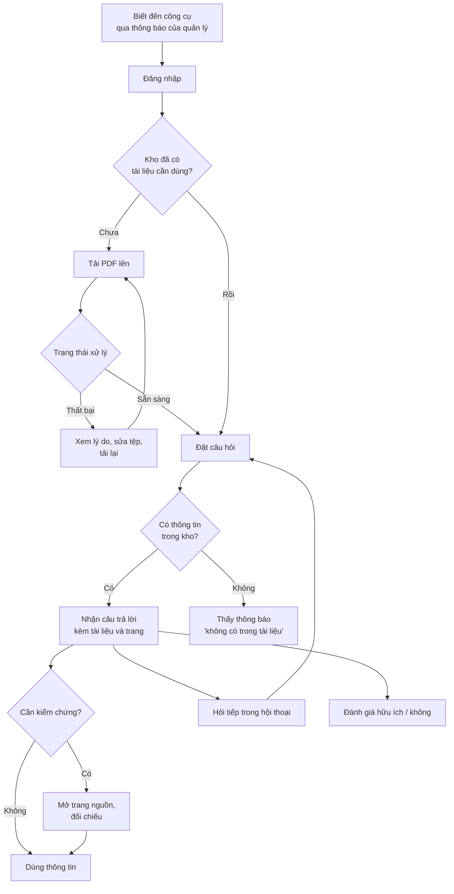

# Tài liệu Yêu cầu Sản phẩm (PRD) — "Chat với tài liệu" (MVP)

> **Tiêu chuẩn:** IEEE 29148-2018
> **Mã tài liệu:** PRD-CWD-001 · **Phiên bản:** 0.1 · **Trạng thái:** Draft · **Ngày:** 2026-10-19
> **Đầu vào:** [BRD.md](BRD.md) (BRD-CWD-001 v0.1)
> **Quy ước:** `[TBD: OQ-xxx]` là giá trị chưa được chốt, lấy từ danh sách câu hỏi mở của BRD (Mục 12). Mã `BR-xxx`, `BO-xxx`, `SN-xxx`, `BRU-xxx`, `RSK-xxx` trỏ về BRD để truy vết.

---

## 0. Xác thực các trụ cột sản phẩm

Prompt yêu cầu điền "Product Foundation" nhưng để trống. Dưới đây là phần tôi suy ra từ BRD, kèm đánh giá mức độ chắc chắn.

| Trụ cột | Nội dung rút ra | Nguồn | Đánh giá |
|---|---|---|---|
| Tên sản phẩm | Chat với tài liệu (MVP) | BRD Mục 1 | Chắc chắn |
| Người dùng mục tiêu | Đội phát triển kinh doanh | BRD STK-002 | Chắc chắn về nhóm; **chưa có số lượng và chân dung thực tế** (OQ-004) |
| Vấn đề | Thông tin nằm rải rác trong nhiều PDF; mỗi lần tìm phải mở và tổng hợp thủ công | BRD Mục 3 | Chắc chắn về định tính; **chưa đo được mức độ** (OQ-001) |
| Giải pháp cốt lõi | Tải PDF lên → hỏi bằng ngôn ngữ tự nhiên → nhận câu trả lời tổng hợp kèm nguồn (tài liệu + trang) | BRD BR-009→BR-013 | Chắc chắn |
| Trụ cột UX | *Prompt không cung cấp.* Đề xuất 4 trụ cột ở Mục 4.0, **cần sponsor xác nhận** | BA đề xuất | Chưa xác nhận |

**Ba điểm cần lưu ý trước khi đọc tiếp:**

1. **Mâu thuẫn thứ tự đầu vào.** Prompt gọi đầu vào là "SRS" nhưng tệp thực tế là BRD. Tôi coi BRD là đầu vào duy nhất; chưa có SRS nào tồn tại.
2. **Không có chỉ tiêu nào được tự đặt.** Mọi ngưỡng (độ chính xác, độ trễ, kích thước tệp, thời gian xử lý) vẫn là `[TBD]` như trong BRD. PRD này không thể đóng các câu hỏi mở thay cho sponsor.
3. **Một quyết định chặn toàn bộ thiết kế:** OQ-011 (có được gửi tài liệu tới dịch vụ AI bên ngoài không). Kết quả quyết định có thể thay đổi kiến trúc, chi phí và cả phạm vi P0. PRD này giả định theo ASM-005 (được phép) và đánh dấu mọi chỗ phụ thuộc.

---

## 1. Tóm tắt điều hành và chiến lược

### 1.1 Tầm nhìn sản phẩm

Mọi thành viên đội phát triển kinh doanh có thể nhận được thông tin đáng tin cậy từ toàn bộ tài liệu của dự án bằng một câu hỏi, và kiểm chứng được thông tin đó chỉ trong một thao tác — thay vì mở từng tệp PDF để tìm.

**Phạm vi của MVP:** chứng minh giá trị với một nhóm người dùng nhỏ và thu về bằng chứng để sponsor quyết định có đầu tư tiếp hay không (BO-003). MVP không nhằm thay thế kho lưu trữ tài liệu chính thức.

### 1.2 Mục tiêu và kết quả then chốt (OKR)

| Mục tiêu | Kết quả then chốt | Chỉ số BRD | Baseline | Mục tiêu | Nguồn |
|---|---|---|---|---|---|
| **O1.** Người dùng tìm được thông tin nhanh hơn cách đọc thủ công | KR1.1 — Giảm thời gian trung bình để có một thông tin trên bộ tác vụ chuẩn | MET-001 | [TBD: OQ-001] | [TBD: OQ-002] | BO-001 |
| **O2.** Người dùng tin vào câu trả lời nhờ kiểm chứng được | KR2.1 — Tỷ lệ câu trả lời đúng và trích dẫn đúng trên bộ câu hỏi kiểm thử | MET-002 | Không áp dụng | ≥ [TBD: OQ-003]% | BO-002 |
| | KR2.2 — Tỷ lệ câu hỏi không có đáp án nhận được thông báo "không tìm thấy" | (AC-013) | Không áp dụng | ≥ 90% | BO-002 |
| **O3.** Có đủ bằng chứng để quyết định đầu tư giai đoạn sau | KR3.1 — Tỷ lệ người dùng mục tiêu dùng ít nhất một lần mỗi tuần | MET-003 | Không áp dụng | [TBD: OQ-015] | BO-003 |
| | KR3.2 — Tỷ lệ câu trả lời được đánh giá "hữu ích" | MET-004 | Không áp dụng | [TBD: OQ-015] | BO-003 |

> Khác với ví dụ trong prompt ("tải trang < 2 giây"), tôi không đặt số cho các KR chưa có baseline. Một mục tiêu không có baseline và cách đo không phải mục tiêu hợp lệ (BRD Mục 4).

---

## 2. Chân dung người dùng và hành trình

### 2.1 Persona

Hiện chưa có phỏng vấn người dùng. Hai persona dưới đây là giả thuyết dựa trên BRD, cần kiểm chứng (hành động: phỏng vấn 3–5 người, xem checklist PRD mục "User Characteristics").

| | **Persona chính — Nhân viên phát triển kinh doanh** | **Persona phụ — Quản lý dự án / sponsor** |
|---|---|---|
| Liên kết BRD | STK-002 | STK-001 |
| Mục tiêu | Tìm đúng thông tin trong bộ PDF dự án để trả lời đối tác/đồng nghiệp | Đánh giá MVP có đáng đầu tư tiếp |
| Khó khăn | Mất thời gian mở nhiều tệp; không chắc đã đọc đủ; khó truy lại nguồn | Chưa có bằng chứng giá trị |
| Mức thành thạo công nghệ | [Unverified] Thành thạo ứng dụng văn phòng, **không giả định** biết cách đặt câu lệnh cho AI | [Unverified] Cơ bản |
| Hành vi chính | Tải tài liệu, hỏi câu hỏi, mở trang nguồn để đối chiếu, hỏi tiếp | Xem số liệu sử dụng và phản hồi (BR-024) |
| Tần suất dự kiến | [TBD: OQ-004] | Hàng tuần trong thời gian thử nghiệm |

**Vai trò vận hành (không phải persona sản phẩm):** Đội BA xem số liệu; Bộ phận ATTT kiểm soát truy cập (STK-005).

### 2.2 Hành trình người dùng cấp cao



**Thành công** là người dùng nhận được thông tin đã kiểm chứng mà không phải mở tệp ngoài công cụ.

---

## 3. Yêu cầu chức năng và User Story

**Quy ước ưu tiên:** P0 = bắt buộc để phát hành; P1 = nên có; P2 = nếu còn nguồn lực. Quy đổi từ BRD: Must → P0, Should → P1, Could → P2.
**Mỗi story có mã `US-xxx`** để truy vết xuống SRS, test case và backlog; mã không được đánh số lại sau khi rà soát.

### 3.1 Ma trận Epic

| Epic | Nội dung | Story | Yêu cầu BRD |
|---|---|---|---|
| E1 | Truy cập và kiểm soát | US-001, US-002 | BR-020, BR-021 |
| E2 | Nạp tài liệu | US-003, US-004, US-005, US-006 | BR-001→BR-005 |
| E3 | Quản lý kho | US-007, US-008, US-009 | BR-006→BR-008, BR-022 |
| E4 | Hỏi đáp và trích dẫn | US-010 → US-016 | BR-009→BR-019 |
| E5 | Đánh giá MVP | US-017, US-018, US-019 | BR-023→BR-025 |

### 3.2 Epic E1 — Truy cập và kiểm soát

| ID | User story | Ưu tiên | BRD |
|---|---|---|---|
| US-001 | As a **người dùng được cấp quyền**, I want to **đăng nhập vào ứng dụng**, so that **chỉ tôi và người được phép xem được tài liệu và hội thoại**. | P0 | BR-020 |
| US-002 | As a **Bộ phận ATTT**, I want to **xác nhận nội dung tài liệu và hội thoại không được dùng để huấn luyện mô hình AI**, so that **thông tin kinh doanh không rò rỉ ra ngoài**. | P0 | BR-021 |

**AC của US-001**
- *Given* người chưa đăng nhập, *When* họ mở đường dẫn ứng dụng hoặc gọi trực tiếp tới trang danh sách tài liệu / hội thoại, *Then* họ bị chuyển tới màn hình đăng nhập và không thấy bất kỳ tên tệp hay nội dung nào.
- *Given* người dùng chưa được cấp quyền, *When* đăng nhập thành công bằng tài khoản hợp lệ của tổ chức, *Then* họ nhận thông báo "Bạn chưa được cấp quyền dùng công cụ này" và không truy cập được kho.
- *Given* người dùng đã được cấp quyền, *When* đăng nhập, *Then* họ thấy kho tài liệu của dự án.

**AC của US-002** (xác nhận bằng kiểm tra tài liệu, không phải tính năng giao diện)
- *Given* nhà cung cấp AI được chọn, *When* Bộ phận ATTT rà soát điều khoản hợp đồng/dịch vụ, *Then* có xác nhận bằng văn bản rằng dữ liệu của tổ chức không được dùng để huấn luyện mô hình.
- *Given* chưa có xác nhận này, *Then* không được nạp tài liệu thật vào hệ thống (liên quan DEP-001).

### 3.3 Epic E2 — Nạp tài liệu

| ID | User story | Ưu tiên | BRD |
|---|---|---|---|
| US-003 | As a **nhân viên phát triển kinh doanh**, I want to **tải một tệp PDF lên kho dự án**, so that **tôi có thể hỏi về nội dung của nó**. | P0 | BR-001 |
| US-004 | As a **nhân viên phát triển kinh doanh**, I want to **thấy trạng thái xử lý của mỗi tệp (Đang xử lý / Sẵn sàng / Thất bại kèm lý do)**, so that **tôi biết khi nào có thể hỏi**. | P0 | BR-003 |
| US-005 | As a **nhân viên phát triển kinh doanh**, I want to **được từ chối tệp sai định dạng hoặc quá giới hạn kèm lý do cụ thể**, so that **tôi biết cần sửa gì**. | P0 | BR-005 |
| US-006 | As a **nhân viên phát triển kinh doanh**, I want to **tải nhiều tệp PDF cùng lúc**, so that **tôi nạp bộ tài liệu ban đầu nhanh hơn**. | P1 | BR-002 |

> BR-004 (tệp sẵn sàng trong [TBD: OQ-005] phút) được áp dụng như tiêu chí chất lượng chung cho US-003, không tách thành story riêng vì không có hành vi người dùng mới.

**AC của US-003**
- *Given* người dùng đã đăng nhập và có tệp PDF hợp lệ trong giới hạn BRU-002, *When* họ tải tệp lên, *Then* tệp xuất hiện trong danh sách với trạng thái "Đang xử lý".
- *Given* tệp đã chuyển sang "Sẵn sàng", *When* người dùng hỏi về nội dung có trong tệp, *Then* câu trả lời sử dụng nội dung của tệp đó.
- *Given* tệp hợp lệ ở kích thước giới hạn, *When* đo trên 20 tệp mẫu, *Then* ≥ 95% tệp đạt "Sẵn sàng" trong [TBD: OQ-005] phút (AC-004).

**AC của US-004**
- *Given* người dùng tải lên 1 tệp hợp lệ và 1 tệp PDF bị hỏng, *When* quá trình xử lý kết thúc, *Then* tệp hợp lệ hiển thị "Sẵn sàng" và tệp hỏng hiển thị "Thất bại" cùng lý do bằng tiếng Việt.
- *Given* tệp đang xử lý, *When* người dùng đặt câu hỏi, *Then* câu trả lời không dùng nội dung của tệp đó và giao diện cho biết tệp chưa sẵn sàng.

**AC của US-005**
- *Given* người dùng chọn tệp .docx, *When* họ tải lên, *Then* tệp bị từ chối với lý do "Chỉ hỗ trợ tệp PDF" và kho không thay đổi.
- *Given* tệp PDF vượt giới hạn [TBD: OQ-007], *When* tải lên, *Then* tệp bị từ chối với lý do nêu rõ giới hạn và kho không thay đổi.

### 3.4 Epic E3 — Quản lý kho tài liệu

| ID | User story | Ưu tiên | BRD |
|---|---|---|---|
| US-007 | As a **nhân viên phát triển kinh doanh**, I want to **xem danh sách tài liệu trong kho (tên tệp, ngày tải, người tải)**, so that **tôi biết câu trả lời dựa trên những tài liệu nào**. | P1 | BR-006 |
| US-008 | As a **nhân viên phát triển kinh doanh**, I want to **xóa một tài liệu khỏi kho**, so that **tài liệu lỗi thời không làm sai câu trả lời**. | P1 | BR-007, BR-008 |
| US-009 | As a **Bộ phận ATTT**, I want to **xem nhật ký tải lên và xóa tài liệu (người, thời điểm, tên tài liệu)**, so that **thay đổi trong kho truy vết được**. | P1 | BR-022 |

> Các story này là P1 theo BRD, nhưng **danh sách tài liệu về thực tế gần như bắt buộc** để người dùng dùng được US-003/US-004 (xem tệp nào đã tải). Đề xuất sponsor cân nhắc nâng US-007 lên P0 khi chốt phạm vi.

### 3.5 Epic E4 — Hỏi đáp và trích dẫn

| ID | User story | Ưu tiên | BRD |
|---|---|---|---|
| US-010 | As a **nhân viên phát triển kinh doanh**, I want to **đặt câu hỏi bằng tiếng Việt thông thường về nội dung tài liệu**, so that **tôi không phải đọc từng tệp**. | P0 | BR-009 |
| US-011 | As a **nhân viên phát triển kinh doanh**, I want to **nhận câu trả lời tổng hợp từ tất cả tài liệu liên quan**, so that **tôi không phải tự ghép thông tin từ nhiều tệp**. | P0 | BR-010 |
| US-012 | As a **nhân viên phát triển kinh doanh**, I want to **thấy tên tài liệu và số trang cho từng thông tin trong câu trả lời**, so that **tôi kiểm chứng được**. | P0 | BR-011 |
| US-013 | As a **nhân viên phát triển kinh doanh**, I want to **được báo rõ khi tài liệu không có thông tin**, so that **tôi không bị đánh lừa bởi câu trả lời bịa**. | P0 | BR-013 |
| US-014 | As a **nhân viên phát triển kinh doanh**, I want to **nhận câu trả lời trong thời gian chấp nhận được**, so that **dùng công cụ nhanh hơn tự tìm**. | P0 | BR-015 |
| US-015 | As a **nhân viên phát triển kinh doanh**, I want to **mở thẳng trang tài liệu được trích dẫn**, so that **đối chiếu nhanh**. | P1 | BR-012 |
| US-016 | As a **nhân viên phát triển kinh doanh**, I want to **hỏi tiếp dựa trên câu trước trong cùng hội thoại**, so that **không phải nhắc lại bối cảnh**. | P1 | BR-016 |

> Độ chính xác tổng thể (BR-014, Must) không có story riêng vì là thuộc tính chất lượng của US-010 → US-013; được kiểm bằng bộ câu hỏi kiểm thử (DEP-002) và nằm trong cổng phát hành (Mục 5.1).

**P2 (chưa lập story chi tiết):** giới hạn câu hỏi trong tài liệu được chọn (BR-017, SN-012), xem lại hội thoại cũ (BR-018, chờ OQ-014), hỏi bằng tiếng Anh (BR-019, chờ OQ-009).

**AC của US-010**
- *Given* kho có ít nhất 1 tài liệu "Sẵn sàng", *When* người dùng nhập câu hỏi tiếng Việt và gửi, *Then* hệ thống trả về câu trả lời hoặc thông báo "không tìm thấy" (không bao giờ trả về màn hình trống hoặc lỗi không giải thích).
- *Given* kho chưa có tài liệu "Sẵn sàng", *When* người dùng mở khu vực hỏi đáp, *Then* hệ thống hướng dẫn tải tài liệu lên trước (xem Mục 4.2) và không cho gửi câu hỏi.

**AC của US-011**
- *Given* kho có tài liệu A và B, trong đó đáp án chỉ trọn vẹn khi gộp thông tin từ cả hai, *When* người dùng hỏi, *Then* câu trả lời chứa thông tin từ cả A và B, mỗi phần có trích dẫn tương ứng.
- *Given* bộ ≥ 10 câu hỏi kiểm thử có đáp án nằm ở ≥ 2 tài liệu, *When* chạy kiểm thử, *Then* ≥ [TBD: OQ-003]% câu trả lời bao gồm đủ các tài liệu nguồn (AC-010).

**AC của US-012**
- *Given* một câu trả lời có nội dung lấy từ tài liệu, *When* hiển thị, *Then* mỗi ý được lấy từ tài liệu đều kèm tên tệp và số trang.
- *Given* bộ câu hỏi kiểm thử, *When* chấm, *Then* 100% câu trả lời có nội dung đều có trích dẫn, và ≥ 95% trích dẫn trỏ đúng tài liệu và trang chứa thông tin (AC-011).

**AC của US-013**
- *Given* câu hỏi mà không tài liệu nào trong kho chứa thông tin, *When* gửi, *Then* người dùng nhận thông báo cho biết không tìm thấy thông tin trong các tài liệu hiện có, và không có thông tin nào không kèm nguồn.
- *Given* ≥ 10 câu hỏi kiểm thử không có đáp án, *When* chạy kiểm thử, *Then* ≥ 90% nhận thông báo "không tìm thấy" (AC-013).
- *Given* người dùng hỏi kiến thức chung không liên quan tài liệu (ví dụ "Thủ đô của Pháp là gì?"), *Then* hệ thống không trả lời bằng kiến thức ngoài kho (BRU-003).

**AC của US-014**
- *Given* kho ở quy mô ASM-003, *When* đo trên toàn bộ bộ câu hỏi kiểm thử, *Then* phân vị 90 của thời gian từ lúc gửi đến lúc có câu trả lời hoàn chỉnh ≤ [TBD: OQ-006] giây (AC-015).
- *Given* câu trả lời đang được tạo, *Then* giao diện cho người dùng thấy rõ hệ thống đang xử lý (không để người dùng tưởng ứng dụng treo).

---

### 3.6 Epic E5 — Đánh giá MVP

| ID | User story | Ưu tiên | BRD |
|---|---|---|---|
| US-017 | As a **nhân viên phát triển kinh doanh**, I want to **đánh giá mỗi câu trả lời là hữu ích hoặc không hữu ích**, so that **đội sản phẩm biết chất lượng thực tế**. | P1 | BR-023 |
| US-018 | As a **đội BA**, I want to **xem số liệu sử dụng theo tuần**, so that **chứng minh giá trị MVP cho sponsor**. | P1 | BR-024 |
| US-019 | As a **đội kỹ thuật**, I want to **theo dõi chi phí dịch vụ AI hàng tuần**, so that **chi phí không vượt ngân sách**. | P1 | BR-025 |

---

## 4. Yêu cầu UX và UI

### 4.0 Trụ cột UX (đề xuất, chờ sponsor xác nhận)

| Trụ cột | Ý nghĩa | Lý do |
|---|---|---|
| **Kiểm chứng được là mặc định** | Trích dẫn luôn hiển thị ngay trong câu trả lời, không giấu sau thao tác phụ | Giảm RSK-001 (AI trả lời sai) |
| **Trung thực khi không biết** | Thông báo "không tìm thấy" rõ ràng, không đoán | BR-013, SN-009 |
| **Ít thao tác** | Từ lúc mở ứng dụng đến lúc đặt câu hỏi đầu tiên không quá [TBD] bước | Giá trị cốt lõi là nhanh hơn tự đọc |
| **Dùng được trên trình duyệt máy tính** | Ưu tiên máy tính để bàn; hỗ trợ di động nằm ngoài MVP (CON-001, ASM-004) | Người dùng làm việc với PDF dài trên máy tính `[Unverified]` |

### 4.1 Bố cục và luồng tương tác cốt lõi

Mô tả logic, **không quy định thiết kế hình ảnh**.

**Cấu trúc màn hình chính (hai vùng):**

```
┌───────────────────────────────────────────────────────────────────┐
│  Tên ứng dụng                              Người dùng │ Đăng xuất │
├───────────────────┬───────────────────────────────────────────────┤
│  KHO TÀI LIỆU     │   HỘI THOẠI                                   │
│                   │                                               │
│  [+ Tải PDF lên]  │   Câu hỏi của người dùng                      │
│                   │   ──────────────────────                      │
│  ▸ BaoCao_Q3.pdf  │   Câu trả lời                                 │
│     Sẵn sàng      │   • Ý 1 …………… [BaoCao_Q3.pdf, tr.12]            │
│  ▸ HopDong_A.pdf  │   • Ý 2 …………… [HopDong_A.pdf, tr.4]            │
│     Đang xử lý…   │   [👍 Hữu ích] [👎 Không hữu ích]              │
│  ▸ KeHoach.pdf    │                                               │
│     Thất bại ⓘ    │   ───────────────────────────────────         │
│                   │   [ Nhập câu hỏi…                    ] [Gửi]  │
└───────────────────┴───────────────────────────────────────────────┘
```

**Tương tác then chốt:**

| Tương tác | Hành vi mong đợi |
|---|---|
| Tải tệp | Chọn tệp hoặc kéo-thả; hiện ngay hàng mới trong danh sách với trạng thái |
| Trạng thái tệp | Cập nhật tự động khi xử lý xong, không cần làm mới trang |
| Gửi câu hỏi | Phím Enter hoặc nút Gửi; khóa nút Gửi khi ô trống; hiển thị chỉ báo đang xử lý |
| Trích dẫn | Mỗi trích dẫn là phần tử bấm được; nhấp mở đúng trang của tài liệu nguồn (US-015, P1) |
| Câu trả lời dài | Trích dẫn nằm sát ý được trích, không gom hết xuống cuối |
| Cảnh báo AI | Một dòng nhắc cố định gần ô nhập: "Câu trả lời do AI tạo; hãy kiểm tra trích dẫn với thông tin quan trọng" (RSK-001) |
| Phản hồi | Hai nút đánh giá dưới mỗi câu trả lời (US-017, P1) |

**Yêu cầu phi chức năng ở mức UX** *(chi tiết định lượng đưa vào SRS)*:
- Ngôn ngữ giao diện: tiếng Việt.
- Trình duyệt hỗ trợ: [TBD] (đề xuất bản mới nhất của Chrome, Edge, Firefox, Safari).
- Trợ năng (độ tương phản, thao tác bằng bàn phím): [TBD] — chưa có yêu cầu từ sponsor.

### 4.2 Trường hợp biên và trạng thái lỗi

| Tình huống | Hành vi hệ thống bắt buộc | Story |
|---|---|---|
| **Kho trống** (chưa có tài liệu) | Vùng hội thoại hiển thị lời mời tải tài liệu; ô nhập bị vô hiệu hóa | US-010 |
| **Tất cả tài liệu đang xử lý** | Cho biết còn bao nhiêu tệp đang xử lý; chưa cho hỏi | US-004 |
| **Hội thoại trống** | Gợi ý 2–3 câu hỏi mẫu (câu mẫu cần được đội nghiệp vụ duyệt) | US-010 |
| **Tệp sai định dạng** | Từ chối ngay, nêu rõ "Chỉ hỗ trợ tệp PDF" | US-005 |
| **Tệp quá giới hạn** | Từ chối ngay, nêu giới hạn [TBD: OQ-007] | US-005 |
| **Tệp PDF hỏng / có mật khẩu** | Trạng thái "Thất bại" kèm lý do; đề nghị gỡ mật khẩu hoặc tải lại bản khác | US-004 |
| **PDF scan (không có lớp văn bản)** | Trạng thái "Thất bại" hoặc cảnh báo "Không đọc được văn bản; MVP chưa hỗ trợ tệp scan" (BRU-001, OQ-008). **Không** được báo "Sẵn sàng" rồi trả lời rỗng | US-004 |
| **Tải trùng tên / trùng nội dung** | [TBD — chưa có quyết định; thêm OQ-016] | US-003 |
| **Mất kết nối khi tải lên** | Hiển thị tệp ở trạng thái "Thất bại — mất kết nối" và cho phép thử lại, không để treo ở "Đang xử lý" | US-004 |
| **Mất kết nối khi gửi câu hỏi** | Giữ nguyên nội dung câu hỏi trong ô nhập; hiển thị lỗi kết nối và nút "Gửi lại" | US-010 |
| **Quá thời gian chờ trả lời** | Sau [TBD: OQ-006 × hệ số] giây, báo "Câu trả lời mất quá nhiều thời gian" kèm nút thử lại | US-014 |
| **Dịch vụ AI không phản hồi** | Thông báo "Hệ thống tạm thời không trả lời được, hãy thử lại sau"; ghi nhận lỗi để theo dõi | US-010 |
| **Câu hỏi rỗng / chỉ khoảng trắng** | Không gửi; không hiện lỗi hung hăng | US-010 |
| **Câu hỏi quá dài** | Giới hạn [TBD] ký tự; báo số ký tự còn lại | US-010 |
| **Câu hỏi không liên quan tài liệu** | Trả lời "không tìm thấy trong tài liệu"; không dùng kiến thức bên ngoài (BRU-003) | US-013 |
| **Câu hỏi mơ hồ** | [TBD — chưa quyết định: hỏi lại người dùng hay trả lời kèm các cách hiểu; thêm OQ-017] | US-010 |
| **Tài liệu bị xóa khi đang có câu hỏi** | Câu trả lời đang xử lý không được dùng tài liệu đã xóa (BR-008) | US-008 |
| **Phiên đăng nhập hết hạn** | Chuyển về đăng nhập; không mất câu hỏi đang soạn nếu có thể | US-001 |
| **Người dùng bị thu hồi quyền** | Mọi yêu cầu tiếp theo bị từ chối; không hiển thị dữ liệu đã tải sẵn trên màn hình khi làm mới | US-001 |

---

## 5. Tiêu chí phát hành và chỉ số sau phát hành

### 5.1 Cổng phát hành

Phát hành **chỉ khi tất cả các điều kiện chặn dưới đây được đáp ứng**.

#### A. Điều kiện tiên quyết về quyết định và bảo mật

| # | Điều kiện | Tham chiếu | Trạng thái hiện tại |
|---|---|---|---|
| G-01 | Bộ phận ATTT/Pháp chế phê duyệt việc dùng dịch vụ AI với tài liệu dự án | DEP-001, OQ-011 | Chưa |
| G-02 | Xác nhận bằng văn bản nhà cung cấp AI không dùng dữ liệu để huấn luyện | BR-021, AC-021 | Chưa |
| G-03 | Ngưỡng độ chính xác, thời gian xử lý, thời gian phản hồi, giới hạn tệp được chốt bằng số | OQ-003, OQ-005, OQ-006, OQ-007 | Chưa |
| G-04 | Ngân sách và hạn chót được duyệt | OQ-012 | Chưa |
| G-05 | Bộ câu hỏi kiểm thử (≥ 50 câu; ≥ 10 câu không có đáp án; ≥ 10 câu đáp án ở ≥ 2 tài liệu) | DEP-002 | Chưa |

#### B. Chất lượng chức năng

| # | Điều kiện | Đo bằng |
|---|---|---|
| G-10 | 100% story P0 đạt toàn bộ AC Given-When-Then | Test case ánh xạ từng AC |
| G-11 | MET-002 ≥ ngưỡng [TBD: OQ-003] trên bộ câu hỏi kiểm thử | Chấm bởi đại diện đội phát triển kinh doanh |
| G-12 | ≥ 95% trích dẫn trỏ đúng tài liệu và trang | AC-011 |
| G-13 | ≥ 90% câu hỏi không có đáp án nhận "không tìm thấy" | AC-013 |
| G-14 | Không còn lỗi mức nghiêm trọng hoặc chặn mở | Hệ thống theo dõi lỗi |

#### C. Hiệu năng

| # | Điều kiện | Đo bằng |
|---|---|---|
| G-20 | P90 thời gian trả lời ≤ [TBD: OQ-006] giây ở quy mô ASM-003 | AC-015 |
| G-21 | ≥ 95% tệp mẫu đạt "Sẵn sàng" trong [TBD: OQ-005] phút | AC-004 |

#### D. Bảo mật

| # | Điều kiện | Đo bằng |
|---|---|---|
| G-30 | Người không có quyền không truy cập được danh sách, nội dung tài liệu hay hội thoại qua mọi đường truy cập được kiểm thử, **bao gồm gọi trực tiếp giao diện lập trình** | AC-020; kiểm thử thâm nhập mức cơ bản |
| G-31 | Dữ liệu truyền và lưu trữ được mã hóa theo chuẩn [TBD: chưa có yêu cầu nội bộ, thêm OQ-018] | Rà soát ATTT |
| G-32 | Nhật ký tải lên/xóa hoạt động | AC-022 |

#### E. Vận hành

| # | Điều kiện | Ghi chú |
|---|---|---|
| G-40 | Người dùng thử nghiệm được hướng dẫn về giới hạn của công cụ (AI có thể sai; cần kiểm trích dẫn) | Giảm RSK-001 |
| G-41 | Đã đo baseline MET-001 trước khi phát hành | RSK-006, OQ-001 |
| G-42 | Thiết lập cơ chế theo dõi chi phí AI | BR-025, RSK-005 |
| G-43 | Có người chịu trách nhiệm phản hồi sự cố trong thời gian thử nghiệm; mức dịch vụ yêu cầu [TBD: OQ-019] | Chưa có yêu cầu về độ sẵn sàng |

> **Phạm vi kiểm thử tối thiểu:** mức độ bao phủ mã nguồn không đặt thành mục tiêu số ở giai đoạn BRD/PRD; thay bằng quy tắc "mỗi AC của story P0 có ít nhất một test case". Nếu tổ chức có chuẩn bao phủ mã, đưa vào SRS.

### 5.2 Phân tích và theo dõi sự kiện

**Nguyên tắc:** chỉ thu thập sự kiện phục vụ các chỉ số MET-001→MET-004 và đánh giá chất lượng. **Không ghi nội dung câu hỏi và câu trả lời vào hệ thống phân tích** trừ khi ATTT cho phép (OQ-011, OQ-014); trong sự kiện chỉ lưu mã định danh, độ dài và kết quả.

| Sự kiện | Kích hoạt | Thuộc tính | Phục vụ |
|---|---|---|---|
| `session_login` | Đăng nhập thành công | user_id (băm), thời điểm | MET-003 |
| `login_denied` | Đăng nhập nhưng chưa có quyền | thời điểm | Bảo mật |
| `doc_upload_started` | Chọn tệp để tải | doc_id, kích thước, số tệp trong lô | Phễu nạp tài liệu |
| `doc_upload_rejected` | Tệp bị từ chối | lý do (định dạng / kích thước) | Chất lượng nạp |
| `doc_processing_completed` | Tệp thành "Sẵn sàng" | doc_id, thời gian xử lý, số trang | AC-004 |
| `doc_processing_failed` | Tệp thất bại | doc_id, mã lỗi (hỏng / mật khẩu / scan / khác) | ASM-001, RSK-003 |
| `doc_deleted` | Xóa tài liệu | doc_id | BR-022 |
| `question_submitted` | Gửi câu hỏi | conversation_id, độ dài, số tài liệu trong kho, câu thứ mấy trong hội thoại | MET-003 |
| `answer_returned` | Có câu trả lời | thời gian phản hồi, số trích dẫn, kết quả (có đáp án / không tìm thấy) | AC-015, AC-013 |
| `answer_failed` | Lỗi / hết thời gian | loại lỗi | Độ ổn định |
| `citation_opened` | Mở trang nguồn | doc_id, trang | Mức kiểm chứng của người dùng |
| `answer_feedback` | Bấm hữu ích / không hữu ích | giá trị, answer_id | MET-004 |
| `followup_asked` | Câu hỏi thứ ≥ 2 trong cùng hội thoại | conversation_id | Mức dùng US-016 |

**Phễu cần theo dõi:**

| Phễu | Các bước | Giá trị theo dõi |
|---|---|---|
| Kích hoạt | `session_login` → `doc_upload_started` → `doc_processing_completed` → `question_submitted` → `answer_returned` | Người dùng rơi ở bước nào |
| Tin cậy | `answer_returned` → `citation_opened` → `answer_feedback` | Tỷ lệ kiểm chứng; mối liên hệ với đánh giá |
| Chất lượng nạp | `doc_upload_started` → (`rejected` hoặc `failed` hoặc `completed`) | Tỷ lệ thất bại theo nguyên nhân |

**Báo cáo hàng tuần cho sponsor (BR-024):** số người dùng hoạt động, số câu hỏi, tỷ lệ "hữu ích", tỷ lệ "không tìm thấy", P90 thời gian phản hồi, chi phí AI, tỷ lệ tệp thất bại theo nguyên nhân.

---

## 6. Truy vết sang BRD

| Epic | Story | BRD | AC trong BRD |
|---|---|---|---|
| E1 | US-001 | BR-020 | AC-020 |
| E1 | US-002 | BR-021 | AC-021 |
| E2 | US-003 | BR-001, BR-004 | AC-001, AC-004 |
| E2 | US-004 | BR-003 | AC-003 |
| E2 | US-005 | BR-005 | AC-005 |
| E2 | US-006 | BR-002 | AC-002 |
| E3 | US-007 | BR-006 | AC-006 |
| E3 | US-008 | BR-007, BR-008 | AC-007, AC-008 |
| E3 | US-009 | BR-022 | AC-022 |
| E4 | US-010 | BR-009 | AC-009 |
| E4 | US-011 | BR-010 | AC-010 |
| E4 | US-012 | BR-011 | AC-011 |
| E4 | US-013 | BR-013 | AC-013 |
| E4 | US-014 | BR-015 | AC-015 |
| E4 | US-015 | BR-012 | AC-012 |
| E4 | US-016 | BR-016 | AC-016 |
| E4 (chất lượng) | — | BR-014 | AC-014 |
| E4 (P2) | — | BR-017, BR-018, BR-019 | AC-017, AC-018, AC-019 |
| E5 | US-017 | BR-023 | AC-023 |
| E5 | US-018 | BR-024 | AC-024 |
| E5 | US-019 | BR-025 | AC-025 |

**Độ phủ:** cả 25 yêu cầu BR đều có ít nhất một story hoặc được nêu như tiêu chí chất lượng. Không có story mồ côi.

---

## 7. Câu hỏi mở bổ sung cho PRD

Các OQ-001→OQ-015 nằm trong BRD. Dưới đây là câu hỏi mới phát hiện khi viết PRD (cần đưa vào BRD Mục 12 ở phiên bản sau):

| ID | Câu hỏi | Lý do quan trọng | Người chịu trách nhiệm | Cần trước | Trạng thái |
|---|---|---|---|---|---|
| OQ-016 | Khi người dùng tải trùng tên hoặc trùng nội dung, hệ thống ghi đè, từ chối hay giữ cả hai? | Ảnh hưởng độ chính xác của câu trả lời (nhiều phiên bản) | Product owner | 2026-11-06 | Open |
| OQ-017 | Với câu hỏi mơ hồ, hệ thống hỏi lại hay đưa ra câu trả lời kèm các cách hiểu? | Ảnh hưởng thiết kế hội thoại và thời gian phản hồi | Product owner | 2026-11-06 | Open |
| OQ-018 | Có chuẩn mã hóa và quản lý khóa nội bộ nào bắt buộc không? | Cổng phát hành G-31 | Bộ phận ATTT | 2026-11-06 | Open |
| OQ-019 | Mức độ sẵn sàng mong muốn của MVP (giờ làm việc, mức chấp nhận gián đoạn)? | Cổng phát hành G-43; trống trong checklist IEEE | Executive sponsor | 2026-11-06 | Open |
| OQ-020 | Cách đăng nhập: tài khoản doanh nghiệp (SSO) hay tài khoản riêng? | Ảnh hưởng US-001, thời gian triển khai | Đội kỹ thuật + ATTT | 2026-10-30 | Open |

---

## 8. Kết luận mức độ sẵn sàng

**Trạng thái: Sẵn sàng có điều kiện** — dùng được làm cơ sở thảo luận và viết SRS cho các phần không phụ thuộc quyết định chưa chốt; **chưa sẵn sàng để phê duyệt hoặc bắt đầu xây dựng bản phát hành**.

**Các hạng mục chặn:**
- Quyết định bảo mật: OQ-011 (G-01, G-02)
- Ngưỡng định lượng: OQ-003, OQ-005, OQ-006, OQ-007 (G-03, G-11, G-20, G-21)
- Ngân sách và hạn chót: OQ-012 (G-04)
- Xác nhận phạm vi P0/P1 và trụ cột UX từ sponsor
- Bộ câu hỏi kiểm thử: DEP-002 (G-05)
- Persona chưa được kiểm chứng bằng phỏng vấn người dùng
